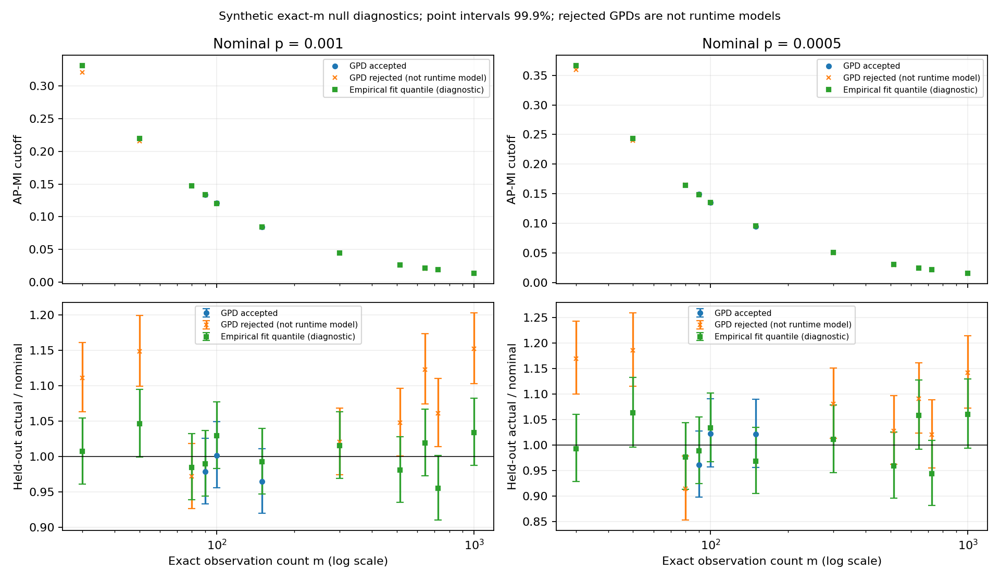

# Exact-m AP-MI null calibration: 2026-10-15

The staged sweep completed before the requested 23:00 Eastern deadline.
All **11 calibration jobs completed**, with **3 accepted and 8 rejected GPD
models**, and no execution failures. Rejections were not rerun or softened.
The tested fixed GPD procedure is **not a generally validated p-to-MI lookup**
across these sample counts, even at the moderate probabilities examined here.

## Design and provenance

The [prospective protocol](PLAN_2026-10-15.md) was committed before production.
Each exact m used 5,000,000 fresh fitting draws and 5,000,000 independent
held-out draws: 110 million synthetic null pairs in total. No expression
values, biological reference edges, or historical calibration streams were
used. Npar=40, the shared AP-MI kernel, unique ordinal ranks, RNG, source
hashes and seed derivation were fixed.

The primary GPD threshold was the fitting-stream 99.5th percentile, with
strict exceedances. Gate 1 required three valid threshold-sensitivity fits
at q=0.9925, 0.995, 0.9975 and cutoff range <=10% at p=0.0005. Gate 2 required
both p=0.001 and p=0.0005 to lie in their independent held-out 99.9%
Clopper-Pearson intervals. Expected held-out counts were 5,000 and 2,500.
The conservative family size ten was retained; confidence is per model,
not simultaneous coverage across all eleven m values.

Generation used the pinned native executable through WSL Ubuntu. The
unmodified calibrator fitted those newly generated, provenance-checked raw
files using Windows Python 3.13, NumPy 2.4.4 and SciPy 1.17.1. Thread limits
prevented nested numerical-library oversubscription.

- Engine checkout HEAD: `7633ebb4a0d966dbda15a4e32d0efa492fb71aeb`.
- Generator SHA256: `08224b6b20e29628be6d89d22eb7e355f8c6a05623e06f801fae5347a70a7f18`.
- Protocol/timing helper commit: `8bc2fdf`; frozen runner/tests: `8792a38`;
  summarizer/tests before real aggregation: `d624425`.
- [Frozen run plan](results_2026-10-15/plan.json),
  [corrected full summary](results_2026-10-15/summary.json), and
  [compact package checksums](results_2026-10-15/package_sha256.json).

## Runtime-first execution

The sequential timing pilot used 200,000 draws per size, excluded from
production. Native generation took 0.11 seconds at m=30, 0.71 at m=300 and
2.22 at m=1000. The rough prelaunch estimate was seven single-worker minutes
of generation, with 15-30 minutes allowed for fitting and overhead. Those
were estimates, not guarantees. [Pilot evidence](timing_2026-10-15/timing_results.json).

Production ran **20:00:19-20:05:10 EDT on October 15**, approximately
**4 minutes 50 seconds elapsed**, including stage gaps:

| Stage | Workers | Observed invocation wall time |
| --- | ---: | ---: |
| Full-draw m=80 technical smoke | 1 | 19.25 seconds |
| Anchors, reusing the completed m=80 attempt | 8 | 149.86 seconds |
| Exact DREAM5 counts m=644, 516, 725 | 3 | 99.95 seconds |

The sum of per-m job times was 630.56 seconds, not elapsed wall time, because
jobs overlapped. Native stream times/RSS and Windows fitting-process peak
working sets are retained in the per-job evidence. They are not estimates
of aggregate simultaneous memory use. Packaging and final review followed
the production completion time above.

## GPD results

All eleven passed Gate 1. All eight rejections were Gate-2 failures. A ratio
above 1 below means more null exceedances than nominal; below 1 means fewer.
Cutoffs for rejected models are **diagnostic only**, not usable model files.

| Exact m | GPD cutoff p=0.001 | GPD cutoff p=0.0005 | Held-out actual/nominal at 0.001 | At 0.0005 | Overall status; failed p |
| ---: | ---: | ---: | ---: | ---: | --- |
| 30 | 0.32095401 | 0.35905606 | 1.1112 | 1.1696 | Rejected; both |
| 50 | 0.21575008 | 0.24007331 | 1.1482 | 1.1860 | Rejected; both |
| 80 | 0.14770599 | 0.16519964 | 0.9720 | 0.9144 | Rejected; 0.0005 |
| 90 | 0.13369017 | 0.14931101 | 0.9790 | 0.9616 | Accepted |
| 100 | 0.12129064 | 0.13522802 | 1.0018 | 1.0220 | Accepted |
| 150 | 0.08458205 | 0.09484121 | 0.9648 | 1.0212 | Accepted |
| 300 | 0.04429150 | 0.04995469 | 1.0208 | 1.0804 | Rejected; 0.0005 |
| 516 | 0.02622096 | 0.02990630 | 1.0480 | 1.0280 | Rejected; 0.001 |
| 644 | 0.02107614 | 0.02409743 | 1.1230 | 1.0904 | Rejected; both |
| 725 | 0.01880680 | 0.02162832 | 1.0612 | 1.0200 | Rejected; 0.001 |
| 1000 | 0.01357139 | 0.01559565 | 1.1522 | 1.1416 | Rejected; both |

[Full GPD parameters and stability ranges](results_2026-10-15/summary.csv)
and [held-out counts and exact intervals](results_2026-10-15/heldout.csv).

Passing one probability does not make a rejected two-point model accepted.
For example, m=516 and 725 pass at p=0.0005 but fail at p=0.001. Only accepted
m=90, 100, 150 have `.model` artifacts in the package. These are exact-m
research models; they were not installed in SJARACNe or made defaults.

The upper panels show cutoff scaling; small cutoff differences can still
produce appreciable tail-rate differences, visible in the lower panels.
Error bars are 99.9% pointwise intervals for held-out exceedance probabilities,
scaled by nominal p. Markers do not imply interpolation between m values.

## Empirical-quantile diagnostic

As preplanned, the 99.9th and 99.95th percentiles were also estimated directly
from the fitting stream using the `higher` quantile rule. Held-out data did
not choose or revise those cutoffs. **All 22 empirical diagnostic intervals
contained their nominal probabilities** in this run. These are diagnostics,
not acceptance under a new runtime-model protocol or automatic fallbacks.

For the exact DREAM5 counts:

| m | Empirical cutoff p=0.001 | Empirical cutoff p=0.0005 | Held-out actual/nominal at 0.001 | At 0.0005 |
| ---: | ---: | ---: | ---: | ---: |
| 516 | 0.02657912 | 0.03026082 | 0.9810 | 0.9592 |
| 644 | 0.02154774 | 0.02421550 | 1.0194 | 1.0584 |
| 725 | 0.01921310 | 0.02189759 | 0.9550 | 0.9440 |

This suggests that direct empirical calibration at these moderate p values
deserves consideration before forcing a GPD representation. It does not
rescue the rejected GPD models, establish an extreme-p tail, or justify a
new engine default. No empirical runtime models were emitted.

## Defensible conclusion and limits

- The sweep is computationally inexpensive on this workstation. The main
  obstacle is model calibration, not simulation runtime.
- Threshold stability is insufficient: all sizes pass it, but eight fail
  independent null calibration. Passing the held-out checks means compatibility
  at the tested probabilities, not exactness or biological validity.
- The tested GPD settings cannot currently provide an accepted lookup for
  m=516, 644 or 725. No interpolation, nearest-m substitution, fit-threshold
  tuning using held-out results, or acceptance-criterion relaxation was done.
- The historical calibration used different seeds and a rare-p stability
  requirement. This is a new moderate-p experiment, not a matched attribution
  test of why historical pass/fail labels differ. Old evidence remains unchanged.
- TF p=0.001 and SIG p=0.0005 remain provisional operating choices motivated by
  earlier BRCA100 density/topology exploration. They are not universal optimal
  cutoffs, biological edge probabilities, or FDR controls.
- Synthetic unique-rank independence does not establish validity with ties,
  zero inflation, related observations or other dataset-specific departures.
  Only Npar=40 and the pinned kernel were examined. Endpoint checks do not
  establish accuracy at every probability inside the declared model range.

No SJARACNe code, defaults, production calibration files or inference networks
were changed. Any revised GPD protocol, empirical-model implementation or
broader m grid requires separate work.

## Verification and retained evidence

The new runner/summary suite passes **32 synthetic tests**. A separate
read-only calculation, without importing the summarizer, recomputed primary
quantiles/counts, both cutoffs, held-out counts, CP intervals, gates, model
contents/counts, and raw/provenance hashes for all eleven jobs: no discrepancies.
All eleven have exactly one fresh attempt and all 22 streams have 5M draws.
The compact timing copies also match their originals and raw hashes.

The original migration verifier passes for 602 records, and the engine archive
verifier passes for its 60 files. Their synthetic verifier suite passes 31
tests with one Windows symlink-privilege skip. These are integrity checks,
not additional scientific validation.

Raw production streams total 880,000,000 bytes and remain local under
`D:/GitHub/sjaracne_benchmark/runs/apmi_null_m_sweep_20261015/`. The compact
result package excludes raw payloads and rejected models. It retains original
reports, commands, seeds, logs, resource records, hashes and accepted models.
The original calibrator's `cutoff_p1e-7` column/prose is a stale label for its
configured default; originals are preserved and the new summaries explicitly
label p=0.0005 and p=0.001.
