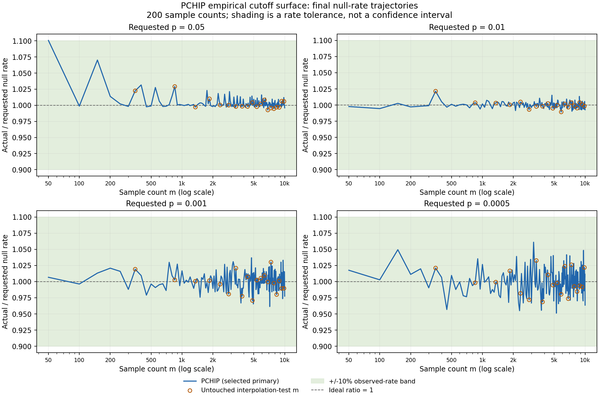

# Broad-grid empirical-cutoff fitting: completed October 17, 2026

**PCHIP was selected before final validation.** It was more accurate than the
quadratic surface on the tested moderate-probability grid, but the complete
core grid did not satisfy the prespecified simultaneous-interval criterion.
This does not promote a general runtime replacement or change SJARACNe defaults.

The [full report and plots](results_2026-10-17/RESULTS.md) contain every planned
comparison, compact tables, models, hashes and access-history records.
The [process](README.md), [focused-analysis amendment](AMENDMENT_2026-10-17.md)
and original [analysis specification](ANALYSIS_SPEC_2026-10-16.md) describe the
fixed design. This pass compared only empirical quadratic and PCHIP surfaces;
the larger GPD/hybrid/spline candidate analysis remains deferred.

## Design and selection

Use 200 sizes m=50,100,...,10000 with 10M fitting and 10M independent validation
draws each. Construct from 160 sizes' first 8M fitting draws; reserve their last 2M
for internal diagnostics. Select on 20 other sizes and four probabilities
{0.05,0.01,0.001,0.0005}, then refit once on 180 sizes. Twenty interpolation-test
sizes never train the final surfaces. Freeze the primary before final access.

The development selection score was 0.0001292240 for PCHIP versus
0.0004035071 for quadratic; lower is better. Both were evaluated on all
**80 development evaluation cases: 20 sample sizes × four probabilities**.
Each evaluation case is one (m,p) pair in a table, not a biological cell or
an individual sample.

For each case, the fitted curve predicts an MI cutoff. Of n=10 million
development null values, c are at or above that cutoff. The score averages
the squared natural logarithm of ((c+0.5)/(n+1))/p across all 80 cases, with
equal weights. The pseudocount keeps the logarithm finite; reported observed
rates remain c/n. A score of zero means perfect agreement with nominal p;
the score is dimensionless, not a probability or an error percentage.
Only these development cases selected the winner, not final validation.

## Independent final validation

Absolute relative error is abs((observed null exceedance rate / nominal p)-1).
The following rates use the same frozen MI>=cutoff comparator and all planned
evaluation cases, without excluding unfavorable sizes or probabilities.

| Evaluation scope | Method | Observed error within 10% | Median error | Worst error |
| --- | --- | ---: | ---: | ---: |
| 200 sizes × four core p | Quadratic | 797/800 | 0.685% | 28.820% |
| 200 sizes × four core p | PCHIP | 799/800 | 0.449% | 10.069% |
| 200 sizes × 33 fixed p>=0.0005 | Quadratic | 6551/6600 | 0.785% | 32.482% |
| 200 sizes × 33 fixed p>=0.0005 | PCHIP | 6599/6600 | 0.492% | 10.069% |
| 20 untouched test sizes × 33 fixed p>=0.0005 | Quadratic | 656/660 | 0.818% | 12.656% |
| 20 untouched test sizes × 33 fixed p>=0.0005 | PCHIP | 660/660 | 0.542% | 3.540% |

All 49 query probabilities, the exact-m empirical diagnostic and the untouched
legacy-affine comparator are included in the full report. Rare-tail summaries
are not evidence for 10% accuracy at 1e-7: 10M draws yield only one expected event.

## PCHIP rate trajectories

Each panel shows the selected PCHIP cutoff's observed null exceedance rate
divided by the requested probability p, across all 200 sample sizes. A ratio
of 1 is ideal; the shaded band is 0.9–1.1, not a confidence interval. Open
circles mark the 20 untouched interpolation-test sizes. The axes do not clip
unfavorable results. These are **rate-validation plots**, not MI-cutoff curves.
[SVG](summary_plots/pchip_null_rate_vs_m.svg) ·
[Plotting code](plot_pchip_summary.py).

## Evidence and limitations

The study's full design, statistical results, interval assessment and rare-tail
precision remain in the [full report](results_2026-10-17/RESULTS.md).
The [process](README.md#frozen-function-and-provenance) identifies
the frozen primary and its bundled SJARACNe representation.

The runtime-port checks preserved all **4500 literal training knots exactly**.
Across 9800 fixed-grid and 1274 additional off-grid representation checks,
native-versus-original-library differences were at most 15 ULPs
(1.78e-15 relative), with no availability mismatches. This verifies numerical
representation, not new null-rate calibration. MI atoms can amplify tiny
cutoff changes; the original rate tables are therefore not claimed to be
bitwise replicated for every ported query. No refitting, reselection or
validation-based fallback was used for this port.

Probabilities below 0.0005 were included in fitting and final evaluation, but
not in the four-probability selection objective. The 0.0005 boundary describes
the principal assessment range, not a demonstrated failure threshold.
The body/rare interpolation boundary is separately fixed at 0.0001, as defined
in the full report.

The null assumes exchangeable observations and unique ordinal ranks. It does
not establish reliability for heavily tied/zero-inflated expression or
clustered/repeated observations, biological FDR, direct regulatory edges, or
downstream network quality.

## Conditional conclusion

**For the same independent-rank AP-MI estimator and the tested m=50–10000,
p=0.0005–0.05 grid, PCHIP is a promising experimental cutoff interpolator:**
6599/6600 observed-rate checks were within 10%, including 660/660 at untouched
test sizes. However, simultaneous intervals confirmed only 784/800 core cases
(16 unresolved, none inconsistent), so uniform ±10% accuracy is **not
established**. Arbitrary off-grid accuracy, rarer tails, biological FDR and new
SJARACNe defaults are not validated here. The [full report and plots](results_2026-10-17/RESULTS.md)
retain the interval, numerical-correction, operational-history and audit details.
