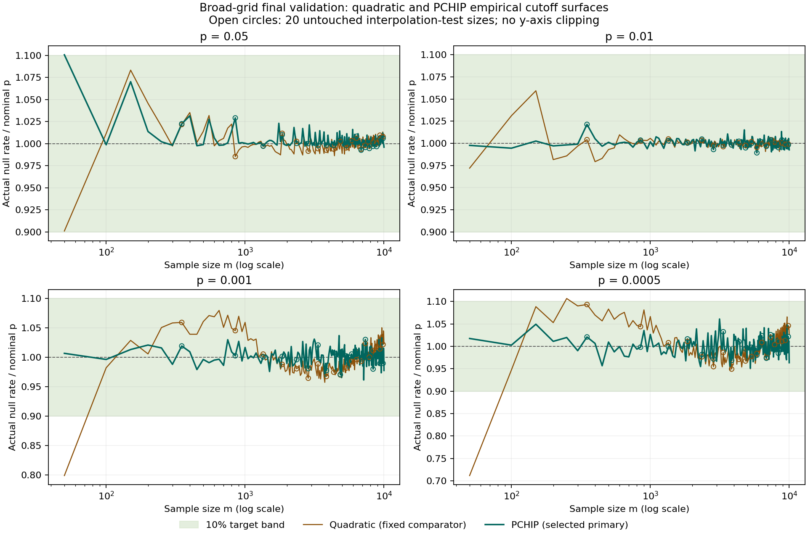

# Broad-grid quadratic/PCHIP fitting and final evaluation

The selected primary is **PCHIP**, chosen using development fitting
streams before final data were opened. The proposed core grid is **not confirmed**: not all 800 evaluation cases meet the planned simultaneous interval criterion.

This is the focused two-empirical-surface pass authorized in the
[October 17 amendment](../AMENDMENT_2026-10-17.md), not completion of the original
104-candidate GPD/hybrid/spline study. No SJARACNe engine code or defaults changed.

## Design, numerical policy and opening order

- 200 sizes: m=50,100,...,10000; 10M fitting plus 10M independent validation draws per size.
- Initial construction: 160 training sizes, first 8M fitting draws. Their last 2M draws are diagnostics only.
- Selection: 20 development sample counts (m=450,950,...,9950), crossed with four p levels {0.05,0.01,0.001,0.0005}: all 80 equally weighted evaluation cases. Each case is one sample-count/probability pair, not a biological cell.
- The 20 final interpolation-test sizes (m=350,850,...,9850) did not train either final surface. Their fitting distributions and every validation distribution stayed sealed until primary freeze.
- Both procedures were refitted once on full 10M fitting draws at the same 180 non-test sizes. The nonwinner is descriptive, never a fallback.
- Both use the frozen 25 empirical `higher` quantile knots. Quadratic fits log-cutoff on {1,x,x²} globally across m; PCHIP interpolates log-cutoff locally across x, where x is normalized log(m).
- Probability interpolation is a separately scoped log-p/log-cutoff PCHIP above and below p=0.0001, with one shared literal boundary cutoff. No rounding, crossing repair, clipping or extrapolation is used.
- Exact binary64 cutoffs are scored with MI>=T. Strict counts, ties and adjacent-ULP counts remain in the CSVs.
- Under the [explicit numerical-zero correction](../CORRECTION_2026-10-17.md), only raw MI in [-64 binary64 epsilon,0) is treated as positive zero. Every positive MI bit is preserved; material negatives remain errors. Original raw files and the failed pre-selection run were not overwritten. Fresh corrected code was frozen before selection or final-data access.
- All 4000 initial quantile hex values and both initial-model files were identical before and after this normalization.
- Cache provenance records original full-stream negative counts/minima. CSV `source_stream_corrected_negative_count` and `source_stream_raw_minimum` expose that provenance; `roundoff_negative_count` describes any additional corrections to the already-normalized scoring input, not the original raw stream. Zero/unique-count diagnostics use normalized values.
- The analysis used at most 12 workers with one numerical thread per worker; no new null draws were generated during fitting.

Opening/selection records are preserved byte-for-byte: [request](request.json),
[selection](selection.json), [frozen primary](primary.json),
[final access lock](access_final.json), and [both refitted models](refit_models.json).
The implementation and original raw distributions are identified by their pinned hashes.

Final scoring was completed by a separately hash-frozen continuation after a Windows progress-file replacement failure. It reused the same cached validation data and frozen models, without extraction, fitting or selection. See the [continuation declaration](../CORRECTION_STATUS_IO_2026-10-17.md) and [continuation request](recovery_request.json). Both failed-run records remain preserved locally; this is the same evaluation, not a new independent study. The complete test suite passed 175/175 tests before continuation. An independent read-only audit verified all 39,200 score rows, all 1600 primary interval calculations/classifications, all 64 summary records and all 430 continuation input pins.

## Development selection

The **80 development evaluation cases** are 20 development sample counts
m=450,950,...,9950 (held out from initial fitting), crossed with four nominal
probabilities p={0.05,0.01,0.001,0.0005}. An evaluation case is one (m,p)
setting, **not a biological cell or an 80-sample dataset**.

For each evaluation case, c counts MI>=T among n=10,000,000 development null
draws. Define the regularized actual rate `r_tilde=(c+0.5)/(10,000,000+1)`.
The **development loss** is the equally weighted mean of
`[log(r_tilde/p)]^2` across all 80 evaluation cases, using the natural logarithm.
Lower is better; zero is ideal. This is a dimensionless score, **not a
percentage**. The pseudocount is only for this loss; reported actual rates are
c/n. An invalid evaluation case makes a candidate ineligible. Ties within
absolute 1e-12 prefer quadratic. Final validation did not select or revise the
winner.

| Candidate | Eligible | Development selection score (loss; lower is better) | Median absolute rate error | Worst error |
| --- | --- | ---: | ---: | ---: |
| Quadratic | True | 0.000403507113005 | 0.486% | 9.940% |
| PCHIP | True | 0.000129224041118 | 0.461% | 4.220% |

## Final observed null-rate errors

“Within 10%” means the observed c/n is within 10% of nominal p. This is **not**
the simultaneous interval acceptance criterion below. Denominators include
every planned evaluation case; unavailable cases are not passes. Median/worst
errors describe available evaluation cases only; full available/invalid/missing counts are retained
in [summary.json](summary.json).

### Four core p levels, all 200 sizes

| Method | Within 10% / planned evaluation cases | Available | Median error | Worst error |
| --- | ---: | ---: | ---: | ---: |
| Quadratic | 797/800 | 800/800 | 0.685% | 28.820% |
| PCHIP | 799/800 | 800/800 | 0.449% | 10.069% |
| Exact-m empirical diagnostic | 799/800 | 800/800 | 0.465% | 10.069% |
| Untouched legacy-affine comparator | 3/800 | 800/800 | 71.840% | 6040.720% |

### All fixed diagnostic probabilities at p>=0.0005, all 200 sizes

| Method | Within 10% / planned evaluation cases | Available | Median error | Worst error |
| --- | ---: | ---: | ---: | ---: |
| Quadratic | 6551/6600 | 6600/6600 | 0.785% | 32.482% |
| PCHIP | 6599/6600 | 6600/6600 | 0.492% | 10.069% |
| Exact-m empirical diagnostic | 6598/6600 | 6600/6600 | 0.396% | 11.341% |
| Untouched legacy-affine comparator | 613/6600 | 6600/6600 | 48.812% | 6040.720% |

### All 49 probabilities, including weakly measured rare tails

| Method | Within 10% / planned evaluation cases | Available | Median error | Worst error |
| --- | ---: | ---: | ---: | ---: |
| Quadratic | 9058/9800 | 9800/9800 | 1.140% | 200.000% |
| PCHIP | 9070/9800 | 9800/9800 | 0.770% | 700.000% |
| Exact-m empirical diagnostic | 9075/9800 | 9800/9800 | 0.668% | 700.000% |
| Untouched legacy-affine comparator | 613/9800 | 9800/9800 | 71.885% | 1178100.000% |

### The 20 untouched interpolation-test sizes: four core p levels

| Method | Within 10% / planned evaluation cases | Available | Median error | Worst error |
| --- | ---: | ---: | ---: | ---: |
| Quadratic | 80/80 | 80/80 | 0.766% | 9.340% |
| PCHIP | 80/80 | 80/80 | 0.521% | 3.260% |
| Exact-m empirical diagnostic | 80/80 | 80/80 | 0.597% | 3.640% |
| Untouched legacy-affine comparator | 0/80 | 80/80 | 71.678% | 360.900% |

### The 20 untouched interpolation-test sizes: all moderate probabilities

| Method | Within 10% / planned evaluation cases | Available | Median error | Worst error |
| --- | ---: | ---: | ---: | ---: |
| Quadratic | 656/660 | 660/660 | 0.818% | 12.656% |
| PCHIP | 660/660 | 660/660 | 0.542% | 3.540% |
| Exact-m empirical diagnostic | 660/660 | 660/660 | 0.464% | 4.133% |
| Untouched legacy-affine comparator | 63/660 | 660/660 | 47.349% | 360.900% |

## Primary simultaneous interval assessment

Only the selected frozen primary receives the prospective 99% Bonferroni
study-family intervals across 200x8=1600 evaluation cases. An evaluation case is confirmed when
its entire interval is inside [0.9p,1.1p], inconsistent when disjoint, and
otherwise unresolved. Invalid or unresolved evaluation cases are not passes. The other
models and all extra p probes have descriptive 99.9% pointwise intervals only.

| Primary domain | Planned evaluation cases | Confirmed | Inconsistent | Unresolved | Invalid |
| --- | ---: | ---: | ---: | ---: | ---: |
| Four core p levels | 800 | 784 | 0 | 16 | 0 |
| All eight primary p levels | 1600 | 784 | 0 | 816 | 0 |

The proposed core grid is **not confirmed**: not all 800 evaluation cases meet the planned simultaneous interval criterion. Even universal success on these grid evaluation cases would not establish every
off-grid integer m or arbitrary p. The proposed m range [50,10000] and p range
[0.0005,0.05] were not narrowed after evaluation to hide failures. No fully
general runtime replacement is promoted by this presentation.

The 16 unresolved core cases comprise 15 at p=0.0005, 1 at p=0.05. Unresolved means the interval crosses a target-band boundary; it is neither confirmation nor a demonstrated disjoint-interval violation.

At m=50, p=0.05, the observed rate is 0.0550346 (10.069% relative error). The cutoff is an MI atom: 89,062 validation values equal it exactly. One upward binary64 step would change the exceedance count from 550,346 to 461,284. This is a discreteness/comparator diagnostic, **not** a post-hoc change to the frozen threshold.

## Rate trajectories and largest moderate-domain discrepancies

The shaded band is the +/-10% observed-rate target, not a confidence interval.
Open circles mark the 20 untouched interpolation-test sizes. Both fixed
surfaces are shown, with primary identity stated; y limits do not hide failures.

| m | p | Actual / nominal | Absolute relative error | m role |
| ---: | ---: | ---: | ---: | --- |
| 50 | 0.05 | 1.10069 | 10.069% | training |
| 100 | 0.012247449 | 0.920526 | 7.947% | training |
| 150 | 0.05 | 1.07024 | 7.024% | training |
| 3150 | 0.0005 | 1.061 | 6.100% | training |
| 50 | 0.008660254 | 1.05917 | 5.917% | training |
| 50 | 0.04472136 | 0.94386 | 5.614% | training |
| 50 | 0.034641016 | 0.944632 | 5.537% | training |
| 5250 | 0.0006 | 0.944667 | 5.533% | training |
| 3150 | 0.00054772256 | 1.05473 | 5.473% | training |
| 50 | 0.012247449 | 0.945944 | 5.406% | training |

## Comparators and limitations

- **Exact-m empirical diagnostic:** each of all 49 cutoffs is calculated directly from the corresponding fitting stream, then scored on independent validation. It is not an interpolated function and is not a selected fallback. Final-test fitting streams supplied this diagnostic only after primary freeze.
- **Untouched legacy-affine comparator:** original coefficients and formula were pinned without tuning. Its nominal p label is not itself a probability guarantee.
- The 49-query summaries are diagnostics, not an additional simultaneous-coverage claim over 9800 evaluation cases. The unselected surface cannot inherit the winner's primary claim.
- At 10M validation draws, expected exceedances at p=1e-5,1e-6,1e-7 are only 100,10,1. In particular, a fitted cutoff at 1e-7 is not evidence for +/-10% tail accuracy. Interpolation does not create missing tail information.
- The experiment calibrates SJARACNe's independent-rank AP-MI null, not biological false-positive rates, direct regulatory edges or downstream network quality.
- This pass does not evaluate the deferred GPD/hybrid/spline model families, off-grid sample sizes, or every probability in a continuous interval.

## Reproducible compact evidence

- [final_scores.csv](final_scores.csv) (13,458,534 bytes; SHA256 in [manifest.json](manifest.json)).
- [development_scores.csv](development_scores.csv) (678,097 bytes; SHA256 in [manifest.json](manifest.json)).
- [internal_scores.csv](internal_scores.csv) (4,907,706 bytes; SHA256 in [manifest.json](manifest.json)).

The package contains compact tables, fitted models, immutable access/provenance
locks and plots only. The 32GB raw draws and larger analysis caches remain local,
Git-ignored, and are neither copied nor needed to inspect this report.
The [manifest](manifest.json) records source hashes and byte sizes; this
presentation code never reopens raw distributions or refits any model.
