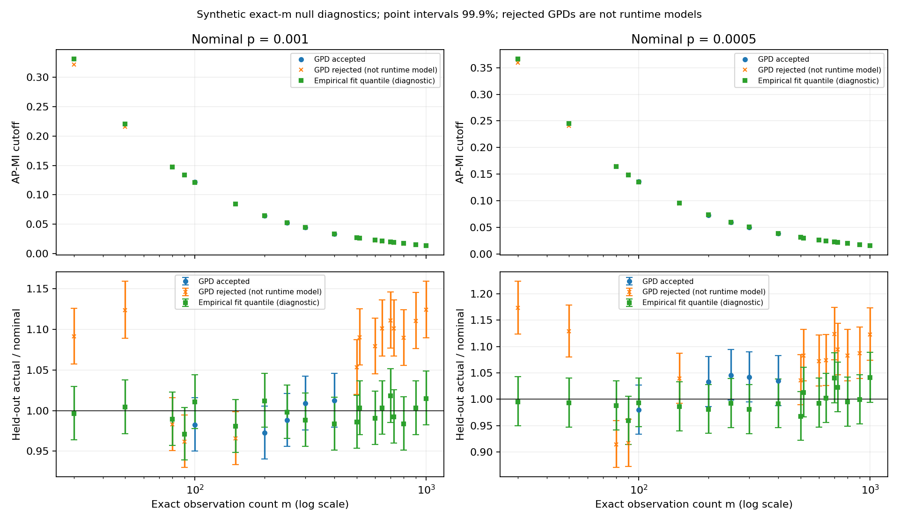

# Expanded AP-MI null calibration: 19 sizes, 10M + 10M

Completed October 15, 2026, at **20:29:49 Eastern**, before the requested
23:00 deadline. All **19 jobs completed: 5 accepted, 14 rejected, zero
execution failures**. Every stability gate passed; every rejection was a
held-out-calibration failure. No criteria were relaxed and no rejection was
rerun until accepted.

The accepted exact sizes are **m=100, 200, 250, 300, 400**. These are five
individual tested sizes, not a validated continuous m range. The tested GPD
procedure still does not provide a generally accepted p-to-MI lookup, and
all three exact DREAM5 sizes remain rejected.

## What was run

The [prospective protocol](PLAN_2026-10-15.md) was committed before production.
The previous eleven sizes were retained, including the m=1000 upper anchor,
and m=200, 250, 400, 500, 600, 700, 800, 900 were added. Every exact m used
10,000,000 fresh fitting draws and 10,000,000 independent held-out draws:
**380 million null pairs and 3,040,000,000 raw bytes** in total.

These are synthetic independent rank permutations using the production-shared
AP-MI kernel, unique ordinal ranks and Npar=40. No expression values or edge
reference labels enter calibration. Previous fitting/validation data were
neither reused nor extended. New base RNG seeds are 20261017 and 20261018,
with the fixed per-m and validation-stream offsets.

All scientific settings were unchanged: primary q=0.995, at least 20,000
strict primary exceedances, three valid sensitivity fits at q=0.9925, 0.995,
0.9975 and cutoff range <=10% at p=0.0005. Gate 2 checks both p=0.001 and
0.0005 with the same 99.9% pointwise Clopper-Pearson intervals. Expected
validation counts are now 10,000 and 5,000. The family-confidence setting
.99 and conservative family size ten remain per model, not simultaneous
coverage across all nineteen m values.

Generation used WSL Ubuntu; the unchanged calibrator fitted newly generated,
strictly verified raw streams in Windows Python 3.13 / NumPy 2.4.4 / SciPy
1.17.1. Numerical-library threads were capped at one per child. The engine
checkout remained unchanged at `7633ebb4a0d966dbda15a4e32d0efa492fb71aeb`, with
generator SHA256 `08224b6b20e29628be6d89d22eb7e355f8c6a05623e06f801fae5347a70a7f18`.

Protocol commit: `937b777`; runner/tests: `74ced9b`; summarizer/tests before
real aggregation: `530406b`. The comparison code's final wording was committed
as `3164a8c` before comparing real packages. Both original and expanded code,
plans and results are preserved separately.

## Runtime gate and observed execution

The full new m=1000 pipeline was timed first: **226.2 seconds**, including
10M fitting draws, 10M validation draws, fitting and checks. Its scientific
rejection did not prevent measuring runtime or proceeding with the fixed grid.
The new anchor stage verified/reused this attempt; m=1000 was not simulated
again. Measured resources and runtime permitted the remaining stages.

| Stage | Workers | Invocation wall time |
| --- | ---: | ---: |
| Full-draw m=1000 timing/pipeline check | 1 | 226.61 seconds |
| Anchors, reusing m=1000 | 8 | 93.84 seconds |
| Eight added sizes | 8 | 274.93 seconds |
| Exact DREAM5 counts m=644, 516, 725 | 3 | 188.45 seconds |

Production started at 20:15:44.889 and the last job finished at 20:29:48.560
EDT: **14 minutes 4 seconds elapsed**, including gaps between stages.
The sum of per-job times was 2,601.32 seconds (43 minutes 21 seconds), not
wall time, because jobs overlapped. The original 5M study's hardware load and
stage layout differ, so these are not a controlled parallel-scaling comparison.
Packaging/review followed the production completion time.

## All nineteen GPD results

All sizes passed Gate 1. A held-out actual/nominal ratio above 1 means more
null exceedances than nominal; below 1 means fewer. A rejected cutoff is
**diagnostic only**, not an emitted usable model. The strict frozen rule is
nominal inclusion in the exact interval, not a fixed relative-error tolerance.

| Exact m | GPD cutoff p=0.001 | GPD cutoff p=0.0005 | Actual/nominal at 0.001 | At 0.0005 | Overall result |
| ---: | ---: | ---: | ---: | ---: | --- |
| 30 | 0.32143852 | 0.35960065 | 1.0913 | 1.1728 | Rejected |
| 50 | 0.21582216 | 0.24048948 | 1.1238 | 1.1286 | Rejected |
| 80 | 0.14788197 | 0.16537692 | 0.9830 | 0.9144 | Rejected |
| 90 | 0.13393484 | 0.14953008 | 0.9617 | 0.9170 | Rejected |
| 100 | 0.12175845 | 0.13587209 | 0.9827 | 0.9796 | Accepted |
| 150 | 0.08444964 | 0.09456338 | 0.9657 | 1.0390 | Rejected |
| 200 | 0.06468328 | 0.07262646 | 0.9724 | 1.0328 | Accepted |
| 250 | 0.05265604 | 0.05932493 | 0.9882 | 1.0458 | Accepted |
| 300 | 0.04433415 | 0.05011981 | 1.0089 | 1.0418 | Accepted |
| 400 | 0.03356964 | 0.03811826 | 1.0124 | 1.0350 | Accepted |
| 500 | 0.02707201 | 0.03086550 | 1.0534 | 1.0362 | Rejected |
| 516 | 0.02610761 | 0.02976787 | 1.0904 | 1.0830 | Rejected |
| 600 | 0.02255840 | 0.02576911 | 1.0790 | 1.0724 | Rejected |
| 644 | 0.02105195 | 0.02409718 | 1.1012 | 1.0738 | Rejected |
| 700 | 0.01935773 | 0.02214518 | 1.1112 | 1.1236 | Rejected |
| 725 | 0.01872509 | 0.02145296 | 1.1011 | 1.0946 | Rejected |
| 800 | 0.01699829 | 0.01950781 | 1.0895 | 1.0830 | Rejected |
| 900 | 0.01510496 | 0.01739357 | 1.1105 | 1.0870 | Rejected |
| 1000 | 0.01360961 | 0.01566143 | 1.1243 | 1.1226 | Rejected |

Full [GPD parameters, cutoffs and stability ranges](results_2026-10-15/summary.csv),
[held-out counts and exact intervals](results_2026-10-15/heldout.csv), and
[verified summary/provenance](results_2026-10-15/summary.json).

Only m=80, 150 and 500 pass one held-out point while failing the other. They
still fail the predeclared two-point model requirement. Some failures are
relatively small: at m=150, p=0.001 has observed/nominal=0.9657, 3.43% below
target. Others are larger: m=1000 is 12.43% and 12.26% above nominal at the
two probabilities. The table and intervals retain that distinction.

Error bars show 99.9% pointwise held-out intervals scaled by nominal p.
The smooth cutoff trajectory in the upper panels does not establish accurate
probability calibration in the lower panels. Markers do not imply interpolation.

## Additional MI cutoff table: GPD or empirical

This additional table follows the requested display rule: retain GPD cutoffs
only for the five accepted exact-m models; replace **both** cutoff columns
with fitting-stream empirical quantiles for each of the fourteen rejected
models. There is no per-probability cherry-picking: m=80, 150 and 500 also
use empirical cutoffs for both probabilities, despite passing one GPD check.
The original GPD table and all rejection labels above remain unchanged.

`GPD` means an accepted GPD model. `Empirical` means the fitting-stream
`higher` quantile at 1-p, substituted for a rejected GPD; it does **not** mean
an accepted empirical runtime model. Values below are rounded to eight decimal
places. The [full-precision CSV](cutoffs_gpd_or_empirical.csv) includes each
row's original GPD status, cutoff source and held-out actual/nominal ratios
for the selected method, derived from the unchanged
[source summary](results_2026-10-15/summary.json).

| Exact m | Cutoff source | MI cutoff p=0.001 | MI cutoff p=0.0005 |
| ---: | --- | ---: | ---: |
| 30 | Empirical | 0.33115988 | 0.36634091 |
| 50 | Empirical | 0.22035866 | 0.24498408 |
| 80 | Empirical | 0.14766935 | 0.16407152 |
| 90 | Empirical | 0.13366652 | 0.14865385 |
| 100 | GPD | 0.12175845 | 0.13587209 |
| 150 | Empirical | 0.08419582 | 0.09534634 |
| 200 | GPD | 0.06468328 | 0.07262646 |
| 250 | GPD | 0.05265604 | 0.05932493 |
| 300 | GPD | 0.04433415 | 0.05011981 |
| 400 | GPD | 0.03356964 | 0.03811826 |
| 500 | Empirical | 0.02745226 | 0.03121662 |
| 516 | Empirical | 0.02656104 | 0.03012528 |
| 600 | Empirical | 0.02299394 | 0.02610579 |
| 644 | Empirical | 0.02148528 | 0.02434351 |
| 700 | Empirical | 0.01975587 | 0.02244727 |
| 725 | Empirical | 0.01915392 | 0.02172022 |
| 800 | Empirical | 0.01738903 | 0.01978258 |
| 900 | Empirical | 0.01546640 | 0.01764979 |
| 1000 | Empirical | 0.01394064 | 0.01586849 |

This is a retrospective, user-requested **presentation rule**, chosen after
reviewing the held-out results, not a prospectively validated hybrid calibration
policy. The empirical quantiles themselves were predeclared fit-only
diagnostics; their existing held-out intervals remain diagnostic evidence.
Selecting methods this way does not establish a new confidence guarantee for
the combined table. No new models, engine fallbacks, defaults or biological
FDR claims are introduced. A supported hybrid policy would require separately
frozen rules and fresh confirmation. Exact-m use only; no interpolation or
extrapolation to p=1e-7.

## Comparison with the 5M + 5M experiment

The [hash-verified descriptive comparison](comparison_5m_10m_2026-10-15/REPORT.md)
and [machine-readable table](comparison_5m_10m_2026-10-15/comparison.csv) retain
all nineteen rows, including the eight new sizes marked previously `not_run`.

Among the eleven overlapping sizes:

- m=100 remains accepted; m=90 and 150 change from accepted to rejected.
- m=300 changes from rejected to accepted.
- The other seven remain rejected, including m=80 and all three DREAM5 sizes.

Both simulation counts **and random seeds changed**, so this is not an
isolated matched test of increasing draw count. A changed status is neither
proof of improvement nor proof of regression. Doubling Monte Carlo draws
reduces stochastic uncertainty by about 1/sqrt(2), but does not repair GPD
approximation error. Narrower intervals can expose discrepancies that a
smaller study could not distinguish from noise.

## Empirical-quantile diagnostic

As fixed in the protocol, empirical cutoffs were estimated from the fitting
stream alone using the `higher` 99.9th/99.95th percentiles, then checked on the
independent validation stream. **All 38 empirical diagnostic intervals
contained nominal p**. The full cutoffs/counts/intervals are in
[heldout.csv](results_2026-10-15/heldout.csv).

This is compatibility with the nominal rates under the stated intervals,
not proof of exact calibration. Empirical diagnostics were not used to
select a GPD, change a cutoff, relax a rejection or emit fallback models.
They support considering direct empirical calibration at these moderate
probabilities before simply increasing simulation counts again. A runtime
empirical-model design and validation protocol would be separate work.

## Defensible conclusion and safeguards

Simulation runtime is not the main obstacle. The tested fixed GPD procedure
continues to miss nominal null probabilities at many m values despite more
draws, three stable threshold fits and independently verified outputs.
Acceptance means compatibility at the two checked probabilities, not exact
accuracy or a universally valid model family.

The five accepted exact-m models are packaged for research use only. None
was installed into SJARACNe. Do not substitute an accepted model for another
m or interpolate between them. The endpoint checks do not establish every
interior probability in the declared [0.0005,0.001] model range. There is no
support here for extrapolation to p=1e-7.

TF p=0.001 and SIG p=0.0005 remain provisional operating choices from prior
BRCA100 density/topology exploration, not biological probabilities, optimal
settings or FDR controls. Synthetic unique-rank independence does not validate
ties, zero inflation, related observations or transfer to every bulk/single-cell
dataset. No engine code, defaults, production models, inference networks or
historical evidence were changed.

## Verification and retained files

The expanded runner, summarizer and comparison have **54 passing synthetic
tests**; the earlier workflow's 32 checks also pass. Independent read-only
calculations, without importing the runner/summarizer, recomputed primary and
sensitivity quantiles/counts, tail masses, both cutoffs, held-out counts/CP
intervals, gates, model contents/counts and raw/provenance hashes for all
nineteen jobs: no discrepancies. There is exactly one fresh attempt per m,
38 streams with 10M draws/80MB each, and five accepted model files.

[Compact package checksums](results_2026-10-15/package_sha256.json) cover the
original reports, commands, seeds, metadata, logs, timings and accepted models.
Raw payloads remain local under
`D:/GitHub/sjaracne_benchmark/runs/apmi_null_m_sweep_10m_20261015/`.
The original calibrator's stale `cutoff_p1e-7` column/prose is preserved
byte-for-byte; the new summaries correctly label p=0.0005 and p=0.001.
