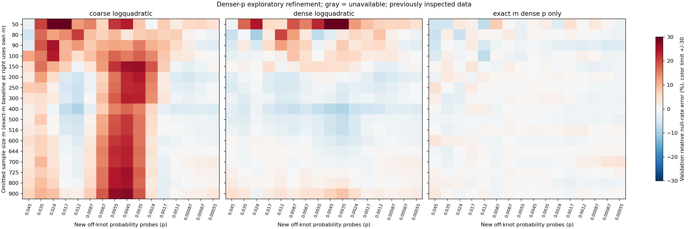

# Denser-p refinement results

**Denser probability knots substantially improve interpolation, but do not
produce a uniformly accurate cutoff function.** On 272 new off-knot checks,
the quadratic surface improved from 187 to 261 observed errors within +/-10%;
PCHIP improved from 203 to 265. Remaining main-check failures are concentrated
at m=50,80,90 and can still be large. Do not replace the legacy function yet.

Verification/extraction took **4.35 seconds** and analysis/plotting **5.45
seconds**, **9.89 seconds total computation** with twelve verification workers.
This excludes coding, synthetic tests, independent review and packaging.
**Zero new null draws and zero new large stream copies.** The expensive broad
m sweep remains stopped. No GPD optimization, engine or default changes.

## Fixed design and provenance

The [refinement plan](PLAN.md), numerical implementation, grid and 39 synthetic
checks were committed as `d29538d` before extracting new quantiles. This is a
separate follow-up to the [first feasibility analysis](../smooth_feasibility/RESULTS.md),
whose frozen evidence remains unchanged.

Reuse all nineteen sizes m=30,50,80,90,100,150,200,250,300,400,500,516,600,
644,700,725,800,900,1000, each with 10M fitting and 10M validation draws.
These are independent rank-permutation nulls under the same production-shared
AP-MI kernel, unique ordinal ranks and Npar=40. Verify all 38 original raw
hashes, cache hashes/support/order, sidecars and original source identities.
Reuse the existing sorted arrays read-only; do not sort or copy them again.

The only statistical change is p-knot density. The three unchanged m-axis
rules are loglinear, logquadratic and PCHIP on log(m), with log(cutoff) as
response. Both coarse and dense candidates use PCHIP on log(p) for queries.
In every smooth-surface fold, omit the evaluated m's entire fitting
distribution and train on the other eighteen sizes. No quantile crossing,
clipping, neighboring-m substitution, or after-the-fact repair is permitted.
No crossings occurred. PCHIP remains unavailable at the two endpoint folds.

The probability grid is:

- Eight original coarse knots, unchanged.
- Twenty-five dense knots: 22 in [0.0001,0.05], plus 1e-5,1e-6,1e-7.
  Moderate knots use mantissas {1,1.5,2,3,4,5,6,7.5} across three decades,
  clipped at 0.05. Every old coarse knot remains a dense knot.
- Twenty-one new probes at geometric midpoints between adjacent moderate
  dense knots, rounded to fourteen significant decimal digits. None is a knot.
- All sixteen old query values retained, giving 49 distinct total queries.

Old probes such as p=0.02 and 0.005 now become dense knots. They are regression
checks, **not new p-interpolation evidence**. Main results instead use sixteen
new off-knot probes with p>=0.0005 across seventeen interior sizes: **272
checks per candidate**. A secondary group includes all 21 probes down to
p=0.0001: 357 checks. Endpoints are reported separately.

Use the engine's MI >= cutoff comparator, recording strict > counts and exact
ties separately. Main tables use the independent-RNG validation stream, but
these distributions were previously inspected. This is **exploratory development
evidence, not fresh independent study confirmation**. Intervals are descriptive
99.9% pointwise Clopper-Pearson intervals, not simultaneous guarantees or
uncertainty for the whole fitted procedure.

## Main comparison: genuinely off-knot probabilities

Error is abs(P_validation(MI >= predicted cutoff)/p - 1). All 272 main
predictions per method were evaluable; no unavailable points are excluded.

| Method | Observed error <=10% | Median absolute error | 90th percentile | Worst error |
| --- | ---: | ---: | ---: | ---: |
| Coarse loglinear | 131/272 (48.2%) | 10.92% | 22.68% | 57.73% |
| Dense loglinear | 184/272 (67.6%) | 5.08% | 18.38% | 34.40% |
| Coarse logquadratic | 187/272 (68.8%) | 5.14% | 21.22% | 60.61% |
| Dense logquadratic | **261/272 (96.0%)** | **2.23%** | **6.58%** | **48.43%** |
| Coarse PCHIP | 203/272 (74.6%) | 4.01% | 21.97% | 61.85% |
| Dense PCHIP | **265/272 (97.4%)** | **1.09%** | **5.27%** | **54.99%** |
| Exact-m coarse p-only baseline | 199/272 (73.2%) | 3.67% | 22.22% | 61.73% |
| Exact-m dense p-only baseline | 272/272 (100%) | 0.90% | 2.93% | 7.67% |
| Exact-m empirical quantile baseline | 269/272 (98.9%) | 0.52% | 1.61% | 18.04% |

Exact-m baselines use that evaluated m's fitting data, so they are **not
leave-m-out methods** and cannot establish interpolation to unseen sizes.
The p-only baselines isolate p-axis interpolation by removing m-axis fitting.
Neither baseline is perfect ground truth. Exact-m empirical cutoffs can
overshoot a requested null rate at a repeated MI value; floating-point
reconstruction also matters near such atoms, as discussed below.

Of the dense quadratic's 272 main intervals, 254 lay wholly within the +/-10%
band and 11 were disjoint; the other seven overlapped. Dense PCHIP had 257
wholly inside, seven disjoint and eight overlapping. These are descriptive
pointwise classifications, not new acceptance gates or universal accuracy.

Heatmap colors saturate at +/-30%; numerical tables retain larger errors.
The right panel is a decomposition baseline using its own m, not another
leave-m-out candidate. Gray would mean unavailable; none of these main panels
has unavailable predictions.

## Remaining failures: small-m interpolation, not uniform improvement

| Dense method | Main failures | Failure distribution | Complete 16-probe size sets within 10% |
| --- | ---: | --- | ---: |
| Logquadratic | 11/272 | m=50: eight; m=80: two; m=90: one | 14/17 |
| PCHIP | 7/272 | All seven at m=50 | 16/17 |

Every remaining main failure had a cutoff that was too low, causing excess
null exceedances. These predicted cutoffs had zero exact ties. Fitting-stream
errors closely resembled validation-stream errors, arguing against a simple
explanation based only on validation sampling noise.

The worst main example is m=50,p=0.0034641016151378. Quadratic error changes
from **+8.16% coarse to +48.43% dense**; dense PCHIP gives **+54.99%**. The
dense quadratic cutoff is 5.43% below the exact-m empirical quantile.
Exact-m dense p-only error is +2.28%, and the exact empirical baseline is
about +0.66% at that point. Thus overall improvement is not improvement at
every point, and a small cutoff discrepancy can have a large tail-rate effect.

Using the exact-m dense p-only baseline instead of interpolating across m
removes the observed main failures at these particular points. This supports
residual cross-m interpolation error as an immediate issue under the tested
representation; it does not prove the biological or algorithmic cause.
Observed low-m MI distributions contain substantial repeated values. Finite
AP partitions and distribution shape changes are plausible contributors, not
mechanisms established by this study.

## Numerical/tie limitation

The frozen interpolation procedure reconstructs cutoffs through log/exp.
At an exact p knot, that round trip can shift a cutoff by one floating-point
unit. At m=50,p=0.05:

- Literal fitting quantile: 0.06627772298751955, validation >= count 549,550,
  including 89,319 ties; actual/nominal=1.0991.
- Reconstructed exact-m p-only cutoff: 0.06627772298751956, count 460,231,
  zero ties; actual/nominal=0.920462.

Both observed errors happen to be inside 10%, but this is a substantial
probability change from a numerically tiny cutoff change. Do not interpret
an effectively zero relative cutoff error as equivalent edge selection.
The frozen candidate results were not silently recomputed with a more
favorable tie policy. Future runtime work must specify exact-knot preservation,
rounding/comparison semantics and numerical sensitivity near repeated values.
No randomized tie breaking or new threshold convention was introduced here.

A [post-hoc numerical sensitivity audit](AUDIT.md#post-hoc-floating-point-sensitivity-not-a-candidate-revision)
recounted all 272 main points for dense quadratic, dense PCHIP and exact-m
dense p-only at each threshold and its adjacent floats. No counts changed;
the 261/265/272 observed success totals were unchanged. Replacing reconstructed
exact knots by literal empirical knots changed counts at 55 of 289 moderate
knot queries but did not change the exact-m p-only 561/561 success total.
This identifies a real numerical caveat without invalidating the main totals.

## Wider checks, regressions and endpoints

| Evaluation group | Dense quadratic within 10% | Dense PCHIP within 10% | Exact-m dense p-only within 10% |
| --- | ---: | ---: | ---: |
| Main new probes, p>=0.0005 | 261/272 | 265/272 | 272/272 |
| All new probes down to p=0.0001 | 341/357 | 340/357 | 356/357 |
| All moderate queries, including knots | 534/561 | 543/561 | 561/561 |
| Original p=0.001/0.0005 operating checks | 34/34 | 34/34 | 34/34 |

Across all 561 moderate queries, quadratic failures occur at m=50,80,90,100;
PCHIP failures at m=50,80,90. Worst errors are 48.43% for quadratic and
64.26% for PCHIP. Describing only the new-probe success fraction would hide
these remaining problems. Exact-m p-only results use the frozen numerical
procedure and retain the tie caveat above; they are not a general guarantee.

At p=0.001 and 0.0005, the previous results are unchanged: dense quadratic
median/worst errors 1.80%/5.56%, and dense PCHIP 1.77%/8.50%, over 34 checks.
All **1,824 old coarse-grid scoring rows** reproduced their original statuses,
cutoffs and >=/>/tie counts, with no discrepancies.

Endpoint extrapolation is not repaired. Quadratic operating-p predictions
remain outside 10% in two of four endpoint checks; PCHIP is unavailable in
all four. There are 16,758 total scoring rows: 16,366 evaluable and 392
unavailable endpoint-PCHIP rows, with zero crossing-related omissions.

Rare p levels remain diagnostics. Dense moderate knots do not create more
tail observations: 10M validation draws still give only 100,10,1 expected
events at p=1e-5,1e-6,1e-7. The lower range near 1e-4 also has weaker interval
precision. No extreme-tail or broad-domain accuracy claim is supported.

## Defensible conclusion and stopping decision

**The p-axis refinement worked for most tested moderate-p interpolation
points. It did not solve uniform calibration.** A dense empirical surface is
more promising than the original coarse representation, but the largest
remaining errors are not acceptable under a universal 10% target.

The next focused investigation should address small-m shape/interpolation and
numerical/tie behavior, not automatically spend 9-10 hours generating the full
grid up to m=10000. Sparse targeted low-m calibration may eventually be useful,
but no such simulations were launched. High-m behavior above 1000 is still
unknown. Post-hoc better-performing subranges are observations, not newly
accepted supported domains.

Any selected runtime procedure needs an explicitly frozen domain, numerical
policy and fresh confirmation. This study does not establish every integer m,
every interior p, expression-tie/zero-inflation transfer, biological FDR or
optimal TF/SIG operating probabilities. No function, artifact or default was
promoted into SJARACNe.

## Evidence

- [Fixed request/grid/environment and code pins](results_2026-10-15/request.json).
- [Verified input/cache records and 931 quantiles](results_2026-10-15/extraction.json).
- [All 8,379 predictions](results_2026-10-15/predictions.json),
  [knot/crossing diagnostics](results_2026-10-15/knot_diagnostics.json), and
  [all 16,758 score rows](results_2026-10-15/evaluation.csv).
- [63 group summaries](results_2026-10-15/summary.csv),
  [per-probability summaries](results_2026-10-15/per_probability.csv),
  [old-result reproduction](results_2026-10-15/old_result_reproduction.json).
- [Runtime/output hashes](results_2026-10-15/completion.json),
  [compact package checksums](results_2026-10-15/package_sha256.json),
  [independent audit](AUDIT.md).

Local compact run output is `runs/apmi_null_p_axis_refinement_20261015/`.
Raw streams and sorted caches remain in their original ignored run folders.
Execution-code snapshots preserve the exact analysis dependencies; use the
repository-layout entry point to reproduce, not an unqualified snapshot copy.
