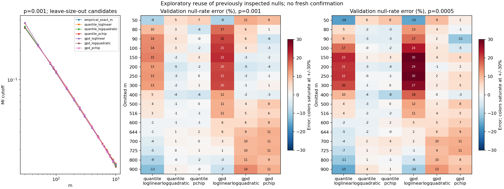

# Smooth-cutoff feasibility results

**A compact empirical-cutoff surface is promising at p=0.001 and 0.0005,
but the tested surface is not accurate across the full probability range.**
Smoothing the existing GPD parameters was less successful. These are exploratory
results from reused data, not a validated replacement for the legacy function.

No new null simulations were run. With twelve extraction workers, verification,
sorting and extraction took **26.61 seconds**; candidate evaluation and plotting
took **3.04 seconds**, **29.69 seconds total**. This excludes implementation,
synthetic testing, independent review and packaging. The proposed 9-10-hour
generation sweep remains unexecuted.

## Question and fixed design

Can a function T(m,p) interpolate MI cutoffs without requiring a calibration
file for every exact m? The [analysis plan](PLAN.md) and candidate implementation
were committed as `7b6299e`; a pre-execution interval-interpretation correction
and regression test were committed as `c3f130c`. Neither changed the old evidence.

Use all nineteen sizes from the [expanded 10M + 10M study](../expanded_10m/RESULTS.md),
m=30,50,80,90,100,150,200,250,300,400,500,516,600,644,700,725,800,900,1000.
Each size has 10M fitting and 10M independently generated validation draws,
using the production-shared AP-MI kernel, Npar=40 and unique ordinal ranks.
Every original raw stream, report, metadata record and artifact hash was verified.

For each fold, exclude that m's entire fitting distribution and GPD parameter
set. Train on the other eighteen sizes. Score predicted thresholds on both
streams at the omitted m, using **MI >= cutoff**, recording strict counts and
ties separately. Main tables below use the validation stream. Its RNG stream
is independent, but these data had already been inspected: this is **not fresh
independent study confirmation**.

There are seventeen interior interpolation folds. Omitting m=30 or 1000
requires endpoint extrapolation, reported separately. PCHIP does not extrapolate.
Eight fitting p knots are 0.05,0.01,0.001,0.0005,0.0001,1e-5,1e-6,1e-7.
Eight additional p probes are 0.02,0.005,0.002,0.00075,0.0002,5e-5,5e-6,5e-7.
Probes are not used as direct-surface training knots.

## What was fitted

The direct empirical family fits log(cutoff) against log(m) at each fixed p
knot. The global quadratic has the form

$$\log T(m,p_j)=a_j+b_j\log m+c_j(\log m)^2.$$

At query p, interpolate log(cutoff) against log(p) with shape-preserving
piecewise cubic interpolation (PCHIP). The alternative m-axis smoothers are a
global loglinear curve and PCHIP. There is no repair of crossing quantiles,
clipping to MI support or nearest-size substitution. The quadratic uses three
coefficients per p knot; PCHIP is a more flexible interpolation comparator,
not an equally small global parameterization.

The GPD family applies those same m-axis smoothers to log(u), log(scale), shape
and logit(tail mass), reusing **all nineteen** existing q=0.995 primary fits,
including rejected ones. No new GPD was optimized. Original tail mass uses
(strict tail_count+1)/(N+1). Its p input is evaluated analytically through the
GPD inverse tail. Predictions outside the available tail or finite support
are unavailable, not silently repaired. This is a test of smoothing that
existing GPD procedure, not a rejection of every possible GPD strategy.

## Main result: the two provisional operating probabilities

There are **34 checks per candidate**: seventeen interior m values times
p=0.001 and 0.0005. Absolute null-rate error is
abs(P_validation(MI >= predicted cutoff)/p - 1), not relative MI-cutoff error.

| Candidate | Median absolute null-rate error | Worst error | Observed error <=10% | Pointwise interval entirely within +/-10% |
| --- | ---: | ---: | ---: | ---: |
| Empirical surface, loglinear | 9.44% | 22.88% | 19/34 | 12/34 |
| Empirical surface, logquadratic | **1.80%** | **5.56%** | **34/34** | 33/34 |
| Empirical surface, PCHIP | 1.77% | 8.50% | 34/34 | 31/34 |
| GPD parameters, loglinear | 11.80% | 29.88% | 12/34 | 10/34 |
| GPD parameters, logquadratic | 4.78% | 14.29% | 27/34 | 22/34 |
| GPD parameters, PCHIP | 6.14% | 11.34% | 27/34 | 16/34 |
| Exact-m empirical baseline (not leave-size-out) | 1.11% | 4.08% | 34/34 | 34/34 |
| Exact-m GPD baseline (not leave-size-out) | 7.31% | 12.86% | 27/34 | 16/34 |

All six candidates produced mathematically valid cutoffs for these 34 checks.
Here "valid" means evaluable, not scientifically accepted or runtime-supported.
The interval column uses descriptive **99.9% pointwise** Clopper-Pearson
intervals. It is not a simultaneous accuracy statement, does not include
function-fitting uncertainty, and is not a new acceptance gate. The quadratic's
remaining interval overlaps the target band; no primary interval was disjoint.

The left panel shows how similarly smooth cutoff curves can hide different
probability calibration. The heatmaps display the actual null-rate errors;
colors saturate at +/-30%, and numeric cells retain the values.

## Wider p range: the important failure

The quadratic's performance is not uniform between or beyond the two main p
knots. All rows below use seventeen interior m values and validation draws.

| p | Role in direct surface | Observed error <=10% | Worst absolute null-rate error |
| ---: | --- | ---: | ---: |
| 0.05 | Knot | 16/17 | 13.25% |
| 0.02 | Additional probe | 13/17 | **60.62%** |
| 0.01 | Knot | 15/17 | 16.13% |
| 0.005 | Additional probe | **1/17** | **29.23%** |
| 0.002 | Additional probe | 15/17 | 11.61% |
| 0.001 | Knot | 17/17 | 4.97% |
| 0.00075 | Additional probe | 17/17 | 4.47% |
| 0.0005 | Knot | 17/17 | 5.56% |
| 0.0002 | Additional probe | 17/17 | 8.10% |
| 0.0001 | Knot | 16/17 | 15.20% |
| 5e-5 | Additional probe | 16/17 | 10.20% |
| 1e-5 | Knot, sparse tail | 11/17 | 30.00% |
| 5e-6 | Additional probe, sparse tail | 10/17 | 26.00% |
| 1e-6 | Knot, sparse tail | 5/17 | 50.00% |
| 5e-7 | Additional probe, sparse tail | 1/17 | 100.00% |
| 1e-7 | Knot, sparse tail | 7/17 | 100.00% |

At m=50,p=0.02, the quadratic predicted MI cutoff 0.10555793 rather than the
exact-m fitting quantile 0.11507335. The validation null rate was 0.0321246,
**60.623% above nominal**. The exact-m empirical baseline rate was 0.0214543,
7.2715% above nominal, with 14,622 validation ties at that exact cutoff.
Thus modest MI-cutoff error can become much larger probability error.

The widespread p=0.005 failures also occur at larger m with no ties at the
predicted thresholds. They cannot be dismissed as ties alone. The coarse
log-p knot spacing and MI-to-tail-rate sensitivity are plausible contributors;
this analysis does not isolate a single cause. Denser p knots can be extracted
from these same draws in a later, explicitly exploratory refinement, without
regenerating nulls. They were not added after seeing these failures.

A separately labeled [post-hoc audit diagnostic](AUDIT.md#post-hoc-probability-axis-decomposition)
removed m-axis interpolation and used each size's own p-knot quantiles. The
same p interpolation still produced actual/nominal ratios 1.60291 at
m=50,p=0.02 and 1.23974 at m=725,p=0.005. Thus the p-axis representation alone
reproduces much of the error at those examples; a dense m sweep is not required
to expose or investigate it. This diagnostic did not change the candidates.

For p<=1e-5, these observed-error fractions are noisy diagnostics, **not precise
calibration comparisons**. Expected validation exceedances are only 100,10,1
at p=1e-5,1e-6,1e-7, respectively. Even exact-m empirical tail estimates are
imprecise there. No conclusion of +/-10% accuracy at extreme p is justified.

The q=0.995 GPD cannot represent p=0.05 or 0.01 within its fitted tail.
Across all m,p,methods, the validation table retains **2,432 prediction rows**:
2,090 evaluable, 64 unavailable endpoint-PCHIP predictions and 278 unavailable
GPD probability-domain predictions. None was removed from the detailed table.

## Endpoints and generalization limits

For quadratic empirical extrapolation after omitting m=30, actual/nominal
ratios were 0.8312 and 0.7334 at the two main p values. After omitting m=1000,
ratios were 1.0318 and 1.0706. The small-m endpoint clearly failed. PCHIP
returned unavailable at both endpoints, as specified. These folds do not
support general extrapolation, particularly above m=1000.

The nineteen-size grid is nonuniform and relatively sparse at small m. Even
successful interior leave-size-out tests do not establish every integer m,
all interior probabilities, m>1000, expression ties/zero inflation, biological
FDR or optimal TF/SIG operating points. Observed success under the new +/-10%
target does not retrospectively change any earlier GPD rejection.

## Defensible conclusion and next decision

**There is enough evidence to continue with a direct empirical-cutoff surface
before spending 9-10 hours on the dense m sweep.** The global quadratic is a
compact, promising candidate for the two main probabilities; it did not need a
separate GPD fit at every test m. Smoothing existing GPD parameters did not
match that result. No candidate met a uniform broad-p accuracy claim.

A sensible next exploratory step is to improve p-axis coverage using existing
fitting streams, and then consider sparse new high-m anchors only if needed.
Do not extrapolate this function to m=10000 or p=1e-7 as an accepted replacement.
Any selected procedure requires frozen supported-domain rules and fresh
confirmation before an engine implementation or default change. No runtime
winner or accepted model file was emitted in this analysis.

## Evidence and verification

- [Full evaluation table](results_2026-10-15/evaluation.csv): all 4,864 rows,
  including both streams, endpoints, unavailable predictions, exact tie counts,
  pointwise intervals and explicit training-size lists.
- [Summary table](results_2026-10-15/summary.csv) and
  [fold predictions/parameters](results_2026-10-15/predictions.json).
- [Verified input extraction and raw hashes](results_2026-10-15/extraction.json),
  [frozen execution request](results_2026-10-15/request.json),
  [timings/output hashes](results_2026-10-15/completion.json), and
  [compact package checksums](results_2026-10-15/package_sha256.json).

The [execution snapshot](results_2026-10-15/execution_code/) preserves the exact
plan and tested code bytes used before execution. It is provenance, not a
standalone runner: the extractor imports the separately versioned
`expanded_10m/summarize.py` verification helpers, whose hash is recorded per
size. Run the current benchmark entry point from the repository layout.

Large sorted copies remain local under ignored
`runs/apmi_null_smooth_feasibility_20261015/` (approximately 3.04GB).
Original streams remain under `runs/apmi_null_m_sweep_10m_20261015/`.
No new raw draws, native jobs, networks, engine changes or default changes.

An [independent numerical/provenance audit](AUDIT.md) found no discrepancies.
The new workflow's 45 synthetic checks and 98 existing calibration/timing
checks pass. The engine checkout remained clean and unchanged.
