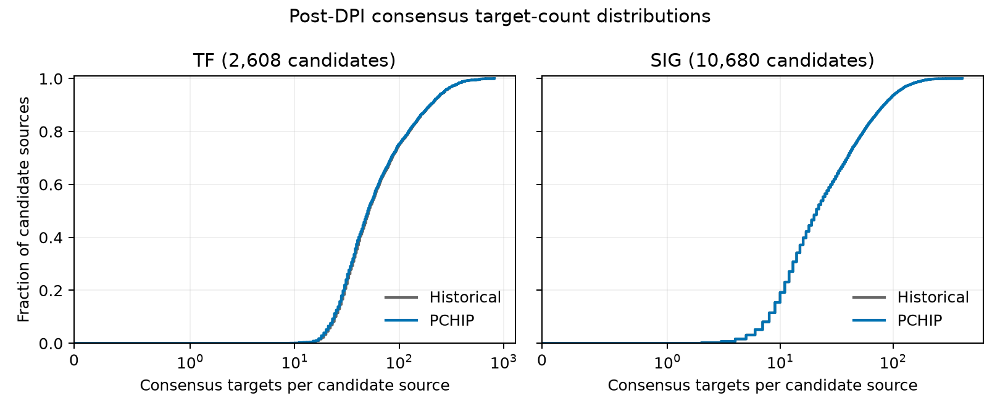

# BRCA100: current PCHIP end-to-end workflow and NetBID2 QC

## Outcome

Fresh inference completed **200/200 seed networks** (100 TF and 100 SIG), both post-DPI consensus networks, and **2/2 pinned NetBID2 QC reports**. The table reports the measured current networks beside the matched historical configurations; no probabilities were selected from these outcomes.

| Network / cutoff function | Per-resample p | MI cutoff | Consensus edges | Median targets | Active sources | Incident nodes | LCC | Scale-free adjusted R-squared |
| --- | ---: | ---: | ---: | ---: | ---: | ---: | ---: | ---: |
| TF / historical | 0.001 | 0.14732247558240297 | 224,608 | 51 | 100.000% | 97.807% | 100.000% | 0.883664 |
| TF / pchip | 0.001 | 0.14783093032516142 | 221,487 | 50 | 100.000% | 97.687% | 100.000% | 0.895698 |
| SIG / historical | 0.0005 | 0.1644671599536221 | 379,053 | 21 | 99.991% | 99.558% | 100.000% | 0.924718 |
| SIG / pchip | 0.0005 | 0.16445222440051604 | 379,059 | 21 | 99.991% | 99.558% | 100.000% | 0.924687 |

Display fractions/fit values are rounded; [comparison_metrics.tsv](comparison_metrics.tsv) retains the numerical metrics read from the source summaries. All outcomes are **after seed-level MI filtering, DPI and consensus**.

## Matched design and metric definitions

- Frozen engine: `86f8729087b3a6d22bdce128649b4e49d725fb9e`; [declared process/protocol](../PROTOCOL.md).
- BRCA100: 28,278 expression nodes, 100 samples; full lists of 2,608 TF and 10,680 SIG candidates.
- Seeds 1–100; 80/100 samples without replacement, `m=80`, `Npar=40`, DPI epsilon 0. Each class uses its full source list as DPI annotation (`-l`).
- Explicit TF `p_b=0.001` and SIG `p_b=0.0005`; these are provisional starting settings, not software defaults or selected optima.
- Stock normal-approximation consensus at `p_c=1e-5`; **minimum recurrence K=6 is not used**. Twelve native workers, one numerical thread per worker; consensus serialized.
- Median targets include zero-target candidates. Active sources are candidates with at least one consensus edge. Incident-node coverage uses all 28,278 expression nodes. LCC is the largest weak component divided by incident nodes. Scale-free adjusted R-squared uses the unchanged historical summary-script regression alongside NetBID2 QC, not necessarily the fit label displayed in the HTML; [definition](../README.md#netbid2-qc-and-compact-results). It is not a measure of edge correctness.

## Directed-edge and source-target-size comparison

| Network | Shared directed edges | Historical-only | PCHIP-only | Jaccard | Historical edges retained |
| --- | ---: | ---: | ---: | ---: | ---: |
| TF | 221,487 | 3,121 | 0 | 0.986105 | 98.610% |
| SIG | 379,053 | 0 | 6 | 0.999984 | 100.000% |

[Full directed-overlap values](historical_edge_overlap.tsv). Reverse directions are distinct; neither added nor removed pairs are labeled biologically true or false.

- TF: 0 candidate sources have more targets, 887 the same number, and 1,721 fewer; [paired counts](tf_paired_target_sizes.tsv).
- SIG: 6 candidate sources have more targets, 10,674 the same number, and 0 fewer; [paired counts](sig_paired_target_sizes.tsv).

Each curve uses the complete candidate-source list, including zero-target sources. The horizontal axis is symmetric-log scaled with a linear region around zero; curves describe target-set sizes, not biological accuracy.

## Provenance and validation

The input blobs, frozen model hashes, runner source, 200 design-bound seed metadata records, both consensus inventories and both QC inventories were checked before publication. The consensus fingerprints bind each network to its ordered 100-seed ledger. NetBID2 summaries were independently cross-checked against the analyzer's topology/target-count audit; historical summary files matched their archived hashes.

The AP-MI kernel and stock consensus source are unchanged between the historical and current engine versions. A separate implementation/compiler/runtime anchor reran **TF seed 1 only**, at the exact historical MI cutoff with explicit `-t`, bypassing probability conversion and PCHIP. The serialized post-DPI data sections matched exactly at that identical explicit cutoff. This is one example, not proof of equivalence for every seed, threshold, dataset or environment. It is not a PCHIP run or null-rate calibration. [Anchor provenance](provenance/native/implementation_anchor/anchor_result.json).

- Current compiler: `g++ (Ubuntu 13.3.0-6ubuntu2~24.04.1) 13.3.0`.
- PCHIP data SHA256: `5ae44f3ec251282b242e1e25e5695fe8c6d80a0e7a3f156170dbb72c29e09f59`.
- Calibration primary SHA256: `8b4104be3f3ffe0a476a4dd7c8f7f6d95f00f1a51fa467c7194edf3806d427f5`.
- [Build manifest](provenance/native/build_manifest.json), [native metadata/commands/logs](provenance/native/), [QC provenance](provenance/analysis_manifest.json), and [presentation manifest](presentation_manifest.json).
- Seed-001 [TF header-only excerpt](provenance/native/tf/TF_run_001.adj_header_only.txt) and [SIG header-only excerpt](provenance/native/sig/TF_run_001.adj_header_only.txt), with corresponding logs, show actual PCHIP method, sampled m, model hashes, full-precision cutoff and warnings. These excerpts contain no adjacency data rows.
- [Historical 13-point sweep](../../brca100_pr67_threshold_sweep/COMBINED_RESULTS.md) motivates the initial density-oriented settings; it is not current PCHIP calibration.

## NetBID2 reports

- [TF network-QC HTML](tf_netbid2_qc.html)
- [SIG network-QC HTML](sig_netbid2_qc.html)

Download and open the HTML locally; GitHub does not render it as a normal web page. Figures are embedded. Standard R Markdown may request MathJax online; offline viewing can omit mathematical typesetting. R 4.4.3, NetBID2 2.2.0 (`5defa454d600b94f5dd6d1f9f4428f99759a6821`) and igraph 2.3.3 match the historical QC environment.

## Conditional conclusion

If the measured coverage and target-set sizes meet a stated application requirement, these two explicit probabilities remain reasonable **provisional BRCA100 starting settings**. This completed workflow/QC check does not identify optimal probabilities, justify universal defaults, or establish improved biological accuracy or downstream activity robustness.

This is one dataset without independent edge-level truth. Density, connectivity, overlap and scale-free fit are descriptive QC, not biological reliability or edge FDR. TF/SIG comparisons also reflect different hub-list/DPI contexts. `m=80` lies between the broad calibration study's tested 50-step sizes; a callable cutoff is not a directly validated null-rate guarantee at this off-grid query. No new null fitting, calibration draws or consensus-rule tuning was performed.

Original QC files, `package_manifest.json` and `SHA256SUMS` remain unchanged. Verify the augmented package separately with `sha256sum -c PRESENTATION_SHA256SUMS`; it covers original QC and added presentation/provenance files, including the new presentation manifest. Large native adjacency/expression files and raw calibration draws remain local.
