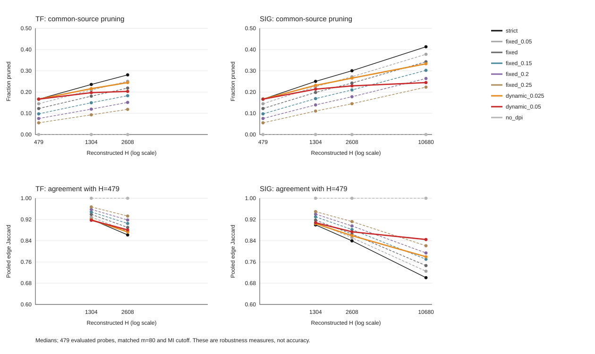
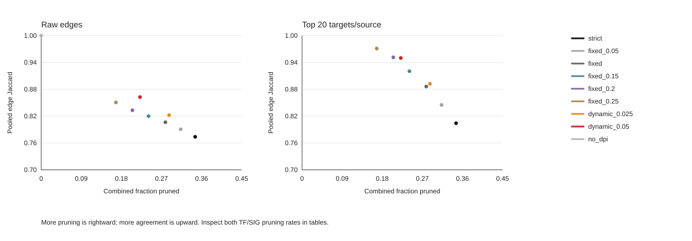

> Publication copy of a frozen local report/process. Scientific text and numbers are unchanged; relative links are adapted to this compact package. See [publication provenance](PUBLICATION.json) for original hashes and [local artifacts](README.md#local-artifacts) for omitted sidecars.

# BRCA100 fixed-tolerance controls

## Conditional scope

Exploratory follow-up on the same three observation resamples and panels, not independent confirmation. No reference edges, TP/FP, direct-edge accuracy, LUAD, new sampling seeds, consensus or default changes. The same 479 probe-level sources (254 distinct symbols) are evaluated; all 28,278 target rows, m=80, PCHIP p_b=0.0005 and source/annotation memberships remain matched. Original evidence was reused unchanged.

Fixed epsilon is shared across all H; labels `fixed` and `fixed_0.2` mean epsilon 0.10 and 0.20. Dynamic slopes remain 0.025/0.05 with H_ref=479 and cap=0.30. At one H a dynamic tolerance is just a number; any distinct benefit must concern the complete H trajectory.

## Natural full TF versus full SIG

Medians over three unique matched sample pairs, not nine independent panels. The source population is common, but TF/SIG context differs in size and membership.

| Strategy | TF pruning | SIG pruning | Raw Jaccard | Top-10 Jaccard | Top-20 Jaccard | Top-50 Jaccard |
| --- | ---: | ---: | ---: | ---: | ---: | ---: |
| strict | 0.2809 | 0.4131 | 0.7737 | 0.9030 | 0.8042 | 0.6566 |
| fixed_0.05 | 0.2506 | 0.3777 | 0.7906 | 0.9341 | 0.8451 | 0.7094 |
| fixed | 0.2187 | 0.3425 | 0.8063 | 0.9578 | 0.8862 | 0.7685 |
| fixed_0.15 | 0.1828 | 0.3021 | 0.8198 | 0.9715 | 0.9204 | 0.8156 |
| fixed_0.2 | 0.1512 | 0.2637 | 0.8331 | 0.9830 | 0.9514 | 0.8841 |
| fixed_0.25 | 0.1184 | 0.2231 | 0.8506 | 0.9908 | 0.9711 | 0.9269 |
| dynamic_0.025 | 0.2446 | 0.3332 | 0.8221 | 0.9582 | 0.8922 | 0.7850 |
| dynamic_0.05 | 0.2031 | 0.2446 | 0.8626 | 0.9831 | 0.9500 | 0.8519 |
| no_dpi | 0.0000 | 0.0000 | 1.0000 | NA | NA | NA |

Top-k uses the same eligible sources in all eight arms and both contexts. No-DPI is shown only as a raw zero-pruning upper bound; its matched-k cells are intentionally NA, not missing inference.

| Targets/source | Median eligible sources | Minimum | Maximum |
| ---: | ---: | ---: | ---: |
| 10 | 456/479 | 455 | 459 |
| 20 | 276/479 | 265 | 280 |
| 50 | 39/479 | 39 | 44 |

## Full-trajectory evidence and trade-offs

Plots show group medians; per-family and min/max tables retain the paired results. No whole-trajectory weighted score or automatic optimum is selected. Both endpoint pruning rates must be inspected: a combined rate can conceal sacrificing one context. Physical aliases are deduplicated.

`fixed_dynamic_tradeoffs.tsv` compares each shared fixed arm with each dynamic arm in every physical comparison family. Dominance requires agreement and both context pruning fractions to be at least as large, with at least one strict gain (roundoff tolerance 1e-12). A separate combined-pruning flag is less restrictive; neither flag is a statistical or biological superiority test.

For baseline-to-H expansion, dynamic epsilon is zero at H=479 while positive fixed epsilon also relaxes that baseline. The both-context dominance requirement can therefore structurally protect dynamic from dominance. This anchor asymmetry is not evidence of superiority; do not interpret nondominated-cell counts as a success rate. Inspect combined-pruning trade-offs and the complete trajectories instead.

## Conditional conclusion

Interpret dynamic as a candidate engineering correction only if its agreement/pruning trade-off is useful across H and is not explained equally well by a shared fixed tolerance. Nondominance alone does not establish superiority. Perfect context agreement with no pruning is the trivial limit, not a successful objective. A benefit limited to high-degree sources must be described narrowly. Independent-dataset transfer and direct-edge validation remain untested.

## Evidence and limitations

Engine `b41c4ca637ac2bffe73617a86af65c83e75ee075`; follow-up design `e07af307b375e2355565d458f250b99a48ee124304e70526c07046adab16c574`. The adapter validates 504 views and eight strategy labels, retaining the frozen original scoring arithmetic. Added fixed arms must not alter shared budget eligibility. Three common deterministic MI-tie orders are assessed. Literal six-digit MI matching is not a full-precision fingerprint. Observation resamples overlap; membership draws are not independent biological datasets.

[Frontier points](frontier_points.tsv) | [Frontier summaries](frontier_summary.tsv) | [Fixed/dynamic paired trade-offs](fixed_dynamic_tradeoffs.tsv) | [All H pruning](run_summary.tsv) | [Matched identity](matched_summary.tsv) | [Paired differences](strategy_difference_summary.tsv) | [Complete analysis](README.md#local-artifacts)
