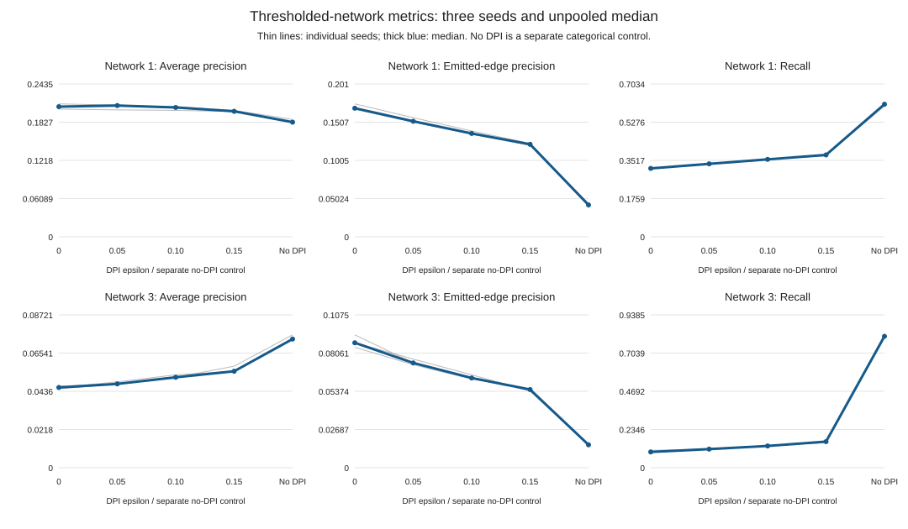
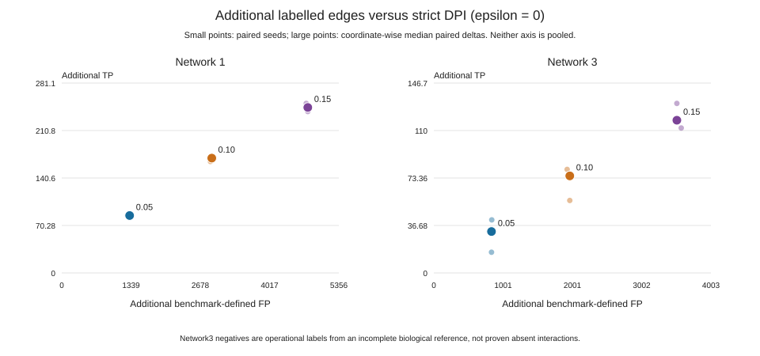

> Publication copy of a frozen local report/process. Scientific text and numbers are unchanged; relative links are adapted to this compact package. See [publication provenance](PUBLICATION.json) for original hashes and [local artifacts](README.md#local-artifacts) for omitted sidecars.

# DREAM5 DPI epsilon Stage1

Exploratory, matched three-seed comparison; no best-epsilon or biological-validation claim.

## Frozen design

Engine: `b41c4ca637ac2bffe73617a86af65c83e75ee075`. Analysis SHA256: `82de2cf236646fee1c14628138c1c3f029c25226fc4a056b8fd781323905a2c8`.

Both TF datasets use the prospectively fixed current-engine experimental PCHIP setting `-M pchip -p 0.001`, `Npar=40`, and exactly 644 of 805 profiles sampled without replacement, seeds 1, 2, 3. Full released TF lists are used for inference and TF annotation: Network1 195; Network3 334. The probability is a provisional single exploratory choice, not a universally optimal threshold. It was not selected using gold-label scores.

The five modes are thresholded no-DPI (`-e 1`) and DPI epsilon 0, 0.05, 0.10, 0.15. No-DPI is not an unthresholded raw-MI ranking. This is a new current-engine comparison, not an exact rerun of the historical affine p=1e-7 / fixed-MI 0.03759353615996272 benchmark.

## Thresholded-network metrics

Entries are medians across three matched seeds, not pooled estimates. Full per-seed values and minimum/maximum ranges are in the TSV files.

| Dataset | Mode | Labelled TP | Labelled FP | Precision | Recall | AP | AUROC |
|---|---|---:|---:|---:|---:|---:|---:|
| network1 | No DPI | 2448 | 5.602e+04 | 0.04187 | 0.6102 | 0.1827 | 0.7395 |
| network1 | epsilon 0 | 1263 | 6207 | 0.1691 | 0.3148 | 0.2074 | 0.6486 |
| network1 | epsilon 0.05 | 1347 | 7519 | 0.1519 | 0.3357 | 0.2091 | 0.6574 |
| network1 | epsilon 0.10 | 1430 | 9081 | 0.1359 | 0.3564 | 0.2061 | 0.6661 |
| network1 | epsilon 0.15 | 1512 | 1.093e+04 | 0.1216 | 0.3769 | 0.2 | 0.6736 |
| network3 | No DPI | 1667 | 1.016e+05 | 0.0161 | 0.8069 | 0.07342 | 0.6405 |
| network3 | epsilon 0 | 200 | 2134 | 0.08786 | 0.09681 | 0.04578 | 0.5416 |
| network3 | epsilon 0.05 | 236 | 2967 | 0.07368 | 0.1142 | 0.04784 | 0.5477 |
| network3 | epsilon 0.10 | 276 | 4098 | 0.0631 | 0.1336 | 0.0516 | 0.5539 |
| network3 | epsilon 0.15 | 331 | 5673 | 0.05497 | 0.1602 | 0.05505 | 0.5625 |

## Paired changes versus strict DPI

Each seed is compared with its own epsilon-zero network before aggregation. The reported medians are medians of paired differences, not differences of independent medians. Rescued precision means TP / (TP + FP) among newly retained explicitly labelled edges; it is undefined when no labelled edges are added.

| Dataset | Relaxed epsilon | Median TP delta | Median FP delta | Median rescued precision | Median AP delta |
|---|---|---:|---:|---:|---:|
| network1 | 0.05 | +85 | +1312 | 0.06039 | -0.001269 |
| network1 | 0.10 | +170 | +2900 | 0.05475 | -0.002056 |
| network1 | 0.15 | +245 | +4756 | 0.04874 | -0.005928 |
| network3 | 0.05 | +32 | +833 | 0.038 | +0.002814 |
| network3 | 0.10 | +75 | +1964 | 0.03664 | +0.006574 |
| network3 | 0.15 | +118 | +3511 | 0.03253 | +0.009137 |

## Scope and limits

- Only explicit directed TF-target labels enter scoring: Network1 278,392 pairs (4,012 positive); Network3 152,280 pairs (2,066 positive). Unlabelled emitted edges are excluded, not counted as FP.
- AP is tie-grouped stepwise average precision on the fixed explicit-label universe; AUROC is tie-aware. Omitted pairs receive zero scores and remain in the bottom tie. These are not official DREAM5 leaderboard scores.
- Network1 is simulated. Network3 uses real E. coli expression and an experimentally supported but incomplete reference; zero labels are operational negatives. Fewer benchmark-defined FP does not prove biologically false edges were removed, and newly retained labelled TP does not establish transfer to other systems.
- TF-to-target output orientation does not independently establish causal direction. All released genes and candidate TFs remain in inference; the labelled scoring universe is narrower.
- Three seeds describe limited resampling variation. No confidence interval, significance test, general optimum, or independent evaluation of a retrospectively chosen epsilon is claimed.
- Native adjacencies serialize MI at six significant digits. Identical shared serialized weights and subset checks are not direct empirical verification of full-precision pre-DPI MI equality. This report reads only frozen scores; native execution and sample-selection validation belong to the inference evidence.

## Files

`runs_per_seed.tsv`, `runs_summary.tsv`, `comparisons_per_seed.tsv`, `comparisons_summary.tsv`, two SVG plots, and `report_provenance.json`. Empty TSV cells denote undefined metrics; no missing seed is silently discarded.
