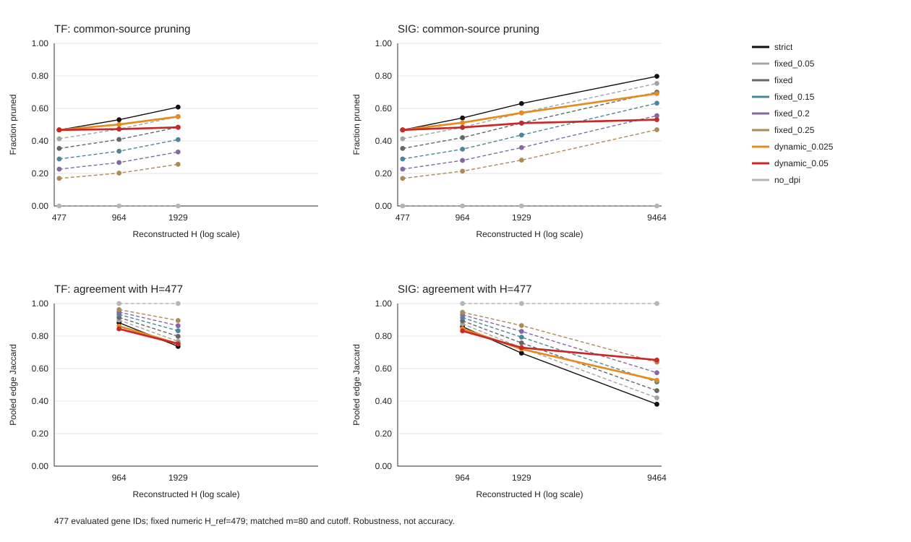
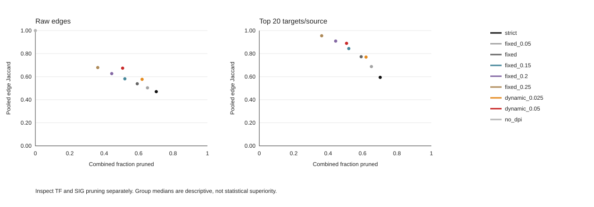

> Publication copy of a frozen local report/process. Scientific text and numbers are unchanged; relative links are adapted to this compact package. See [publication provenance](PUBLICATION.json) for original hashes and [local artifacts](README.md#local-artifacts) for omitted sidecars.

# LUAD100 common-source DPI transfer test

## Design and interpretation

A prespecified transfer of the BRCA100 engineering comparison, not a direct-edge accuracy benchmark. One fixed set of 100 patient-distinct LUAD tumors was selected from the prepared 517-patient cohort; each matched observation resample uses 80 without replacement. The 29,841-gene matrix and full TF/SIG annotations were frozen before hub-panel construction. IQR feature selection used the full 517-patient preparation; these patient subsets are not independent held-out feature-selection validation.

The same 477 common Ensembl gene IDs are evaluated in separate TF/SIG reconstructions. Full lists have 1,929 TF and 9,464 SIG genes. The unchanged numeric rule is `epsilon(H)=min(0.30, slope*max(0,log2(H/479)))`, slopes 0.025/0.05. H_ref remains 479 computational source nodes; the pure common-source baseline H=477 therefore has epsilon zero. This is an explicit node-count transfer, not a claim that 479 BRCA probes (254 symbols) and 479 LUAD genes are biologically equivalent.

PCHIP p_b=0.0005 is shared by TF/SIG with m=80, Npar=40, no noise or extra native filtering. The PCHIP null study assumed independent unique ordinal ranks, not zero-inflated or heavily tied RNA-seq expression; this transfer does not establish null-rate calibration or biological FDR control for LUAD. These are individual resample networks; no consensus, K=6, downstream activity or production-default change.

## Natural full TF versus full SIG

Medians over three unique matched observation pairs; repeated full-list panel aliases are not replication.

| Strategy | TF pruning | SIG pruning | Combined pruning | Raw Jaccard | Top-10 | Top-20 | Top-50 |
| --- | ---: | ---: | ---: | ---: | ---: | ---: | ---: |
| strict | 0.6081 | 0.7974 | 0.7027 | 0.4703 | 0.7123 | 0.5940 | 0.4835 |
| fixed_0.05 | 0.5498 | 0.7535 | 0.6516 | 0.5034 | 0.7921 | 0.6878 | 0.5768 |
| fixed | 0.4842 | 0.7000 | 0.5921 | 0.5388 | 0.8606 | 0.7732 | 0.6752 |
| fixed_0.15 | 0.4081 | 0.6321 | 0.5201 | 0.5817 | 0.9261 | 0.8440 | 0.7772 |
| fixed_0.2 | 0.3321 | 0.5556 | 0.4439 | 0.6268 | 0.9642 | 0.9089 | 0.8612 |
| fixed_0.25 | 0.2563 | 0.4690 | 0.3626 | 0.6792 | 0.9834 | 0.9551 | 0.9270 |
| dynamic_0.025 | 0.5496 | 0.6911 | 0.6203 | 0.5770 | 0.8584 | 0.7701 | 0.6877 |
| dynamic_0.05 | 0.4837 | 0.5307 | 0.5072 | 0.6740 | 0.9415 | 0.8894 | 0.8320 |
| no_dpi | 0.0000 | 0.0000 | 0.0000 | 1.0000 | NA | NA | NA |

Combined pruning is candidate-weighted within each paired comparison BEFORE the median. It is not the average of the displayed endpoint medians. No-DPI is a raw zero-pruning upper bound; its matched-budget cells are intentionally NA.

| Targets/source | Median eligible /477 | Minimum | Maximum |
| ---: | ---: | ---: | ---: |
| 10 | 477 | 475 | 477 |
| 20 | 457 | 450 | 458 |
| 50 | 198 | 197 | 199 |

## Observed paired balance against fixed tolerance

Dynamic slope0.05 minus each fixed comparator at top20/source, primary tie order. Each difference is paired within an observation selection BEFORE the median. Positive pruning means more candidate edges removed, not improved accuracy. These are computational repetitions.

| Fixed comparator | Available pairs /3 | Top20 Jaccard change | TF pruning change | SIG pruning change | Combined pruning change |
| --- | ---: | ---: | ---: | ---: | ---: |
| fixed | 3/3 | 0.1134 | -0.0006 | -0.1682 | -0.0844 |
| fixed_0.2 | 3/3 | -0.0168 | 0.1516 | -0.0249 | 0.0633 |
| fixed_0.25 | 3/3 | -0.0636 | 0.2274 | 0.0620 | 0.1446 |

## Complete H trajectories and pruning trade-off

Fixed labels .05/.10/.15/.20/.25 mean the same epsilon at every H (`fixed` is .10). At one H, dynamic epsilon is simply a number. The distinct claim concerns its allocation across H. Agreement alone is not an objective: no-DPI gives identical context graphs with no pruning. For baseline-to-H expansion, positive fixed epsilon also relaxes the baseline whereas dynamic is zero. Both-endpoint nondominance is structurally affected by this asymmetry and must not be counted as a success rate.

## Which common sources benefit?

Per-source identity/count comparisons use pre-DPI degree bins 0-9,10-19,20-49,50-99,>=100, fixed within each observation seed. All 477 raw source denominators include undefined/zero-target cases. The exact per-family tables avoid non-additive medians. Source-resample events are not independent genes.

| Dynamic | Comparator | Seed | Sources | Identity improved/worsened/unchanged/undefined | Count-gap improved/worsened/unchanged/undefined |
| --- | --- | ---: | ---: | --- | --- |
| dynamic_0.025 | strict | 1 | 477 | 449 / 6 / 22 / 0 | 423 / 25 / 29 / 0 |
| dynamic_0.025 | fixed | 1 | 477 | 317 / 80 / 80 / 0 | 389 / 10 / 78 / 0 |
| dynamic_0.025 | fixed_0.2 | 1 | 477 | 49 / 385 / 43 / 0 | 280 / 143 / 54 / 0 |
| dynamic_0.025 | fixed_0.25 | 1 | 477 | 9 / 428 / 40 / 0 | 243 / 181 / 53 / 0 |
| dynamic_0.05 | strict | 1 | 477 | 453 / 2 / 22 / 0 | 430 / 20 / 27 / 0 |
| dynamic_0.05 | fixed | 1 | 477 | 421 / 14 / 42 / 0 | 404 / 23 / 50 / 0 |
| dynamic_0.05 | fixed_0.2 | 1 | 477 | 262 / 147 / 68 / 0 | 373 / 37 / 67 / 0 |
| dynamic_0.05 | fixed_0.25 | 1 | 477 | 108 / 307 / 62 / 0 | 328 / 71 / 78 / 0 |
| dynamic_0.025 | strict | 2 | 477 | 435 / 13 / 29 / 0 | 402 / 35 / 40 / 0 |
| dynamic_0.025 | fixed | 2 | 477 | 317 / 79 / 81 / 0 | 388 / 12 / 77 / 0 |
| dynamic_0.025 | fixed_0.2 | 2 | 477 | 35 / 400 / 42 / 0 | 267 / 156 / 54 / 0 |
| dynamic_0.025 | fixed_0.25 | 2 | 477 | 8 / 430 / 39 / 0 | 232 / 195 / 50 / 0 |
| dynamic_0.05 | strict | 2 | 477 | 447 / 4 / 26 / 0 | 407 / 31 / 39 / 0 |
| dynamic_0.05 | fixed | 2 | 477 | 412 / 18 / 47 / 0 | 396 / 30 / 51 / 0 |
| dynamic_0.05 | fixed_0.2 | 2 | 477 | 244 / 158 / 75 / 0 | 349 / 58 / 70 / 0 |
| dynamic_0.05 | fixed_0.25 | 2 | 477 | 105 / 316 / 56 / 0 | 299 / 107 / 71 / 0 |
| dynamic_0.025 | strict | 3 | 477 | 443 / 3 / 31 / 0 | 414 / 24 / 39 / 0 |
| dynamic_0.025 | fixed | 3 | 477 | 292 / 96 / 89 / 0 | 373 / 19 / 85 / 0 |
| dynamic_0.025 | fixed_0.2 | 3 | 477 | 26 / 409 / 42 / 0 | 257 / 156 / 64 / 0 |
| dynamic_0.025 | fixed_0.25 | 3 | 477 | 4 / 432 / 41 / 0 | 216 / 200 / 61 / 0 |
| dynamic_0.05 | strict | 3 | 477 | 454 / 2 / 21 / 0 | 421 / 24 / 32 / 0 |
| dynamic_0.05 | fixed | 3 | 477 | 412 / 20 / 45 / 0 | 394 / 34 / 49 / 0 |
| dynamic_0.05 | fixed_0.2 | 3 | 477 | 235 / 160 / 82 / 0 | 351 / 44 / 82 / 0 |
| dynamic_0.05 | fixed_0.25 | 3 | 477 | 93 / 318 / 66 / 0 | 301 / 92 / 84 / 0 |

## Recurrence and limitations

Rescued edges are relaxed-post minus strict-post in the SAME panel/sample/H. Recurrence separates relaxed-post presence, strict-post presence, repeated rescued status and pre-DPI candidate availability. The rescued union has at least one hit by construction and can overlap the strict-retained union across resamples. Conditional retention is not evidence that an edge is direct. Three overlapping observation resamples cannot establish broad reproducibility. Identical full/baseline membership aliases are omitted as replication. See recurrence_by_group.tsv and compressed edge-level records.

## Conditional transfer conclusion

Evaluate whether dynamic slope 0.05 reduces H/context-related variation while preserving useful TF/overall pruning at comparable target-identity agreement against strong fixed 0.20/0.25 controls. A larger raw Jaccard or a flatter pruning curve alone is insufficient. The tables retain failures and trade-offs; no winner, optimum or new default is selected automatically. A reproduced balance would extend the BRCA100 engineering observation to this LUAD preparation, not prove biological accuracy or a tissue-only effect: patient cohort, measurement platform and node representation differ.

For descriptive context, BRCA100 full TF/SIG slope0.05 had raw Jaccard0.8626, top20 Jaccard0.9500 and combined pruning0.2217; fixed0.20 had0.8331/0.9514/0.2048, and fixed0.25 had0.8506/0.9711/0.1676. These historical summaries are not paired LUAD comparisons or new replication.

Engine `b41c4ca637ac2bffe73617a86af65c83e75ee075`; design `a53167d5688bf6d82d7da30dd1ac5d31da16e5581a57e7884a5594283307d200`. All native graphs and frozen scorer are rehashed. Serialized MI matching is six-significant-digit evidence, not hidden full-precision identity. The same three MI-tie orders as BRCA are retained. No biological reference labels, TP/FP or biological precision claim is introduced.

[Pruning](run_summary.tsv) | [Agreement](agreement_summary.tsv) | [Matched identity](matched_summary.tsv) | [Paired trade-offs](fixed_dynamic_tradeoffs.tsv) | [Exact source/degree families](family_source_summaries.tsv) | [Rescue support](recurrence_by_group.tsv) | [Complete analysis](README.md#local-artifacts)
