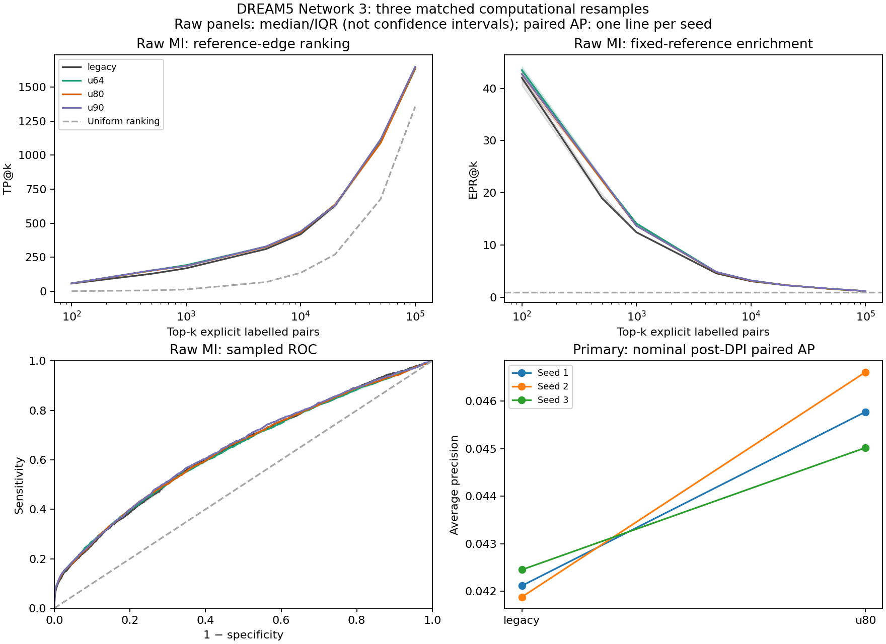

# DREAM5 Network 3: exploratory sampling and DPI benchmark

The prospective primary endpoint is nominal post-DPI average precision (AP), u80 versus legacy, across three matched seeds. All other arms, stages and metrics are supporting diagnostics. No consensus was applied.

Inference uses all 334 TFs, 4,511 genes and 805 original profiles. Scoring uses only 152,280 explicitly labelled directed pairs (2,066 positive; 150,214 negative); other predicted pairs are unlabelled, not false positives. AP is tied-threshold stepwise average precision, not trapezoidal area under a precision–recall curve.

## Prospective primary comparison

| Seed | Legacy AP | u80 AP | Paired AP difference |
|---|---:|---:|---:|
| 1 | 0.042117 | 0.045776 | 0.003659 |
| 2 | 0.041881 | 0.046612 | 0.004731 |
| 3 | 0.042454 | 0.045022 | 0.002568 |

Median paired AP difference: 0.003659; u80 higher/equal/lower in 3/0/0 seeds. These are descriptive computational comparisons, not significance tests.

## Sampling and MI cutoffs

| Arm | Draws | Sampling | Nominal MI cutoff | Fixed-control MI cutoff |
|---|---:|---|---:|---:|
| legacy | 805 | legacy bootstrap with replacement | 0.030729776 | 0.037593536 |
| u64 | 516 | fixed-size without replacement | 0.045710709 | 0.037593536 |
| u80 | 644 | fixed-size without replacement | 0.037593536 | 0.037593536 |
| u90 | 725 | fixed-size without replacement | 0.033795801 | 0.037593536 |

Nominal p=10⁻⁷ uses the existing affine cutoff. Raw stages use p=1, MI cutoff 0 and no DPI. The fixed cutoff is the prospectively specified u80 nominal MI cutoff; it is not selected using Network3 labels.

## All arms and stages

Medians across three resamples. AUROC/AP use the same explicit labelled universe, with omitted pairs in a shared MI=0 bottom tie. Raw top-k includes every labelled pair; filtered-stage top-k stops at the labelled emitted count and never pads missing pairs.

| Arm | Stage | All edges | Labelled edges | Unlabelled edges | TP | FP | Precision | Sensitivity | Specificity | AUROC | AP |
|---|---|---:|---:|---:|---:|---:|---:|---:|---:|---:|---:|
| legacy | raw | 1506340 | 152280 | 1354060 | 2066 | 150214 | 0.013567 | 1.000000 | 0.000000 | 0.640041 | 0.066079 |
| legacy | nominal_pre | 1131528 | 128618 | 1002910 | 1893 | 126725 | 0.014765 | 0.916263 | 0.156370 | 0.639809 | 0.066030 |
| legacy | nominal_post | 31828 | 3448 | 28380 | 206 | 3242 | 0.059745 | 0.099710 | 0.978417 | 0.539562 | 0.042117 |
| legacy | fixed_pre | 1094663 | 125082 | 969581 | 1865 | 123217 | 0.014962 | 0.902711 | 0.179724 | 0.639666 | 0.066012 |
| legacy | fixed_post | 31814 | 3448 | 28366 | 206 | 3242 | 0.059745 | 0.099710 | 0.978417 | 0.539562 | 0.042117 |
| u64 | raw | 1483825 | 151094 | 1332676 | 2055 | 149040 | 0.013596 | 0.994676 | 0.007816 | 0.638397 | 0.075918 |
| u64 | nominal_pre | 597611 | 66146 | 531465 | 1274 | 64872 | 0.019429 | 0.616651 | 0.568136 | 0.631580 | 0.074942 |
| u64 | nominal_post | 21145 | 2447 | 18700 | 217 | 2233 | 0.087454 | 0.105034 | 0.985135 | 0.545407 | 0.047296 |
| u64 | fixed_pre | 672906 | 75389 | 597517 | 1387 | 74002 | 0.018313 | 0.671346 | 0.507356 | 0.634592 | 0.075233 |
| u64 | fixed_post | 21167 | 2447 | 18722 | 217 | 2233 | 0.087454 | 0.105034 | 0.985135 | 0.545407 | 0.047296 |
| u80 | raw | 1488024 | 151488 | 1336546 | 2061 | 149427 | 0.013605 | 0.997580 | 0.005239 | 0.640926 | 0.073642 |
| u80 | nominal_pre | 721784 | 82207 | 639577 | 1472 | 80735 | 0.017906 | 0.712488 | 0.462533 | 0.638315 | 0.073113 |
| u80 | nominal_post | 19539 | 2354 | 17177 | 200 | 2134 | 0.087859 | 0.096805 | 0.985794 | 0.541570 | 0.045776 |
| u80 | fixed_pre | 721784 | 82207 | 639577 | 1472 | 80735 | 0.017906 | 0.712488 | 0.462533 | 0.638315 | 0.073113 |
| u80 | fixed_post | 19539 | 2354 | 17177 | 200 | 2134 | 0.087859 | 0.096805 | 0.985794 | 0.541570 | 0.045776 |
| u90 | raw | 1506340 | 152280 | 1354060 | 2066 | 150214 | 0.013567 | 1.000000 | 0.000000 | 0.645688 | 0.075440 |
| u90 | nominal_pre | 787660 | 90119 | 697541 | 1578 | 88541 | 0.017382 | 0.763795 | 0.410568 | 0.645089 | 0.074988 |
| u90 | nominal_post | 19299 | 2267 | 17034 | 203 | 2064 | 0.088742 | 0.098258 | 0.986260 | 0.542443 | 0.045498 |
| u90 | fixed_pre | 747535 | 85266 | 662269 | 1526 | 83740 | 0.017769 | 0.738625 | 0.442529 | 0.644499 | 0.074890 |
| u90 | fixed_post | 19299 | 2267 | 17034 | 203 | 2064 | 0.088742 | 0.098258 | 0.986260 | 0.542443 | 0.045498 |

## DPI pruning diagnostics

Each pruning fraction is computed within a resample before taking its median; it is not a ratio of table medians.

| Arm | Branch | Global fraction pruned | Labelled fraction pruned | TP pruned | FP pruned | TP fraction pruned | FP fraction pruned | TP fraction retained |
|---|---|---:|---:|---:|---:|---:|---:|---:|
| legacy | nominal | 0.971058 | 0.972265 | 1681 | 123186 | 0.889722 | 0.973525 | 0.110278 |
| legacy | fixed | 0.970085 | 0.971282 | 1653 | 119678 | 0.887738 | 0.972579 | 0.112262 |
| u64 | nominal | 0.964617 | 0.962509 | 1059 | 62644 | 0.830495 | 0.965107 | 0.169505 |
| u64 | fixed | 0.968544 | 0.967098 | 1170 | 71774 | 0.842878 | 0.969415 | 0.157122 |
| u80 | nominal | 0.972429 | 0.971365 | 1252 | 78601 | 0.861207 | 0.973568 | 0.138793 |
| u80 | fixed | 0.972429 | 0.971365 | 1252 | 78601 | 0.861207 | 0.973568 | 0.138793 |
| u90 | nominal | 0.975591 | 0.974844 | 1374 | 86478 | 0.870722 | 0.976700 | 0.129278 |
| u90 | fixed | 0.974268 | 0.973413 | 1322 | 81677 | 0.866317 | 0.975364 | 0.133683 |

## Interpretation limits

- Three matched computational resamples are exploratory, not independent biological replicates; IQR is descriptive, not a confidence interval
- Only 152,280 explicitly labelled directed pairs are evaluated; 1,354,060 other full-TF pairs remain unlabelled and never count as false positives
- The regulatory reference is incomplete; explicit zero labels are benchmark negatives, not proof that biological regulation is absent
- The 805 expression profiles span heterogeneous conditions and may be correlated; resampling does not turn them into independent biological replicates
- Sampling draw counts and nominal affine MI cutoffs change together; fixed-cutoff stages and raw ranking are supporting controls, not a new selected primary endpoint
- Arms also differ in selected sample identities, draw counts, RNG consumption and tie-noise realizations; replacement alone is not isolated
- All 334 TFs and 4,511 genes remain in native inference; labels do not select hubs or genes
- MI is symmetric while evaluation labels are directed; these local AP/AUROC metrics are not the official DREAM5 calibrated challenge score
- An AP gain accompanied by TP loss is a precision/coverage tradeoff, not blanket improvement; report TP retention alongside pruning
- No consensus step, parameter optimization, significance test or automatic superiority conclusion

Exact MI identity and raw→pre-DPI→post-DPI subset checks are verified within each arm/seed. Six-significant-digit native cutoff rounding is allowed without re-filtering serialized output. Fixed-budget TP, precision, sensitivity and EPR are related views, not independent evidence.

Replotting inputs: `metrics.json`, `all_arm_stage_medians.tsv`, `DPI_pruning_medians.tsv`, and `paired_primary_AP.tsv`. The package preserves compact frozen provenance but not native networks, logs or expression.
