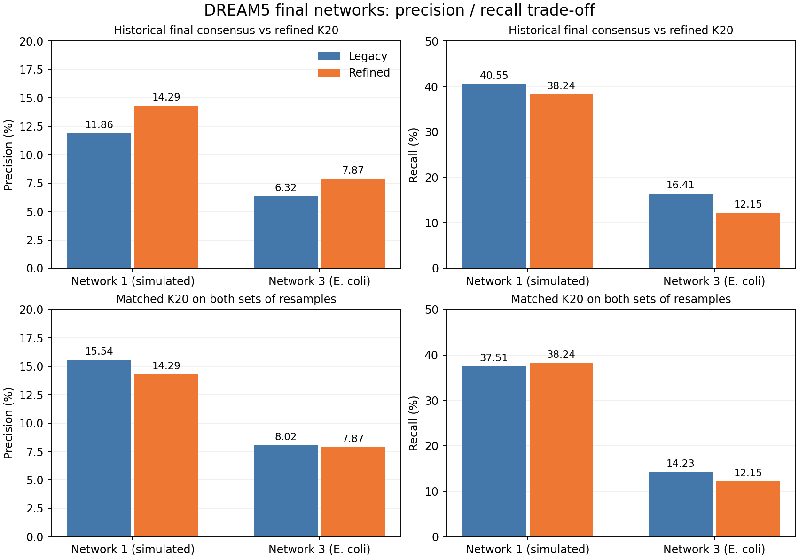
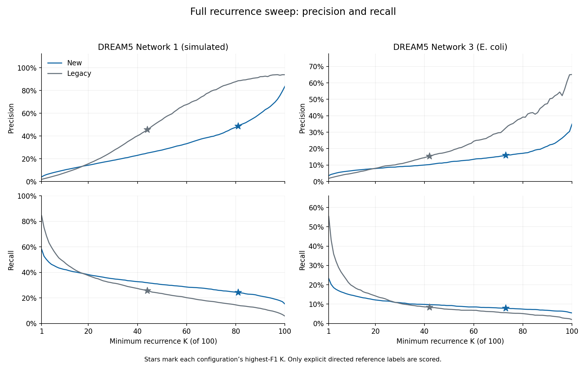
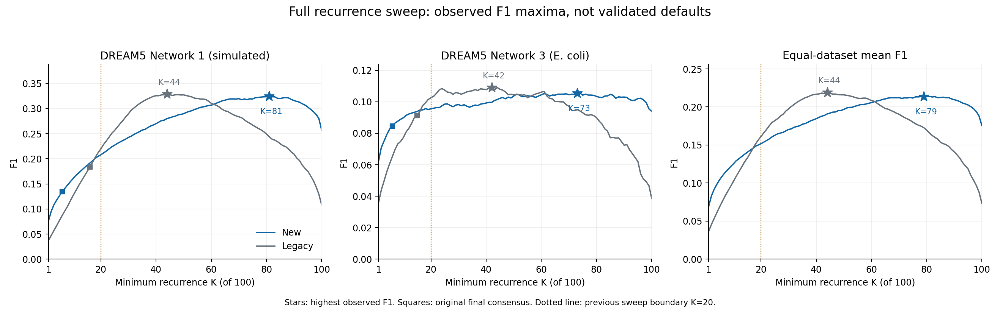
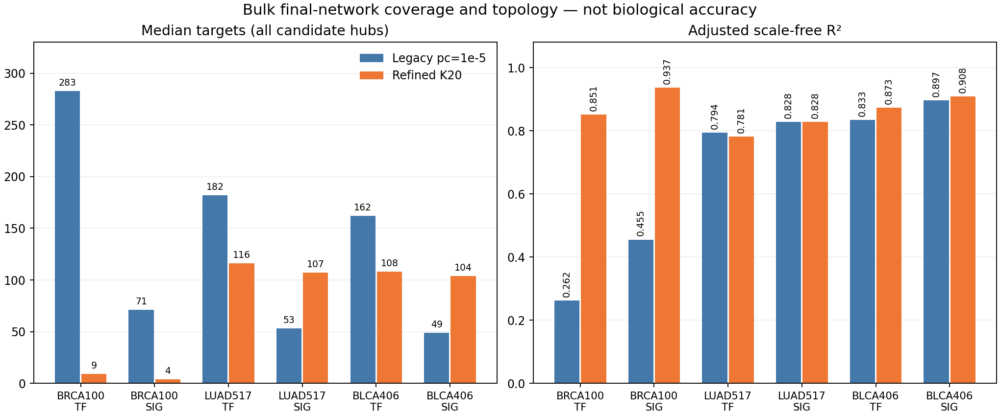

# Results: historical versus refined workflows with K20

[Process and definitions](README.md) · [Concise summary](../../docs/benchmark_summaries/legacy_refined_k20.md) · [All original QC figures](NETBID2_FIGURES.md)

Completed comparison across DREAM5 Networks 1 and 3, BRCA100, LUAD517 and
BLCA406. Every inference configuration contains 100 post-DPI resamples. BLCA's
four workflows and report extension completed on November 3, 2026. This PR
packages existing completed results; it launches no new scientific runs.

## 1. Primary DREAM5 final-network comparison

The legacy primary keeps its original p_c=1e-5 consensus. The refined primary
uses K20. Consequently, these are different full-workflow operating points.

| Dataset | Workflow / consensus | TP | FP | Precision | Recall | F1 | All emitted edges | Unlabeled edges |
| --- | --- | ---: | ---: | ---: | ---: | ---: | ---: | ---: |
| Network 1 | Legacy, p_c=1e-5 | 1,627 | 12,089 | 11.86% | 40.55% | 0.1836 | 15,202 | 1,486 |
| Network 1 | Refined, K20 | 1,534 | 9,200 | 14.29% | 38.24% | 0.2081 | 12,022 | 1,288 |
| Network 3 | Legacy, p_c=1e-5 | 339 | 5,021 | 6.32% | 16.41% | 0.0913 | 46,195 | 40,835 |
| Network 3 | Refined, K20 | 251 | 2,938 | 7.87% | 12.15% | 0.0955 | 27,719 | 24,530 |

Reference-negative FP decreases by 23.90% in Network 1 and 41.49% in Network 3.
TP also decreases by 5.72% and 25.96%, respectively. Precision and F1 improve at
these operating points, but recall falls. This is not uniform improvement.
Unlabeled predictions never enter FP; Network 3's biological reference is incomplete.

## 2. DREAM5 control: K20 applied to both workflows

| Dataset | Resample-generation configuration | TP | FP | Precision | Recall | F1 |
| --- | --- | ---: | ---: | ---: | ---: | ---: |
| Network 1 | Legacy, K20 | 1,505 | 8,177 | 15.54% | 37.51% | 0.2198 |
| Network 1 | Refined, K20 | 1,534 | 9,200 | 14.29% | 38.24% | 0.2081 |
| Network 3 | Legacy, K20 | 294 | 3,370 | 8.02% | 14.23% | 0.1026 |
| Network 3 | Refined, K20 | 251 | 2,938 | 7.87% | 12.15% | 0.0955 |

At matched K20, results are of comparable magnitude, but legacy has higher
precision and F1 on both datasets. Refined Network 1 retains 29 more TPs and
1,023 more FPs; refined Network 3 retains 43 fewer TPs and 432 fewer FPs.
No equivalence or noninferiority test was performed. Equal K removes the
consensus-rule difference, not the sampling and MI-cutoff differences.

## 3. Full K=1-100 trajectories and why K20

The refined workflow's highest observed F1 is at K81 for Network 1 and K73 for
Network 3. Those maxima recover only 24.33% and 7.89% of reference positives.
The legacy F1 maxima occur at K44 and K42, respectively. These benchmark-selected
maxima are exploratory, not independently validated settings.

K20 deliberately retains more edges and TPs than the refined F1 maxima. It is
a **practical precision/recall/coverage compromise**, not the accuracy optimum.
The proposed general operating point is **K=20 for B=100**, with explicit
overrides when target coverage or the analysis objective requires them.

All [400 metric rows](evidence/dream5_k_sweep.tsv), the
[equal-dataset mean-F1 trajectory](evidence/dream5_shared_K.tsv) and
[complete sweep analysis](evidence/dream5_k_analysis.json) are retained.
The original 80 K1-20 rows reproduce exactly in the full sweep; saved support
ledgers and original consensus metric checks passed. No MI or DPI reruns were
needed for either sweep. These are dependent resamples of two datasets, not
400 independent validation datasets.

## 4. Bulk primary comparison: coverage and topology

| Dataset | Network | Workflow / consensus | Edges | Active hubs | Median targets, all hubs | Median targets, active only | Adjusted scale-free R2 |
| --- | --- | --- | ---: | ---: | ---: | ---: | ---: |
| BRCA100 | TF | Legacy, p_c=1e-5 | 800,099 | 100.00% | 283 | 283 | 0.2624 |
| BRCA100 | TF | Refined, K20 | 77,020 | 98.66% | 9 | 9 | 0.8514 |
| BRCA100 | SIG | Legacy, p_c=1e-5 | 851,887 | 100.00% | 71 | 71 | 0.4552 |
| BRCA100 | SIG | Refined, K20 | 195,183 | 88.52% | 4 | 5 | 0.9368 |
| LUAD517 | TF | Legacy, p_c=1e-5 | 442,965 | 100.00% | 182 | 182 | 0.7939 |
| LUAD517 | TF | Refined, K20 | 291,735 | 99.95% | 116 | 116 | 0.7813 |
| LUAD517 | SIG | Legacy, p_c=1e-5 | 633,732 | 100.00% | 53 | 53 | 0.8279 |
| LUAD517 | SIG | Refined, K20 | 1,249,500 | 99.94% | 107 | 107 | 0.8279 |
| BLCA406 | TF | Legacy, p_c=1e-5 | 382,365 | 100.00% | 162 | 162 | 0.8335 |
| BLCA406 | TF | Refined, K20 | 264,148 | 100.00% | 108 | 108 | 0.8729 |
| BLCA406 | SIG | Legacy, p_c=1e-5 | 595,101 | 99.92% | 49 | 49 | 0.8967 |
| BLCA406 | SIG | Refined, K20 | 1,299,759 | 99.93% | 104 | 105 | 0.9080 |

LUAD and BLCA retain median target counts of roughly 100 under refined K20.
BLCA TF has no zero-target hubs; BLCA SIG has 7 of 9,428. BLCA TF edges decrease
30.92% versus legacy while SIG edges increase 118.41%. Both BLCA scale-free fits
increase modestly. LUAD TF R2 decreases slightly; LUAD SIG is essentially unchanged.
These results do not show uniformly better topology, and topology does not
establish biological accuracy.

### Changing K alone in the refined bulk workflow

| Dataset | Network | K6 edges | K20 edges | K6 median targets | K20 median targets | K6 adjusted R2 | K20 adjusted R2 |
| --- | --- | ---: | ---: | ---: | ---: | ---: | ---: |
| BRCA100 | TF | 454,591 | 77,020 | 110 | 9 | 0.8310 | 0.8514 |
| BRCA100 | SIG | 1,039,983 | 195,183 | 50 | 4 | 0.8807 | 0.9368 |
| LUAD517 | TF | 761,067 | 291,735 | 340 | 116 | 0.6947 | 0.7813 |
| LUAD517 | SIG | 3,090,642 | 1,249,500 | 292 | 107 | 0.7814 | 0.8279 |

BRCA100 is the clear **coverage exception**: K20 leaves 35 TF and 1,226 SIG
candidate hubs with no targets. Its high R2 does not compensate for median
regulons of 9 and 4. BRCA100 remains a bulk-expression dataset; these measurements
do not establish a single-cell-like mechanism or isolate sample size as the cause.
There is no BLCA K6 baseline in this study.

### Matched K20 bulk control

| Dataset | Network | Resamples | Edges | Median targets, all hubs | Adjusted R2 |
| --- | --- | --- | ---: | ---: | ---: |
| BRCA100 | TF | Legacy, K20 | 46,606 | 10 | 0.9157 |
| BRCA100 | TF | Refined, K20 | 77,020 | 9 | 0.8514 |
| BRCA100 | SIG | Legacy, K20 | 30,724 | 1 | 0.9584 |
| BRCA100 | SIG | Refined, K20 | 195,183 | 4 | 0.9368 |
| LUAD517 | TF | Legacy, K20 | 107,796 | 37 | 0.8439 |
| LUAD517 | TF | Refined, K20 | 291,735 | 116 | 0.7813 |
| LUAD517 | SIG | Legacy, K20 | 117,290 | 9 | 0.6786 |
| LUAD517 | SIG | Refined, K20 | 1,249,500 | 107 | 0.8279 |

These controls do not include BLCA. The legacy primary rows above retain the
original probability rule, not K20. Distinguishing the two avoids attributing
all differences to the inference engine.

## 5. Original NetBID2 figures

The [figure catalog](NETBID2_FIGURES.md) displays the target-size distribution
and scale-free diagnostic for each primary legacy/refined pair: six network
pairs and 24 original PNGs. They are extracted from the source QC HTMLs without
pixel changes. Target-size figures include only active hubs; use the all-hub
table above to assess zero-target coverage. Large HTMLs remain local.

## Conditional conclusion and proposed default

**Recommend K=20 as the default for the standard B=100 refined workflow**, while
keeping K explicitly configurable and requiring users to inspect target coverage.
This is an engineering choice that balances reference-negative predictions,
TP recovery and retained regulon sizes, not a validated universal error threshold.

Compared with the historical final networks, refined K20 improves DREAM precision
and F1 at the cost of recall. At matched K20, legacy precision and F1 remain
slightly higher, so no uniformly superior inference accuracy is claimed. LUAD
and BLCA retain substantially larger regulons than BRCA100. The BRCA coverage
exception remains visible and can require a lower user-selected K; the results
do not establish that these networks behave like single-cell data.

K20 was selected after inspecting the DREAM trajectories. It is not the
F1-maximizing K, independently confirmed, equivalent to a p-value, or biological
FDR control. Fixed K/B does not guarantee equal accuracy across sample sizes,
cutoffs, densities or data types. The bulk cohorts lack reference edges and do
not validate direct-edge precision/recall or downstream activity robustness.

**Implementation boundary:** this benchmark PR records the proposed default.
Changing SJARACNe's runtime defaults and examples requires a separate engine PR
with regression tests. No scientific outputs or engine defaults are changed here.
