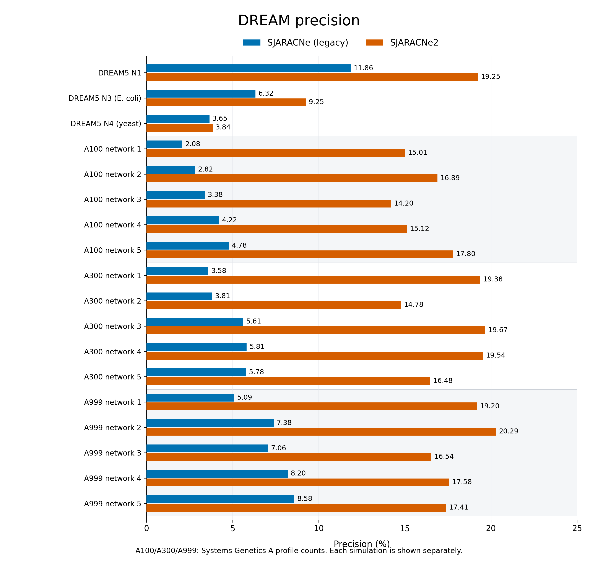
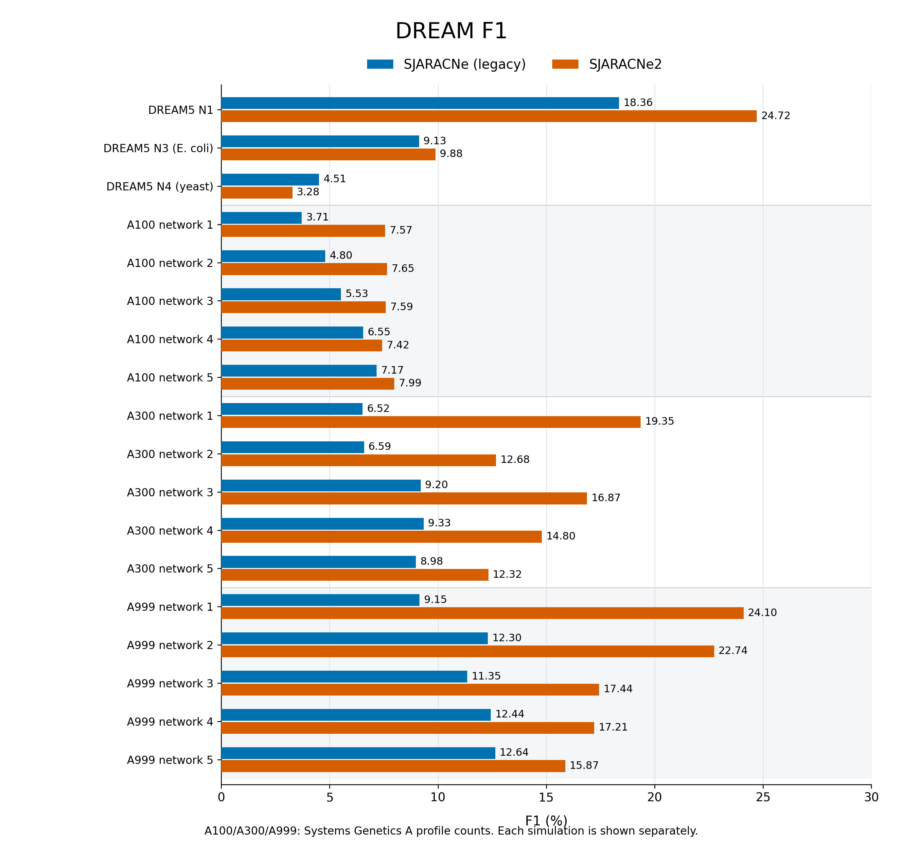
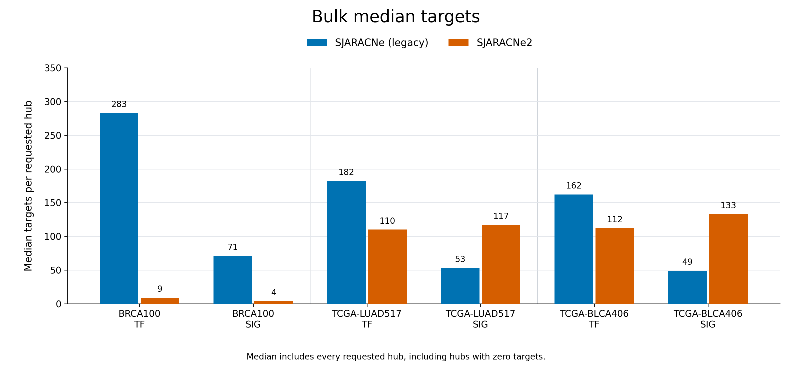
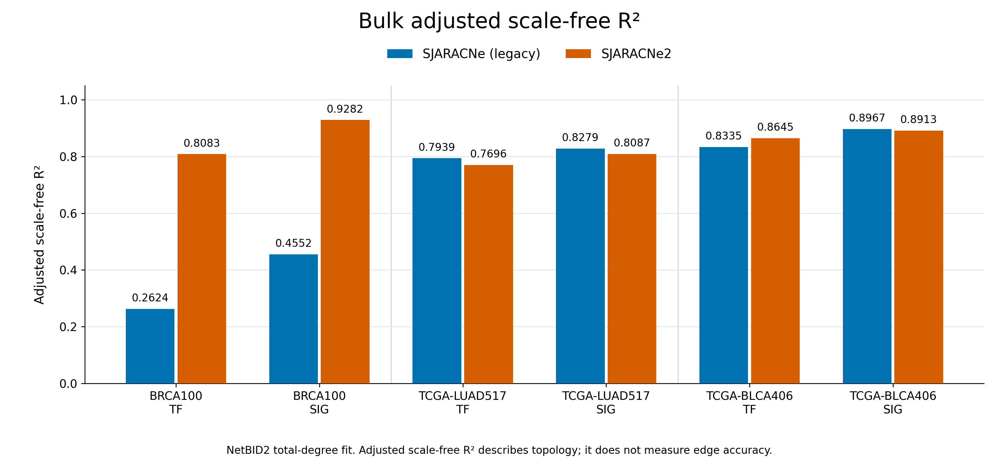

# Comparison bar plots

Paired bars compare pre-sampling-change **SJARACNe (legacy)** with **SJARACNe2**
using the [main report](../README.md)'s matched inputs and workflow definitions.
Blue denotes legacy SJARACNe and orange denotes SJARACNe2.

## DREAM precision



Download [PDF](dream_precision.pdf) or [SVG](dream_precision.svg).

## DREAM F1



Download [PDF](dream_f1.pdf) or [SVG](dream_f1.svg).

Precision and F1 are percentages. N1/N3/N4 and all 15 Systems Genetics A
simulations are shown separately. A100/A300/A999 denote simulation profile
counts. No averaging or pooling across networks is applied.

## Bulk median targets



Download [PDF](bulk_median_targets.pdf) or [SVG](bulk_median_targets.svg).

Median targets includes all requested hubs, including zero-target hubs.

## Bulk adjusted scale-free R²



Download [PDF](bulk_adjusted_scale_free_r2.pdf) or [SVG](bulk_adjusted_scale_free_r2.svg).

Adjusted scale-free R² is the existing NetBID2 degree-fit statistic. It describes
network topology and does not establish biological edge accuracy. Both bulk
figures use BRCA100, TCGA-LUAD517 and TCGA-BLCA406, with separate TF/SIG panels.

All bar axes start at zero. Labels show two decimal places for percentages,
the recorded median counts and four decimal places for R². Exact values are in
[plot_values.tsv](plot_values.tsv), copied from [comparison.tsv](../comparison.tsv)
with only percentage conversion. No networks or metrics were recomputed.

[Provenance](provenance.json) · [Plotting script](plot_bars.py)

```bash
python plot_bars.py
```

The script requires NumPy and Matplotlib and reads only the parent comparison
table. It writes PNG, PDF and SVG versions of all four figures.
