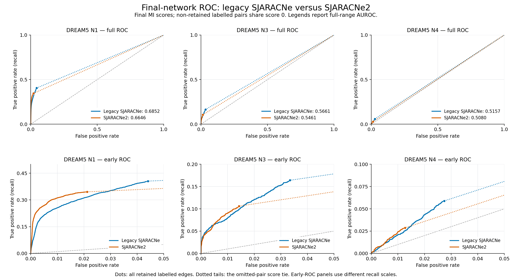
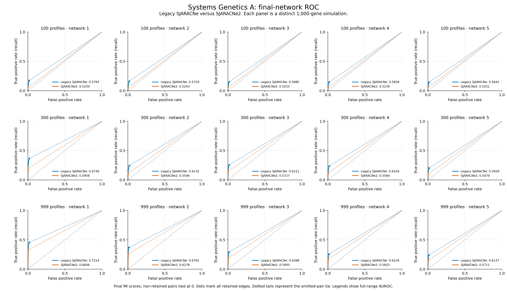
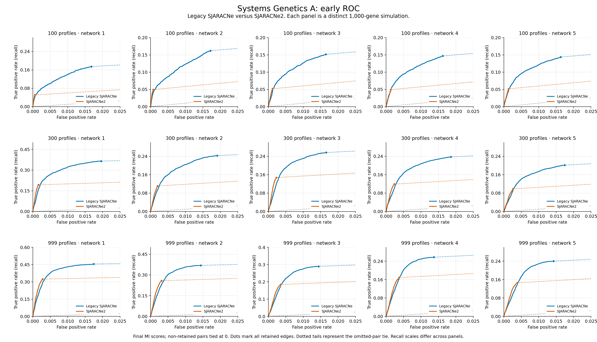

# DREAM ROC curves

ROC curves compare the same final networks as the [main report](../README.md):
actual pre-sampling-change legacy SJARACNe and the SJARACNe2 consensus-first
K20, supporting-run mean MI, dynamic DPI offset +0.025 method.

## Classic DREAM



Download [PDF](dream_classic_roc.pdf) or [SVG](dream_classic_roc.svg).

## Systems Genetics A



Download [PDF](dream_sysgen_a_roc.pdf) or [SVG](dream_sysgen_a_roc.svg).



Download the early-ROC [PDF](dream_sysgen_a_roc_zoom.pdf) or [SVG](dream_sysgen_a_roc_zoom.svg).
Each panel is a separate simulation. Early-ROC panels have different recall
scales to show their retained-edge rankings.

## AUROC comparison

| Dataset | Profiles | Legacy AUROC | SJARACNe2 AUROC | Difference |
| --- | ---: | ---: | ---: | ---: |
| DREAM5_N1 | 805 | 0.685237 | 0.664615 | -0.020621 |
| DREAM5_N3 | 805 | 0.566117 | 0.546143 | -0.019975 |
| DREAM5_N4 | 536 | 0.515727 | 0.508015 | -0.007711 |
| DREAM5_SysGenA100_Network1 | 100 | 0.579335 | 0.524993 | -0.054342 |
| DREAM5_SysGenA100_Network2 | 100 | 0.572915 | 0.524344 | -0.048571 |
| DREAM5_SysGenA100_Network3 | 100 | 0.568019 | 0.525307 | -0.042712 |
| DREAM5_SysGenA100_Network4 | 100 | 0.565828 | 0.523918 | -0.041910 |
| DREAM5_SysGenA100_Network5 | 100 | 0.564158 | 0.525078 | -0.039080 |
| DREAM5_SysGenA300_Network1 | 300 | 0.674916 | 0.595800 | -0.079116 |
| DREAM5_SysGenA300_Network2 | 300 | 0.613164 | 0.554553 | -0.058610 |
| DREAM5_SysGenA300_Network3 | 300 | 0.621080 | 0.572719 | -0.048361 |
| DREAM5_SysGenA300_Network4 | 300 | 0.610433 | 0.558378 | -0.052056 |
| DREAM5_SysGenA300_Network5 | 300 | 0.592934 | 0.547905 | -0.045029 |
| DREAM5_SysGenA999_Network1 | 999 | 0.721426 | 0.660586 | -0.060840 |
| DREAM5_SysGenA999_Network2 | 999 | 0.679084 | 0.627838 | -0.051246 |
| DREAM5_SysGenA999_Network3 | 999 | 0.638799 | 0.590504 | -0.048294 |
| DREAM5_SysGenA999_Network4 | 999 | 0.622622 | 0.582458 | -0.040164 |
| DREAM5_SysGenA999_Network5 | 999 | 0.613677 | 0.571069 | -0.042608 |

Download [all metrics](auroc.tsv) and [exact ROC points](roc_points.tsv.gz).

## Interpretation and scoring

Legacy final-network AUROC is higher in all 18 settings. This differs from
the F1 comparison, where SJARACNe2 wins in 17/18 settings. SJARACNe2 reduces
false positives, but also retains fewer true positives. Most eligible pairs
are omitted by both methods and share a bottom score. Full-range AUROC
therefore reflects final-network selection and recall as well as MI ranking.
Earlier raw-MI ROC results evaluate a different stage.

- Scores are the actual saved final MI values. MI thresholds are swept over
  retained edges; all non-retained eligible pairs have score zero. Dots mark
  the operating point using every retained labelled edge. Dotted tails show
  the large zero-score tie. Ties receive half credit; no ordering is invented
  within them. The grey diagonal is AUROC 0.5.
- N1/N3/N4 use only explicitly labelled directed reference pairs. Unlabelled
  calls are excluded rather than assigned negative truth. Systems Genetics A
  uses all 999,000 directed nonself pairs, with negatives inferred from its
  complete generating-model gold network. Both versions use identical labels.
- Legacy final MI was serialized to four decimals. These ties are preserved.
  Modern adjacency precision is retained; N1/N3 raw inputs retain their older
  six-digit serialization. No scores were jittered or regenerated.
- These are local fixed-universe AUROCs, not the official DREAM calibrated
  challenge score. N3/N4 references are incomplete. No pooled ROC or confidence
  interval is inferred from these distinct networks.

All 36 TP/FP counts reproduce the main report. AUROC agrees between
scikit-learn, an independent tie-aware Mann–Whitney calculation and integration
of the exact ROC points to within 1e-14. Final graph SHA-256 hashes match the
recorded report. No inference, raw-MI reads or environment changes were needed.

[Provenance and exact versions](provenance.json) ·
[Reproducible plotting script](plot_dream_roc.py)

```bash
python plot_dream_roc.py
```

The script reads the external final graphs and gold/input lists identified in
the parent report's `dream_provenance.json`. NumPy, scikit-learn and Matplotlib
must already be installed. Numeric plotting points are included for reuse.
