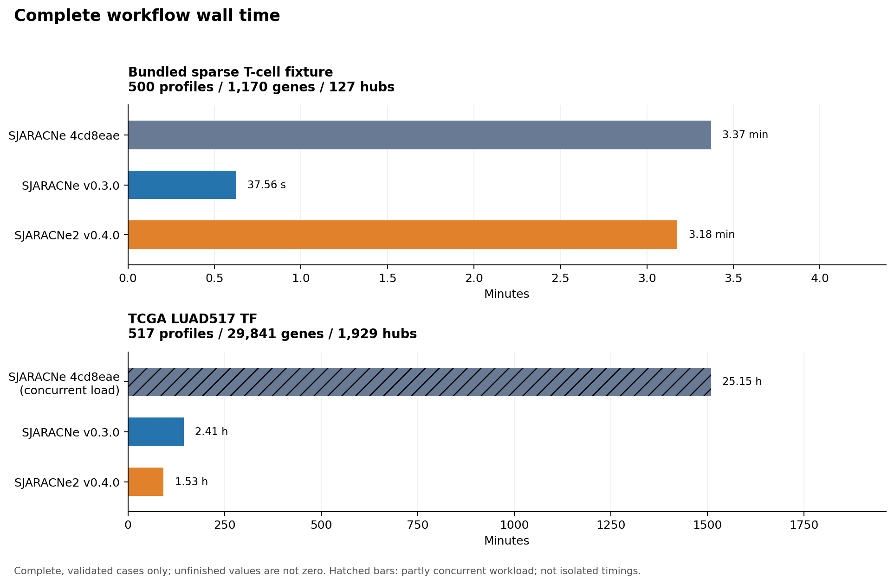
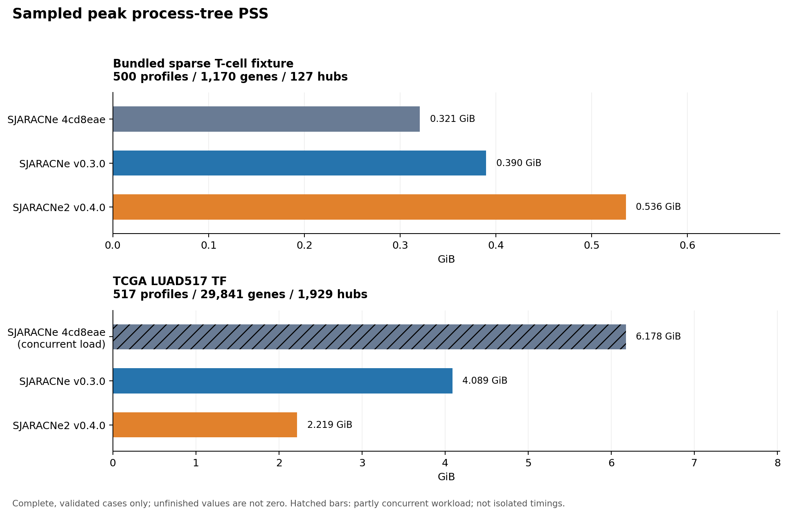
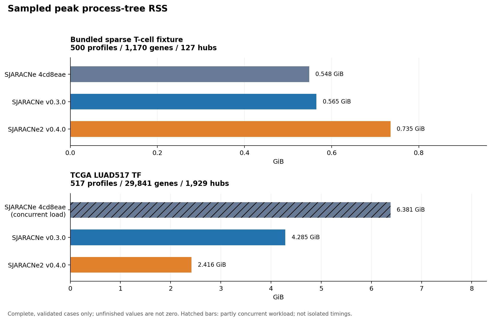
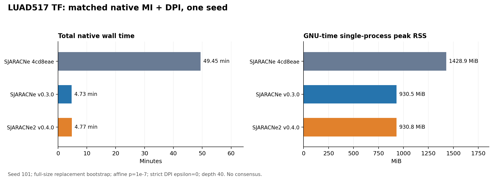
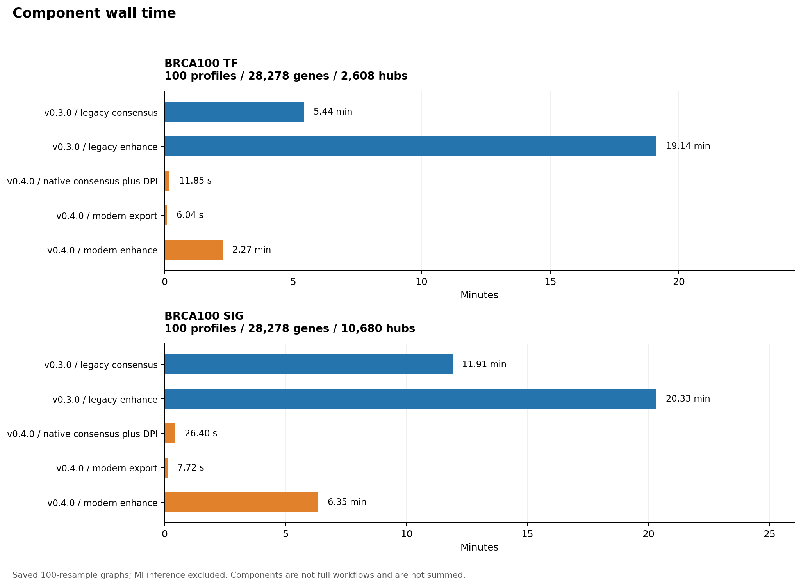
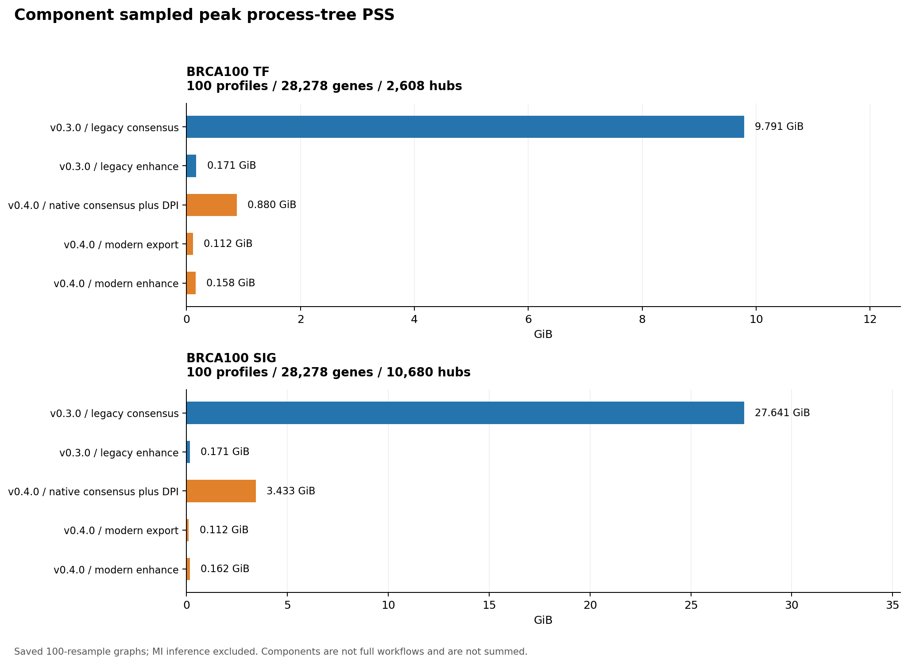
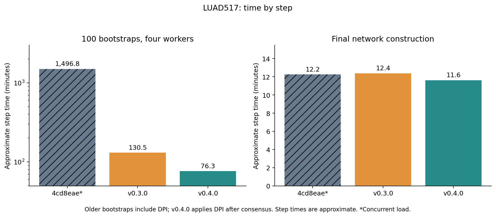
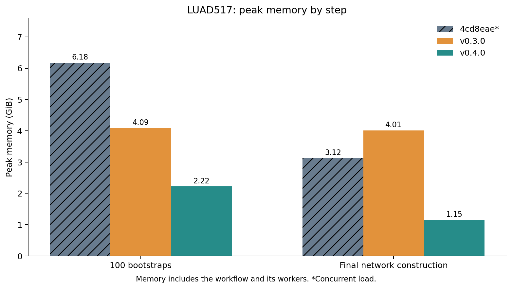

# SJARACNe performance: 4cd8eae, v0.3.0 and v0.4.0

Updated 2026-11-12 15:56 UTC. **6 of 6 full CLI cases completed and passed output validation.** Component replays: **10 of 10** complete. Matched native controls: **3 of 3** complete. Runner state: `complete`.

This benchmark compares the complete CLI workflows and their default scientific profiles on matched inputs. Changes in sampling, MI calibration, consensus and DPI are part of the comparison; full-workflow results do not isolate C++ optimization.

## Versions and methods

| Version | Pinned commit | Scientific process |
| --- | --- | --- |
| [SJARACNe 4cd8eae](https://github.com/jyyulab/SJARACNe/commit/4cd8eae2d63eebad8f4329bd907c7fb8877ebc29) | `4cd8eae` | Full-size replacement bootstraps; strict DPI per resample; historical probability consensus. |
| [SJARACNe v0.3.0](https://github.com/jyyulab/SJARACNe/releases/tag/v0.3.0) | `12113fbc` | Full-size replacement bootstraps; strict DPI per resample; historical probability consensus. |
| [SJARACNe2 v0.4.0](https://github.com/adamdingliang/SJARACNe2/releases/tag/v0.4.0) | `8c0c1e0` | 100 x 80% resamples without replacement; K20 candidates; supporting-run mean MI; DPI with offset 0.025. |

The upstream v0.3.0 tag still contains package metadata version 0.2.1. Exact commits and source fingerprints identify the tested versions. The linked SJARACNe2 release is **v0.4.0**.

## Inputs and execution

Cases use the same expression and hub files across versions. Build, installation, input staging, report generation and NetBID2 QC are excluded from timing. Each full CLI case includes the CLI invocation and workflow overhead. Benchmark cases run sequentially with the same four-worker limit and storage placement; any concurrent external workload is identified below and on affected rows; native controls and component replays use one worker. Numerical-library thread limits are one. Page caches are not forcibly cleared, so run order and cache effects remain. One repetition per case makes this an exploratory performance comparison.

| Execution setting | Value |
| --- | --- |
| CPU | Intel(R) Core(TM) i7-10700F CPU @ 2.90GHz |
| Affinity | 0, 1, 2, 3 (logical CPU IDs) |
| Memory visible to WSL | 94.30 GiB |
| Storage | E: Samsung SSD 990 EVO Plus NVMe; WSL DrvFS/9p, all versions same storage |
| Repetitions | 1 |

**Concurrent-workload exception:** MIBC372 reconstruction was started alongside the remaining original-commit LUAD workflow at user request. The affected case is marked **[concurrent load]** in tables and plots. The CPU affinity masks are disjoint, while cache, memory bandwidth, power and SSD remain shared. Its observed values and output validation remain available; its timing is excluded from isolated cross-version rankings. The completed v0.3.0 and v0.4.0 LUAD measurements retain their sequential execution conditions.

| Affected case | Concurrent work started (UTC) | Benchmark logical CPUs | MIBC372 logical CPUs |
| --- | --- | --- | --- |
| LUAD517_commit_4cd8eae | 2026-11-11T03:43:37.653081+00:00 | 0, 1, 2, 3 | 4, 5, 6, 7, 8, 10, 12, 14 |

See the [concurrent-workload receipt](concurrent_workloads.json). The start marks release into preflight and includes source checks, build, inference and QC, so no unaffected segment is substituted for the full-case time.

| Dataset | Scope | Profiles | Genes | Hubs |
| --- | --- | --- | --- | --- |
| Tcell_sparse | sparse fixture | 500 | 1170 | 127 |
| LUAD517 | bulk | 517 | 29841 | 1929 |

The bundled sparse T-cell test fixture is included to examine computational behavior on sparse inputs. Its cell provenance and independent biological ground truth have not been established. It is **not a validated scRNA-seq benchmark**, and these timings do not establish single-cell inference accuracy or performance across other scRNA-seq datasets.

## Overall comparison

| Dataset | Version | State | Wall (min) | Clock | CPU (min) | Peak tree PSS (GiB) | Peak tree RSS (GiB) | Largest-process RSS (GiB) |
| --- | --- | --- | --- | --- | --- | --- | --- | --- |
| Tcell_sparse | SJARACNe 4cd8eae | Complete | 3.37 | GNU time | 12.51 | 0.321 | 0.548 | 0.144 |
| Tcell_sparse | SJARACNe v0.3.0 | Complete | 0.63 | GNU time | 1.18 | 0.390 | 0.565 | 0.152 |
| Tcell_sparse | SJARACNe2 v0.4.0 | Complete | 3.18 | GNU time | 4.45 | 0.536 | 0.735 | 0.128 |
| LUAD517 | SJARACNe2 v0.4.0 | Complete | 91.92 | GNU time | 299.41 | 2.219 | 2.416 | 0.900 |
| LUAD517 | SJARACNe v0.3.0 | Complete | 144.63 | GNU time | 530.52 | 4.089 | 4.285 | 3.803 |
| LUAD517 | SJARACNe 4cd8eae [concurrent load] | Complete | 1,509.15 | GNU time | 5,960.58 | 6.178 | 6.381 | 2.972 |

`NA` means pending, unavailable or excluded because the case failed. Failed or interrupted elapsed times are not treated as completed pipeline measurements.

**Clock basis:** primary wall time is GNU-time elapsed seconds, checked against the UTC start/finish interval. If GNU time is unavailable, the report uses a valid UTC interval, then the runner monotonic value as a labelled last fallback. In the three completed sparse-fixture cases, the recorded Python monotonic durations were about 2.5% shorter than GNU time, while GNU time and UTC agreed within 0.014 seconds. The cause has not been established. Raw measurements are unchanged; the Clock column and TSV fields retain the selected source and original clocks. Sampled phase activity remains approximate runner-clock activity.

PSS divides shared resident pages among processes and is the preferred process-memory comparison. RSS sums process resident sets and can count shared pages more than once. Both tree peaks are sampled at 0.5-second intervals and can miss short peaks. They exclude the filesystem page cache and the rest of Windows/WSL. GNU-time RSS is the lifetime maximum of the largest individual process, not simultaneous memory across all workers. Memory scheduling requests are not measured usage.







## Matched native control

A separate LUAD517 TF control runs one native seed (101) with identical full-size replacement sampling, affine MI cutoff at p=1e-7, strict DPI tolerance 0 and depth 40 in all three versions. This isolates the native MI/DPI implementation more closely than the default-workflow comparison. It excludes consensus and workflow overhead. One seed is exploratory and is **not extrapolated to a measured 100-resample pipeline time**.

| Version | State | Total native wall (s) | Clock | GNU-time peak RSS (MiB) | Reported MI (s) | Reported DPI (s) |
| --- | --- | --- | --- | --- | --- | --- |
| SJARACNe 4cd8eae | Complete | 2,966.86 | GNU time | 1,428.88 | 2,862 | 96 |
| SJARACNe v0.3.0 | Complete | 283.80 | GNU time | 930.48 | 203 | 72 |
| SJARACNe2 v0.4.0 | Complete | 286.43 | GNU time | 930.83 | 203 | 76 |

The native MI and DPI columns come from integer-second `std::time` (CLOCK_REALTIME) messages inside the executable; they exclude input loading and output writing. They need not sum to total measured native process time.



## Component replays

These BRCA100 TF/SIG replays reuse the frozen 100-resample graphs for each method. They measure original release functions in fresh processes, or the native consensus/DPI executable, without rerunning MI. Runtime includes that component process and imports. Graph staging and validation are excluded. These are **component measurements, not reconstructed full-pipeline timings**. Different output density is part of the released scientific methods.

| Dataset | Version | Component | State | Wall (min) | Clock | Peak tree PSS (GiB) | Peak tree RSS (GiB) |
| --- | --- | --- | --- | --- | --- | --- | --- |
| BRCA100_TF | v0.3.0 | legacy consensus | Complete | 5.44 | GNU time | 9.791 | 9.798 |
| BRCA100_TF | v0.3.0 | legacy enhance | Complete | 19.14 | GNU time | 0.171 | 0.179 |
| BRCA100_TF | v0.4.0 | native consensus plus DPI | Complete | 0.20 | GNU time | 0.880 | 0.883 |
| BRCA100_TF | v0.4.0 | modern export | Complete | 0.10 | GNU time | 0.112 | 0.120 |
| BRCA100_TF | v0.4.0 | modern enhance | Complete | 2.27 | GNU time | 0.158 | 0.166 |
| BRCA100_SIG | v0.3.0 | legacy consensus | Complete | 11.91 | GNU time | 27.641 | 27.649 |
| BRCA100_SIG | v0.3.0 | legacy enhance | Complete | 20.33 | GNU time | 0.171 | 0.178 |
| BRCA100_SIG | v0.4.0 | native consensus plus DPI | Complete | 0.44 | GNU time | 3.433 | 3.436 |
| BRCA100_SIG | v0.4.0 | modern export | Complete | 0.13 | GNU time | 0.112 | 0.120 |
| BRCA100_SIG | v0.4.0 | modern enhance | Complete | 6.35 | GNU time | 0.162 | 0.170 |






## Step-level LUAD comparison

[Step-level tables, figures and reproducible analysis](steps/README.md) compare the three completed LUAD workflows using their existing logs and sampled process records. The comparison maps MI and DPI to their actual positions in each workflow, and reports peak process-tree PSS during each observed step.





Step durations use the original sampler clock and are approximate; full-workflow wall times above use GNU time. The observed clock difference is documented in the step report. Steps can overlap and should not be added to reconstruct total runtime.

The original [generic process-class table](phases.tsv) and [activity figure](figures/phase_activity.png) remain diagnostic records. Their coarse classifier included the v0.3.0 module-based Python consensus under the workflow-controller class. The step report identifies that command correctly and supersedes those generic labels for scientific-stage interpretation.

## Interpretation

For **Tcell_sparse**, SJARACNe v0.3.0 had the shortest observed workflow time (37.56 s). The lowest observed peak process-tree PSS was 0.321 GiB with SJARACNe 4cd8eae.

For **LUAD517**, SJARACNe 4cd8eae [concurrent load] ran partly under concurrent external load. Its measured values are retained, but this report assigns no cross-version workflow winner for that dataset. The sequential v0.3.0 and v0.4.0 cases can be compared independently.

These observations apply to this machine, storage, concurrency and input set. One repetition does not estimate run-to-run variation. Changes in network density and scientific defaults can change both runtime and memory; timing alone does not rank network quality.

## Recorded issues

- Tcell_sparse_v0_4_0: Some polling samples lacked complete process PSS; inspect timeseries and probe counters
- LUAD517_v0_4_0: Some polling samples lacked complete process PSS; inspect timeseries and probe counters

## Historical context

Earlier records used different dates, storage and concurrent workloads. They are context only; no controlled speedup ratio is calculated from them.

| Historical v0.3.0-equivalent arm | Timed seeds | Median native MI + DPI (s) | Median single-process peak RSS (MiB) |
| --- | --- | --- | --- |
| LUAD517_SIG_legacy | 100 | 3,087.70 | NA |
| LUAD517_TF_legacy | 100 | 492.91 | NA |
| BRCA100_TF_legacy | 100 | 136.90 | 323.64 |
| BRCA100_SIG_legacy | 100 | 650.33 | 905.79 |

LUAD RSS was not recorded. BRCA100 RSS is GNU-time lifetime maximum per native process. Summed per-seed elapsed times are not pipeline wall time.

| Historical sequential replay | Stage | Minutes |
| --- | --- | --- |
| LUAD517_SIG | native consensus plus DPI | 24.37 |
| LUAD517_SIG | Python enhancement | 34.36 |
| LUAD517_SIG | NetBID2 QC | 4.69 |

This replay used saved 100-resample MI graphs on D: HDD and a pre-release sequential reader. It excludes MI inference and earlier interrupted work, and has no matched lifetime peak-memory measurement. NetBID2 QC is listed separately from inference.

## Files and reproducibility

- [Full CLI measurements](overall.tsv), [component measurements](components.tsv), [matched native controls](matched_native.tsv), [phase measurements](phases.tsv), and [plot values](plot_values.tsv).
- [Report provenance](report_provenance.json) records input JSON fingerprints and metric definitions.
- Each figure is provided as PNG, PDF and SVG in [figures/](figures/).
- Raw expressions, resample graphs, environments and workflow scratch remain outside this repository.
- Rebuild with the runner JSON files:

```powershell
python build_report.py --plan PATH_TO_PLAN_JSON --measurements PATH_TO_MEASUREMENTS_JSON --status PATH_TO_STATUS_JSON
```
