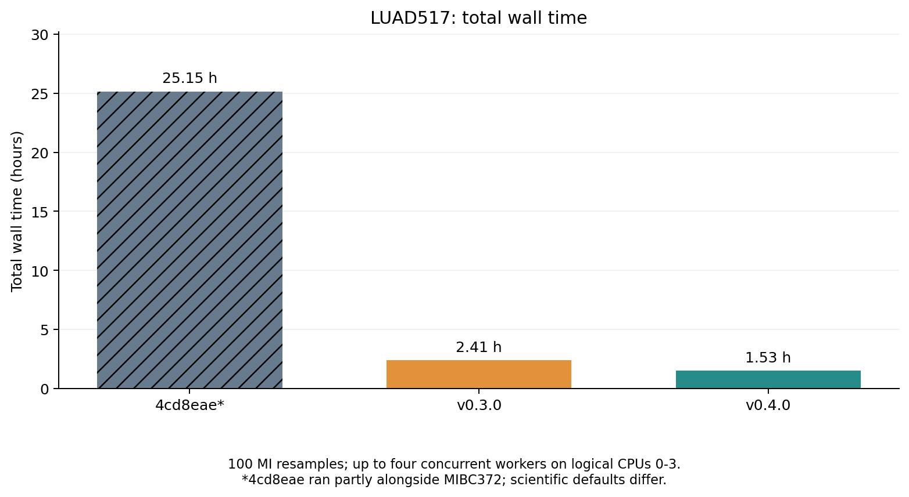
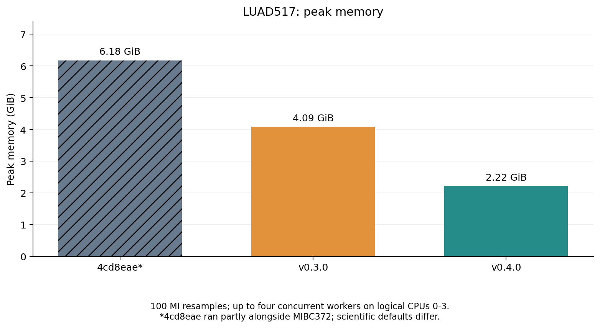
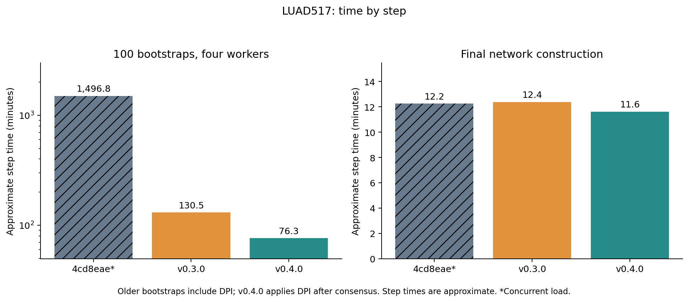
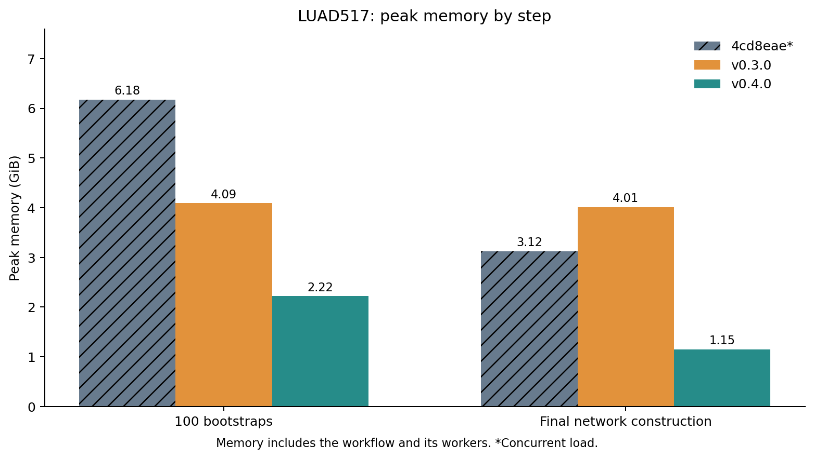
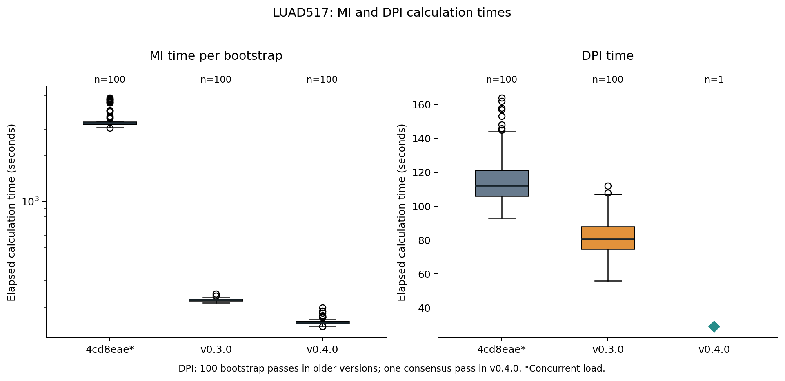

# LUAD517 step comparison: three SJARACNe versions

All numbers below reuse the completed four-worker LUAD517 TF runs: 29,841 genes, 517 profiles and 1,929 requested hubs. No inference was rerun. This analysis supplements the [overall report](../README.md).

## Whole workflows

| Version | Total wall time | Peak memory |
| --- | --- | --- |
| 4cd8eae* | 25:09:09 | 6.178 GiB |
| v0.3.0 | 2:24:38 | 4.089 GiB |
| v0.4.0 | 1:31:55 | 2.219 GiB |





The bar plots use the values in the table; both axes start at zero. Exact plotted values are in [whole_workflows.tsv](whole_workflows.tsv).

`*` The original-commit workflow ran partly alongside MIBC372 on disjoint CPU allocations. Cache, memory bandwidth, package power and SSD remained shared. Its observations are retained without claiming an isolated cross-version speedup. Scientific defaults differ between releases, including sampling, MI calibration and consensus/DPI order.

## Step comparison

The plots compare **100 bootstraps** and **final network construction**. In `4cd8eae` and v0.3.0, each bootstrap computes MI and applies DPI; consensus and annotation follow. In v0.4.0, bootstraps compute MI only. The final step keeps edges supported by at least 20 bootstraps, averages MI over the supporting bootstraps, applies DPI and adds annotations.

Step times are approximate and may overlap. The DPI plot contains 100 bootstrap-level measurements for each older version and one consensus-level measurement for v0.4.0.







## Data and reproduction

[Overall values](whole_workflows.tsv), [Step measurements](steps.tsv), [MI/DPI timings](native_timers.tsv), [Measurement provenance](provenance.json), [Analysis script](build_steps.py)

Plots are available as PNG, PDF and SVG in [figures/](figures/).

```powershell
python build_steps.py --raw-root E:/GitHub/local_runs/sjaracne_performance_20261110/three_versions
```
