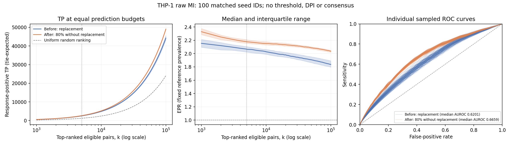

# THP-1 primary result: raw-MI response ranking, 100 matched pairs

Fixed-size 80% sampling without replacement improved raw-MI ranking against
this frozen reconstructed THP-1 perturbation-response reference. Median
TP@5,000 increased from **2,487.50 to 2,624.25**, and median full-ranking AUROC
from **0.620105 to 0.665936**. TP@5,000 improved in **96/100 pairs** and worsened
in four; AUROC improved in **100/100**.

This is the primary THP-1 **analysis**, before MI significance filtering, DPI
or consensus. It is not direct-edge biological validation, exact scMINER
Fig. 6a reproduction, or proof that the whole SJARACNe workflow improved.
The older mixed/unfavorable filtered-workflow results remain complementary
evidence, linked below.

## Design, decision history and endpoint

- The two arms use the same 121 non-targeting-cell metacells, 17,971 genes,
  original 6,951-SIG annotation, reconstructed response labels and estimator
  settings. Before uses **121 draws with replacement**; after uses **97 distinct
  metacells (80%)**. Observation count and RNG consumption change too, so this
  does not isolate replacement alone at identical sample size.
- The baseline is the paper-era proxy at `2922ec9a57d3da4e88b849b840643f543f49807c`;
  the after binary applies only the sampling additions from
  `3a93d10e862ba43229e60ca6491ee38143422379`. This is not a comparison of every
  change in PR70 or PR71. Native binaries/configurations remain pinned.
- Raw flags are `-p 1 -t 0 -e 1`, with AP depth 40 and no measurement-noise
  correction. There is **no significance filtering, DPI or consensus** in
  either arm. Each resample is ranked separately; MI is not averaged or pooled.
- Only the **272 eligible source rows** are computed, retaining all genes and
  the full SIG annotation. Pairwise code inspection and engineering tests
  verified subset/expanded/reordered-source equivalence without DPI. This is
  not a full-6,951-source empirical run or an optimization usable with DPI.
- All seed IDs **1–100** are included in both arms. The original 20 randomly
  selected pairs were retained; the other 80 pairs were newly computed with
  12 workers: **200 completed jobs, zero failures, no reruns of those 40 pilot
  jobs**. Shared integer IDs do not imply identical sampled observations/noise.
- **TP@5,000 remains the primary endpoint**, declared before pilot scoring.
  The other original budgets were 1k, 10k, 50k and 100k; full-ranking AUROC is
  supporting. Every 1k through 100k was already saved on the curve grid.
  The 20k/30k rows below are descriptive displays of those exact saved points,
  not replacement primary endpoints or interpolated scores.

The user requested the 100-pair extension **after reviewing the 20-pair pilot**,
then designated the completed raw-MI analysis as the primary THP-1 result on
2026-10-15. The 100-pair result includes the pilot and is not independent
confirmation or a fully preregistered experiment. The pilot remains an
[unchanged historical snapshot](../results_2026-10-15_pilot20/README.md),
including decisions stated as of its completion. See the
[process](../README.md) and [extension protocol](../EXTENSION_100.md).

## Fixed universe and scoring

The fixed universe contains **4,887,840 eligible non-self source-target pairs**:
**1,177,495 response-positive** and **3,710,345 operational-negative** pairs.
Every eligible pair is evaluated, not just edges surviving a threshold.
Reference positives may reflect indirect responses; negatives are absence of
the defined response label, not proven biological non-regulation.

The full prepared positive list contains 1,177,736 pairs before excluding
240 positive self-pairs and one positive target outside the inference genes.
The older **17,727** figure is the baseline's recovered positive matches in
one filtered consensus network, **not** the reference's total positive count.

Equal serialized native MI scores remain tied. A top-k boundary tie contributes
its expected TP under uniform within-tie ordering, so counts can be fractional.
Computed zero-MI omissions enter the zero tie only after successful complete
native output validation. AUROC gives tied positive-negative pairs half credit
and uses all MI groups, not just plotted coordinates.

Random precision is fixed at `1,177,495 / 4,887,840 = 0.2409029346` in both arms.
**EPR@k = (TP@k / k) / random precision**; no separate random graph is simulated.
At fixed k, FP = k − TP. Precision, sensitivity, specificity and EPR are related
views of the same counts, not independent confirmations of an improvement.

## Results across prediction budgets

All entries are **medians across 100 resamples**, shown as **before → after**.
They are not a pooled network or counts of unique consensus edges.

| k | TP | FP | Precision | EPR | Pairs with higher TP |
| ---: | ---: | ---: | ---: | ---: | ---: |
| 1,000 | 519.00 → 561.25 | 481.00 → 438.75 | 51.90% → 56.13% | 2.1544 → 2.3298 | 95/100 |
| 5,000 | 2,487.50 → 2,624.25 | 2,512.50 → 2,375.75 | 49.75% → 52.49% | 2.0651 → 2.1787 | 96/100 |
| 10,000 | 4,885.50 → 5,184.50 | 5,114.50 → 4,815.50 | 48.86% → 51.85% | 2.0280 → 2.1521 | 99/100 |
| 20,000 | 9,547.17 → 10,279.03 | 10,452.83 → 9,720.97 | 47.74% → 51.40% | 1.9815 → 2.1334 | 100/100 |
| 30,000 | 14,065.50 → 15,298.90 | 15,934.50 → 14,701.10 | 46.89% → 51.00% | 1.9462 → 2.1169 | 100/100 |
| 50,000 | 22,976.00 → 25,141.60 | 27,024.00 → 24,858.40 | 45.95% → 50.28% | 1.9075 → 2.0873 | 100/100 |
| 100,000 | 44,270.90 → 49,064.75 | 55,729.10 → 50,935.25 | 44.27% → 49.06% | 1.8377 → 2.0367 | 100/100 |

At the primary budget, the **median paired TP change is +134.67**
(IQR +97.25 to +190.63), with the opposite FP change. This is not the
difference between the two marginal medians in the table. The corresponding
median paired precision increase is **2.6933 percentage points**.

Full-ranking AUROC medians are **0.620105 before** and **0.665936 after**;
the median paired change is **+0.047204** (IQR +0.035983 to +0.056369).
AUROC improved in all 100 pairs, with the smallest paired increase +0.010209.
This AUROC covers the entire fixed universe and is not AUROC at a particular k.
IQRs describe computational resampling variation, not biological confidence
intervals; no significance p-value is inferred from these 100 overlapping runs.

TP/EPR lines show medians with IQR bands; the dashed TP line is the analytic
uniform-ranking expectation. ROC lines are individual resamples on the saved
common-FPR grid, not one averaged ROC. TP/EPR panels cover 1k–100k; ROC/AUROC
cover the full universe. The dotted top-k marker is the primary k=5,000.

Numerical tables: [all 100 budget summaries](budget_summary.tsv),
[20,000 per-arm/seed/budget rows](per_seed_budget_metrics.tsv),
[original five-budget paired table](paired_seed_metrics.tsv), and
[analysis summary](analysis_summary.json). Sensitivity and specificity are
included in the tables, not hidden or used to redefine the scoring universe.

## Complementary filtered-workflow evidence

The [earlier DPI/consensus comparison](../../evidence/author_reconstruction_20261011/sampling_comparison_20261013/REPORT.md)
remains unchanged. At consensus p_c=0.01, eligible-source positive matches
fell **17,727 → 10,416**, despite precision increasing **42.14% → 43.47%**;
at p_c=0.001 they fell **11,647 → 8,522**. Its conditional emitted-pool AUROC
and EPR did not improve. The
[individual post-DPI diagnostic](../../evidence/author_reconstruction_20261011/bootstrap_tp_fp_20261013/REPORT.md)
likewise found median TP −50.50% and FP −68.34%, with precision +9.57 points.

Those operating points also changed the sample-size-dependent affine MI cutoff
(0.136987 → 0.155902 at nominal p_b=1e-7), applied DPI and used probability-based
consensus. The saved diagnostic cannot separate filtering from DPI effects;
the new raw-MI result does not identify which stage caused the coverage loss.
Neither PR71 calibration nor K-based consensus is tested by this comparison.

The older emitted-pool EPR uses its own pool/shuffle baseline, and emitted-pool
AUROC conditions on different retained edge sets. Do not compare those absolute
numbers with the new fixed-universe raw-MI EPR/AUROC as if they were identical
endpoints. "Primary" in the unchanged older reports refers to that analysis's
preferred population/operating point, not the current benchmark hierarchy.

Indirect response labels motivate reporting the pre-DPI stage separately;
they do not prove that DPI or consensus is invalid. A real response match need
not be a direct edge, and a high NT-cell MI need not identify a causal response.

## Verification, provenance and defensible conclusion

The [publication audit](provenance/independent_artifact_audit.json) verified all
**1,200 artifact hash/size records**, exact frozen commands/paths, sample counts,
logs and original pilot preservation. Independent calculations from **all 200
score arrays** exactly reproduced primary-k TP/FP and derived metrics, including
the 96 improved/four worse pairs. Independent scikit-learn AUROCs for seeds 1
and 100 in both arms agreed within **2.22e-16**. This is not an independent
recalculation of every AUROC or a reparse of every raw adjacency pair.

All **64 raw-MI synthetic tests** passed. Packaging also checked all 200 metric
hashes, shared grids/classes, tie ranges and metric identities. Large raw
adjacencies, arrays, expression and reference-edge data remain local. Compact
copied records retain their original paths/hashes; this is not a self-contained
data or native-build distribution. See [package manifest](package_manifest.json),
[frozen 100-pair plan](provenance/plan.json),
[reuse record](provenance/extension.json),
[completion record](provenance/status.json) and
[engineering equivalence proof](provenance/smoke_proof.json).

The original [generated report](provenance/generated_REPORT.md) and
[generated summary](provenance/generated_summary.json) are retained byte-for-byte
as execution artifacts. Their inherited pilot wording—including "100 seed IDs
selected before scoring"—does not accurately describe the full decision
history. **This report is the corrected canonical presentation**; the original
artifacts and frozen reporting code were not silently rewritten.

**Defensible conclusion:** the operational sampling change improves
response-associated raw-MI ranking consistently on these fixed THP-1 inputs,
with four exceptions at the primary top-k endpoint. It does not establish
direct-edge accuracy, generalization across datasets, replacement-only benefit
at equal sample size, or improvement of the complete threshold/DPI/consensus
workflow. The complementary coverage losses remain unresolved. MI-cutoff
tuning and downstream biological validation are not performed here.
