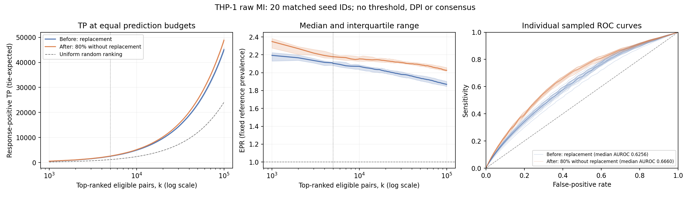

# THP-1 per-resample raw-MI pilot

This is a sampling-stage ranking benchmark against a frozen Perturb-seq response reference, not an exact reproduction of scMINER Fig. 6a and not a direct-regulatory-edge gold-standard benchmark.

## Matched design

- 20 seed IDs selected before scoring: 2, 4, 6, 8, 25, 26, 28, 30, 51, 55, 57, 62, 64, 68, 74, 79, 81, 84, 88, 89.
- Before: 121 draws with replacement from 121 NT-cell metacells. After: 97 distinct metacells (80% fixed-size sampling without replacement).
- Same metacell matrix, genes, original full SIG annotation and eligible-source response reference.
- Only the 272 scored source rows are computed, retaining all 17,971 genes. Code inspection and engineering subset/expanded/reordered-source checks verify that other source rows cannot affect these pairwise MI values when DPI is disabled. This is not a full-6,951-source empirical run or a DPI-compatible shortcut.
- No MI thresholding, DPI pruning or consensus construction in either arm; raw MI is ranked separately for each resample, never averaged across resamples.
- Fixed scoring universe: 4,887,840 non-self eligible pairs; 1,177,495 response-positive and 3,710,345 operational negatives.
- Fixed random precision is 0.24090293; EPR@k = (TP@k / k) / random precision. No random graph simulation is needed.
- Primary endpoint: tie-expected TP@5,000. Other declared top-k metrics and full-ranking AUROC are secondary.
- Exact equal serialized native MI scores are ties (native output has approximately six significant digits). A boundary tie contributes expected TP proportionally; paired TSV also records feasible TP minimum and maximum. AUROC awards half-credit to tied positive/negative pairs.

## Results

The primary-k direction is mixed across selected resamples. Higher: 18; lower: 2; unchanged: 0.

Numbers below are medians across selected resamples. The delta column is the median of paired after-minus-before differences, not the difference of marginal medians.

| k | TP before | TP after | Paired TP delta | Precision before | Precision after | EPR before | EPR after |
| --- | --- | --- | --- | --- | --- | --- | --- |
| 1,000 | 528.50 | 565.83 | +43.50 | 0.5285 | 0.5658 | 2.1938 | 2.3488 |
| 5,000 | 2535.00 | 2624.50 | +112.33 | 0.5070 | 0.5249 | 2.1046 | 2.1789 |
| 10,000 | 4989.00 | 5190.50 | +244.38 | 0.4989 | 0.5191 | 2.0710 | 2.1546 |
| 50,000 | 23351.50 | 25154.16 | +1847.39 | 0.4670 | 0.5031 | 1.9387 | 2.0883 |
| 100,000 | 45043.75 | 48816.96 | +4029.02 | 0.4504 | 0.4882 | 1.8698 | 2.0264 |

Full-ranking AUROC median: 0.625604 before; 0.665975 after; paired median delta +0.037765.

At fixed k, FP = k - TP: a TP increase implies an equal FP decrease. Precision, sensitivity and EPR share the same TP numerator and fixed denominators, so their directions are not independent confirmations.

TP/EPR lines show medians; bands show the interquartile range. ROC lines are individual resamples (common-FPR interpolation when available, otherwise common rank budgets), not an averaged ROC. AUROC values use all MI tie groups, not sparse plotted coordinates.

The dashed TP reference is the analytic expectation under uniform ranking of the same fixed pairs, k times reference-positive prevalence; it is not a separately generated network.

TP/EPR panels stop at the largest prespecified top-k budget; the ROC panel and AUROC cover the entire eligible universe.

## Limits and defensible interpretation

- These are computational resamples of the same cells, not independent biological replicates. IQR is descriptive, not a biological confidence interval; no significance claim or p-value is inferred from the number of resamples.
- This is an initial pilot. Mixed or small effects remain inconclusive; do not choose additional seeds or thresholds because they improve the result.
- The two protocols also differ in observation count (121 draws versus 97 distinct metacells) and RNG consumption. This does not isolate replacement alone at equal sample counts. Matching integer seed IDs does not mean matching sampled cells.
- Response-positive pairs may be indirect. Operational negatives mean absence of the defined response label, not proven biological non-regulation. MI in NT cells is association, not causal perturbation effect.
- Any result here concerns raw-MI response-associated ranking, not accuracy or improvement of the whole threshold/DPI/consensus workflow. Existing unfavorable end-to-end results are retained as separate evidence.

Compact numerical artifacts: `paired_seed_metrics.tsv` and `summary.json`. No multi-million-edge ranked CSV is generated by this reporting step.
