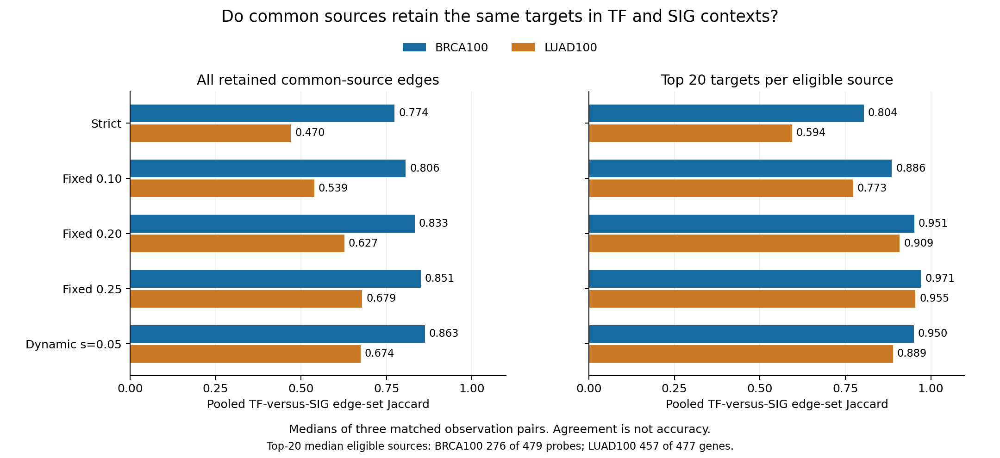
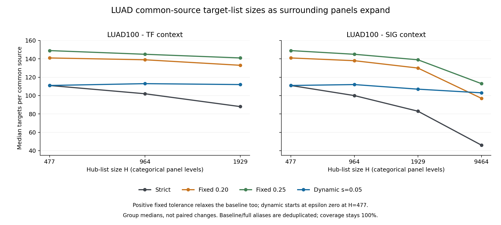

# Common TF and SIG sources: BRCA100 and LUAD100

## Question and matched design

Do the **same evaluated sources** retain consistent targets when surrounded
by different TF or SIG hub panels? A common source is an ID present in both
lists. Reconstruction still uses each surrounding TF or SIG panel; evaluation
keeps only edges originating from their fixed intersection.

| Dataset | Evaluated source IDs | Distinct source symbols | Full TF hubs | Full SIG hubs | Target-expression rows |
| --- | ---: | ---: | ---: | ---: | ---: |
| BRCA100 | 479 probes | 254 | 2,608 | 10,680 | 28,278 |
| LUAD100 | 477 Ensembl genes | 477 | 1,929 | 9,464 | 29,841 |

Each dataset uses three matched observation resamples, each selecting 80 of
100 profiles without replacement, and three nested hub-panel memberships.
Expression, target rows, observations and the PCHIP cutoff are unchanged
within comparisons: `p_b=0.0005` for both contexts, engine `b41c4ca`.
Reconstruction and annotation memberships match (`-s` equals `-l`).
Repeated baseline and full-list jobs are aliases, not independent runs.

Thresholded no-DPI controls verified identical common-source candidate edges
and serialized MI within each observation seed. The measured differences
therefore concern subsequent DPI context sensitivity, not different MI cutoffs
or source denominators. Serialized MI is not a full-precision fingerprint.

## Definition of dynamic epsilon

`H` is the number of source nodes in the reconstruction and annotation panel.
The numerical reference stays `H_ref=479` in both datasets:

```text
epsilon(H) = min(0.30, slope * max(0, log2(H / 479)))
```

At or below 479 hubs, epsilon is zero, meaning strict DPI. Above the anchor,
slope 0.05 adds 0.05 per doubling of H until the 0.30 cap. Larger epsilon
relaxes pruning. Fixed epsilon stays constant across H; no DPI is the separate
epsilon-one control. Slopes 0.025 and 0.05 were tested; 0.05 is highlighted,
not established as optimal. LUAD's 477-gene baseline is zero-clamped, not
retuned. These counts are computational nodes, not equivalent biological
coverage across BRCA probes and LUAD genes. The rule used ordinary native
`-e` runs, not an automatic dynamic-H engine option.

## What target consistency measures

**Jaccard** is the number of shared edges divided by the number present in
either graph. One means identical edge sets; it does not mean correct edges.

- **Raw Jaccard:** pool all retained directed edges from the common sources
  and compare the full TF context with the full SIG context.
- **Top-20 Jaccard:** retain exactly 20 highest-MI targets per eligible source,
  pool these directed edges, then compare contexts. Eligibility requires
  enough targets in every tested pruned strategy and both contexts. The
  source intersection stays matched; short lists are not padded.
- The primary deterministic MI-tie order is shown. Two alternative tie orders
  and top-10 and top-50 comparisons are retained in the detailed reports.

The table gives separate medians of three unique matched observation pairs,
not pooled resamples or whole-network accuracy scores.

| Dataset | Strategy | Raw Jaccard | Top-20 Jaccard |
| --- | --- | ---: | ---: |
| BRCA100 | Strict DPI | 0.7737 | 0.8042 |
| BRCA100 | Fixed epsilon 0.10 | 0.8063 | 0.8862 |
| BRCA100 | Fixed epsilon 0.20 | 0.8331 | 0.9514 |
| BRCA100 | Fixed epsilon 0.25 | 0.8506 | 0.9711 |
| BRCA100 | Dynamic slope 0.05 | 0.8626 | 0.9500 |
| LUAD100 | Strict DPI | 0.4703 | 0.5940 |
| LUAD100 | Fixed epsilon 0.10 | 0.5388 | 0.7732 |
| LUAD100 | Fixed epsilon 0.20 | 0.6268 | 0.9089 |
| LUAD100 | Fixed epsilon 0.25 | 0.6792 | 0.9551 |
| LUAD100 | Dynamic slope 0.05 | 0.6740 | 0.8894 |

Median eligible top-20 populations are **276 of 479** BRCA sources and
**457 of 477** LUAD sources. No-DPI raw Jaccard is one by matched construction;
its top-20 score was intentionally not evaluated.

## Figures and retained target sizes

### Figure 1. Common-source identity in full TF and full SIG contexts



The bars compare the same evaluated sources within each dataset. Strong fixed
tolerance matches or exceeds dynamic Top-20 agreement. Dynamic does not
uniformly improve identity at every intermediate H. Higher agreement alone
cannot establish a better strategy because removing DPI makes raw agreement
perfect by construction.

### Figure 2. LUAD target-list sizes as surrounding panels expand



Medians describe targets per common source, not the entire hub list. The
common-only post-DPI baseline (`H=477`, epsilon zero) has median 111 targets.
At the full TF panel, that becomes 88 under strict DPI and 112 under dynamic
slope 0.05. At the full SIG panel, it becomes 46 under strict DPI and 103 under
dynamic slope 0.05. Different strategies can start at different baseline
target counts because positive fixed epsilon also relaxes the baseline.
Baseline and full-panel medians use three unique sample cases; intermediate
sizes use nine panel-membership and sample-seed views, not biological replicates.

Nonempty-source coverage is **100% under every strategy** in both datasets,
so there is no improved nonempty-coverage claim. BRCA's target median stays
22; its source-level benefits are uneven and stronger at higher pre-DPI
degrees. Retained target sizes do not validate activity robustness.

Figures are regenerated from saved tables, not new inference. The
[plotting script](../../scripts/plot_bulk_dpi_summaries.py) and
[selected plot data and hashes](figures/bulk_dpi_summary_figures.json)
record the inputs and the paired-versus-group-median calculations.

## Conditional conclusion

Across these two preparations, dynamic tolerance is a **candidate engineering
balance**: it reduces some hub-context-related pruning variation and improves
full-context target consistency versus strict DPI while retaining substantial
pruning. Strong fixed tolerance remains competitive, and dynamic does not
improve every context or source. Some additional intermediaries may justify
target differences. More agreement does not prove more accurate edges or
that common TF and SIG sources should have identical targets.

There are only three overlapping computational resamples per dataset, not
independent biological replications. Cross-resample edge instability remains
unresolved. LUAD filtering used all 517 prepared patients before choosing its
100-patient cohort, not held-out feature-selection validation. Probe and gene
representations also differ. No reference-edge, consensus, downstream-activity
or new-default claim is made. PR #3 summarizes these **same experiments** from
a strategy-trade-off perspective, not additional independent evidence.

## Detailed evidence

- BRCA100: [Process](../../benchmarks/dpi_epsilon_summaries/evidence/brca100_fixed_grid/PROCESS.md),
  [Results and full plots](../../benchmarks/dpi_epsilon_summaries/evidence/brca100_fixed_grid/RESULTS.md),
  [Exact source-level counts](../../benchmarks/dpi_epsilon_summaries/evidence/brca100_source_benefits/SUMMARY.md).
- LUAD100: [Process](../../benchmarks/dpi_epsilon_summaries/evidence/luad100_common/PROCESS.md),
  [Results and full plots](../../benchmarks/dpi_epsilon_summaries/evidence/luad100_common/RESULTS.md),
  [Input preparation](../../benchmarks/dpi_epsilon_summaries/evidence/luad_preparation/PREPARATION.md).

Raw expression, native networks and large run archives remain outside Git.
