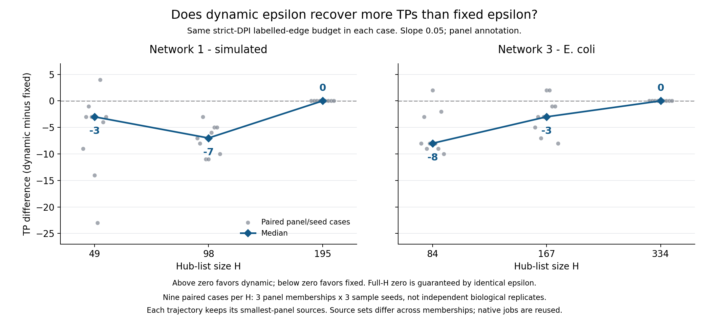

# DREAM5: DPI tolerance and dynamic-schedule controls

## Design

These exploratory comparisons ask whether relaxing DPI improves recovery of reference edges, and whether making the tolerance depend on hub-list size adds an advantage over a fixed positive tolerance.

DREAM5 Network 1 is simulated; Network 3 is measured *E. coli* expression. Both have 805 profiles. Three paired sample seeds each selected exactly 644 profiles without replacement. The frozen experimental engine (`b41c4ca`) used PCHIP `p_b=0.001`, MI cutoff `0.021543205318573955`, `Npar=40`, zero noise and no consensus. All configurations retained the same expression and sampling within each comparison. **No DPI still applies this MI cutoff; it is not unthresholded raw MI.**

Stage 1 compared no DPI, strict DPI (`epsilon=0`) and fixed tolerances 0.05, 0.10 and 0.15 using all 195 candidate TFs for Network 1 and all 334 for Network 3. The follow-up used three label-blind nested hub panels, evaluated the smallest-panel sources throughout each trajectory, and compared:

| Dataset | Tested hub counts H | Dynamic anchor H_min |
| --- | --- | ---: |
| Network 1 - simulated | 49, 98, 195 | 49 |
| Network 3 - E. coli | 84, 167, 334 | 84 |

### What dynamic epsilon means in this benchmark

`H` is the number of source/hub nodes in the reconstruction and annotation
panel. `H_min` is the smallest tested panel: 49 for Network 1 and 84 for
Network 3. For the tested range `H >= H_min`, the rule is:

```text
dynamic: epsilon(H) = min(0.30, slope * log2(H / H_min))
fixed:   epsilon(H) = dynamic epsilon at the full hub-list size, at every H
```

Epsilon zero means strict DPI; increasing epsilon relaxes pruning. At the
anchor, dynamic epsilon is zero. With slope 0.05, each doubling of H adds 0.05
until the cap of 0.30. For example, Network 1 changes from epsilon zero at
H=49 to 0.05 at H=98. The fixed comparator instead keeps about 0.09963 at all
three Network 1 sizes, and about 0.09957 at all three Network 3 sizes. At full H,
the fixed and dynamic tolerances are exactly equal. The cap is not reached in
these DREAM tests. No DPI is a separate control with epsilon one.

Slopes were 0.025, 0.05 and 0.10; the summary tables and Figure 3 highlight
0.05, not a selected optimal slope. Main runs used the panel for both
reconstruction (`-s`) and annotation (`-l`); full-TF annotation was a control.
These DREAM anchors do **not** test the later bulk-data anchor `H_ref=479`.
The schedule was applied through ordinary native `-e` runs, not an automatic
dynamic-H engine option.

## Results

Only explicitly labelled directed reference pairs were scored; unlabelled pairs were excluded.

| Dataset | Reference-covered TFs | Labelled directed pairs | Reference positives |
| --- | ---: | ---: | ---: |
| Network 1 - simulated | 178 | 278,392 | 4,012 |
| Network 3 - E. coli | 141 | 152,280 | 2,066 |

Precision is TP/(TP+FP); recall is TP divided by all reference positives. Average Precision summarizes precision across the ranked list, weighting each recall increment by its precision; omitted labelled pairs share the bottom zero score. This is local scoring, not an official DREAM5 leaderboard submission.

The table gives separate medians across three sample seeds. Fixed and dynamic rows at full H are **identical by construction**, because they reuse the same tolerance and native outputs.

| Network | Configuration at full H | TP | FP | Precision | Recall | Average Precision |
| --- | --- | ---: | ---: | ---: | ---: | ---: |
| 1 | No DPI | 2,448 | 56,018 | 4.19% | 61.02% | 0.1827 |
| 1 | Strict DPI | 1,263 | 6,207 | 16.91% | 31.48% | 0.2074 |
| 1 | Fixed epsilon about 0.09963 | 1,429 | 9,069 | 13.60% | 35.62% | 0.2060 |
| 1 | Dynamic, slope 0.05 | 1,429 | 9,069 | 13.60% | 35.62% | 0.2060 |
| 3 | No DPI | 1,667 | 101,608 | 1.61% | 80.69% | 0.0734 |
| 3 | Strict DPI | 200 | 2,134 | 8.79% | 9.68% | 0.0458 |
| 3 | Fixed epsilon about 0.09957 | 276 | 4,087 | 6.33% | 13.36% | 0.0516 |
| 3 | Dynamic, slope 0.05 | 276 | 4,087 | 6.33% | 13.36% | 0.0516 |

Relaxed DPI recovers positives but also retains many more reference-negative pairs. Fewer raw FPs alone therefore cannot establish a better strategy. The table below compares the full-H slope-0.05 endpoint with strict DPI using paired median differences. A negative FP change means fewer reference-negative predictions.

| Dataset | TP change at the same strict-DPI labelled-edge budget | FP change at that budget | Fewer FPs at the same strict-DPI recall |
| --- | ---: | ---: | ---: |
| Network 1 | +90 | -90 | 2,114 |
| Network 3 | +9 | -9 | 130 |

These favorable selected operating points apply equally to the fixed control, not specifically to dynamic epsilon. MI ties use label-independent expected randomized splits.

At smaller H, the dynamic-specific controls were less favorable. Below are paired dynamic-minus-fixed medians, slope 0.05, panel annotation; each group contains nine paired panel/seed cases.

| Network | H | Same-budget TP change | Same-budget FP change | Same-recall FP change |
| --- | ---: | ---: | ---: | ---: |
| 1 | 49 | -3 | +3 | +207 |
| 1 | 98 | -7 | +7 | +88 |
| 3 | 84 | -8 | +8 | +357 |
| 3 | 167 | -3 | +3 | +86 |

## Figures

### Figure 1. Fixed-epsilon precision and recall trade-off


Original Stage 1 figure: thin lines show the three sample seeds and the thick
line their separate median. Precision and recall are rates from zero to one.
Strict DPI is epsilon zero. No DPI is a separate categorical control, not a
numeric step after 0.15. These are literal fixed epsilons 0.05, 0.10 and 0.15,
**not dynamic schedules**. In particular, fixed 0.10 is not exactly the later
dynamic endpoint near 0.0996, so its numbers differ slightly from the endpoint
table above. Higher precision and lower recall under strict DPI are both
visible; Average Precision is a different ranking summary.

### Figure 2. FP cost of recovering additional TPs


Original Stage 1 fixed-epsilon figure. Differences are paired within each
sample seed before taking medians; large points summarize the three small
points. Relaxing DPI recovers additional TPs but retains substantially more
benchmark-defined FPs. Axes have different ranges between networks. Network
3's reference is incomplete, so its FP labels do not prove biological absence.

### Figure 3. Dynamic versus fixed at matched prediction budgets



New visualization of existing controls, not new inference. Each case compares
the same H, observations, evaluated sources and reference labels at that
case's **strict-DPI emitted reference-labelled edge count**, not a universal k
or equal total-network size. MI-boundary ties use expected TP counts. Gray
points are three panel memberships times three sample seeds; blue diamonds
show medians. Negative values favor fixed tolerance. Some individual cases
favor dynamic even though the smaller-H medians favor fixed.

Each trajectory evaluates its smallest-panel sources at every H, including
full H; this is **not the all-reference-source population of the precision
table**. Source sets differ across memberships. Native outputs are reused,
so the nine paired cases are not nine independent biological replicates.
Full-H zero is guaranteed by identical epsilon and shared native outputs.

Reproduce Figure 3 with `python scripts/plot_dream5_dynamic_fixed.py` (requires
Matplotlib). Its [plot data and hashes](figures/dynamic_vs_fixed_matched_budget.json)
record all 54 plotted cases; an [SVG version](figures/dynamic_vs_fixed_matched_budget.svg)
is also available. Original tables, reports and Figures 1-2 are unchanged.

## Conditional conclusion

Positive epsilon offers a precision-recall trade-off and can improve selected matched operating points over strict DPI. **These tests do not demonstrate an accuracy advantage from making epsilon dynamic rather than fixed.** Flatter hub-size pruning is an engineering property, not proof of more correct edges or a new default. Network 3's reference is incomplete: its benchmark-defined FPs are not all proven biological errors. These post-hoc controls and shared panel/seed cases are not independent biological validation or evidence for a universal schedule.

Details: Stage 1 [Process](../../benchmarks/dpi_epsilon_summaries/evidence/dream5_stage1/PROCESS.md) | [Results](../../benchmarks/dpi_epsilon_summaries/evidence/dream5_stage1/RESULTS.md); matched and fixed-tolerance controls [Process](../../benchmarks/dpi_epsilon_summaries/evidence/dream5_controls/PROCESS.md) | [Results](../../benchmarks/dpi_epsilon_summaries/evidence/dream5_controls/RESULTS.md).
