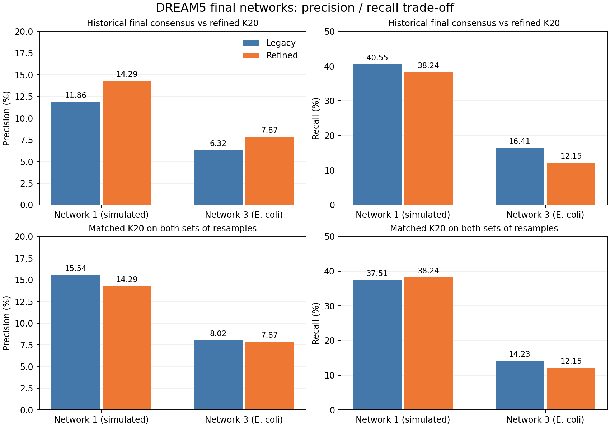
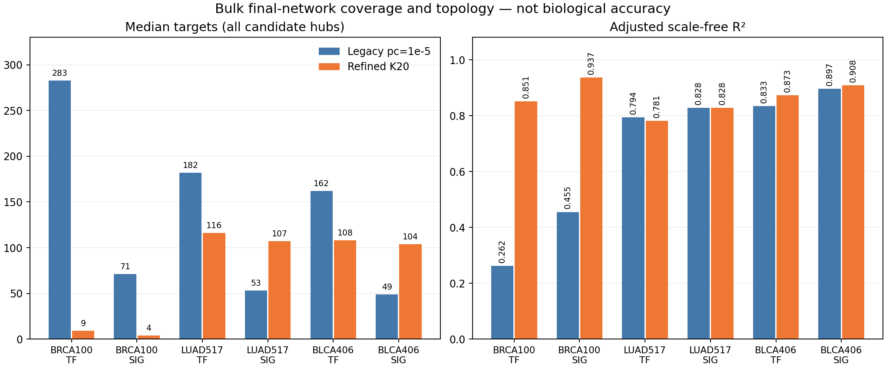
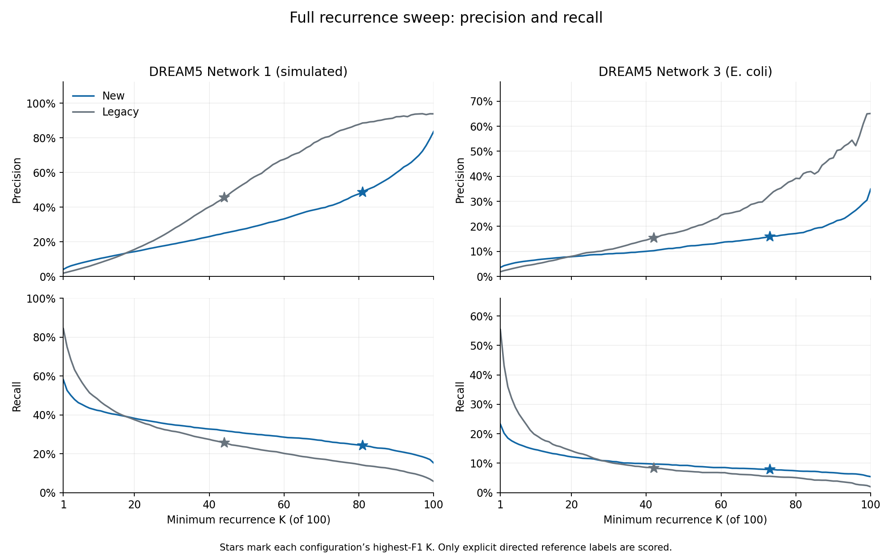

# Full-workflow comparison and the proposed K20 consensus default

[Process](../../benchmarks/legacy_vs_refined_k20/README.md) · [Detailed results](../../benchmarks/legacy_vs_refined_k20/RESULTS.md) · [Original NetBID2 figures](../../benchmarks/legacy_vs_refined_k20/NETBID2_FIGURES.md)

## Goal and design

Compare genuine historical SJARACNe with the refined workflow on DREAM5 Networks
1 and 3, BRCA100, TCGA-LUAD517 and TCGA-BLCA406. Each inference configuration has
100 post-DPI resamples. Full TF/SIG lists remain separate. This is a full-workflow
comparison, not a sampling-only or dynamic-DPI-only experiment.

Legacy uses full-size draws with replacement, affine p_b=1e-7, strict DPI and
original consensus p_c=1e-5. Refined uses 80% without replacement, PCHIP
p_b=0.001 for TF / 0.0005 for SIG, dynamic DPI, and **support >=20 of 100**.
The dynamic rule is `min(0.30, 0.05*max(0, log2(H/479)))`; both DREAM hub lists
are below 479, so their actual tolerance remains zero.

## DREAM5: reference-edge recovery

| Dataset | Workflow / consensus | TP | FP | Precision | Recall | F1 |
| --- | --- | ---: | ---: | ---: | ---: | ---: |
| Network 1 | Historical legacy | 1,627 | 12,089 | 11.86% | 40.55% | 0.1836 |
| Network 1 | Refined K20 | 1,534 | 9,200 | 14.29% | 38.24% | 0.2081 |
| Network 3 | Historical legacy | 339 | 5,021 | 6.32% | 16.41% | 0.0913 |
| Network 3 | Refined K20 | 251 | 2,938 | 7.87% | 12.15% | 0.0955 |

At **matched K20**, legacy/refined precision is 15.54% versus 14.29% on Network 1
and 8.02% versus 7.87% on Network 3. Legacy F1 is also slightly higher on both.
These are comparable-scale results, not tested equivalence or uniform improvement.
Only explicitly labeled directed pairs are scored; unlabeled predictions are
excluded from FP. Network 3's incomplete reference does not establish that every
benchmark-negative prediction is biologically false.

## Bulk networks: coverage and topology

All-hub target medians include zero-target candidates. R2 is NetBID2's adjusted
scale-free fit, not a biological-accuracy score.

| Dataset | Network | Legacy median targets | Refined K20 median targets | Legacy adjusted R2 | Refined adjusted R2 |
| --- | --- | ---: | ---: | ---: | ---: |
| BRCA100 | TF | 283 | 9 | 0.2624 | 0.8514 |
| BRCA100 | SIG | 71 | 4 | 0.4552 | 0.9368 |
| LUAD517 | TF | 182 | 116 | 0.7939 | 0.7813 |
| LUAD517 | SIG | 53 | 107 | 0.8279 | 0.8279 |
| BLCA406 | TF | 162 | 108 | 0.8335 | 0.8729 |
| BLCA406 | SIG | 49 | 104 | 0.8967 | 0.9080 |

LUAD/BLCA retain medians near 100, but BRCA100 is a substantial coverage exception:
35 TF and 1,226 SIG hubs have no targets under K20. Within the same refined BRCA
resamples, K6-to-K20 lowers the TF median from 110 to 9 and the SIG median from
50 to 4. In LUAD, the TF median changes from 340 to 116 and the SIG median from
292 to 107. BLCA has no K6 comparison. These observations
do not identify sample size alone as the cause or establish a single-cell analogy.

## Why propose K20 rather than maximize F1?

The full DREAM sweep evaluates every integer K=1-100 using saved post-DPI outputs;
there is no MI/DPI rerun. Refined F1 peaks at K81 and K73, but those maxima retain
only 24.33% and 7.89% recall. K20 keeps more TPs and larger networks. It was chosen
after viewing these trajectories as a practical coverage/precision compromise,
not an independently validated optimum.

## Conditional conclusion

**Propose K=20 for the standard B=100 workflow, with an explicit user override.**
The evidence supports this engineering operating point, not a universal
accuracy improvement, an FDR guarantee or transfer to arbitrary B or single-cell
data. BRCA100's severe coverage loss must remain an explicit exception. Its
earlier K6 choice was coverage-motivated, not a universal reliability threshold.

This PR packages existing results, portable metric tables, provenance and original
QC PNGs. It changes no SJARACNe code/defaults and launches no inference. A separate
SJARACNe PR should implement the agreed default with regression tests. The
[detailed report](../../benchmarks/legacy_vs_refined_k20/RESULTS.md) retains all
primary and matched-K20 controls, adverse results and limitations.
